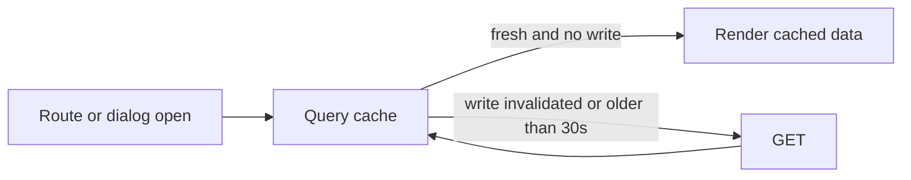

# 30-second cache for page reads

## What is already true

Admin and participant list/dashboard routes already use TanStack Query (`@tanstack/react-query` ^5.107). Defaults in [admin/src/lib/query-client.ts](admin/src/lib/query-client.ts) and [participant/src/lib/query-client.ts](participant/src/lib/query-client.ts):

- `staleTime` is **45s** (`STALE_MS` in each `query-keys.ts`)
- `refetchOnMount: true` refetches only when that data is stale, not on every visit
- `refetchOnWindowFocus: false`
- unused results stay in memory for 5 minutes (`GC_MS`)
- successful writes call `invalidateAdmin` / `invalidateClient`, which marks those keys stale so the next visit fetches

Authenticated JSON stays `Cache-Control: no-store` in [api/src/app.ts](api/src/app.ts). The dashboard summary is the only Redis cache ([api/src/lib/cache.ts](api/src/lib/cache.ts), about 60s, cleared on writes). That stays.

## Why fast switches still hit the API

These screens load with `useEffect` + a direct GET, so every visit is a new request even when the list was just loaded:

- Admin: [activity-wizard.tsx](admin/src/pages/activity-wizard.tsx) (`getActivity`, and `getSponsors` / `getContests` outside the list cache), [bank-form.tsx](admin/src/pages/bank-form.tsx), [quiz-questions-panel.tsx](admin/src/pages/quiz-questions-panel.tsx), [result-detail.tsx](admin/src/pages/result-detail.tsx), [registration-detail.tsx](admin/src/pages/registration-detail.tsx), [settings-general.tsx](admin/src/pages/settings-general.tsx), editor dialogs for user, participant, sponsor, and contest
- Participant: [activity-detail.tsx](participant/src/pages/activity-detail.tsx) calls `listActivities` again instead of the library query; [results.tsx](participant/src/pages/results.tsx) `ResultDetailPage` calls `getResult` every open; [register.tsx](participant/src/pages/register.tsx) refetches the public form

## Server choice

No new Redis cache for lists or details. One missed invalidation would show stale rows to every user. The client cache is enough for fast switches, and the next allowed request still reads Postgres. Keep the dashboard Redis cache and `no-store` on authenticated JSON so a reload or another browser does not reuse disk cache after sign-out.

Load control that is safe to add: pass React Query’s `AbortSignal` into GET `fetch` (both api clients already merge a caller signal in `withRequestTimeout`). Leaving a page during a cache miss cancels that browser request. Do not cancel Prisma on the server.

## Client rules

- Set `STALE_MS` to `30_000` in [admin/src/lib/query-keys.ts](admin/src/lib/query-keys.ts) and [participant/src/lib/query-keys.ts](participant/src/lib/query-keys.ts). Leave `GC_MS` at 5 minutes so back-navigation still has data.
- Keep `refetchOnMount: true` (stale only) and `refetchOnWindowFocus: false`. Do not bring back `sessionStorage` persistence.
- Detail keys sit under the prefixes `invalidateAdmin` / `invalidateClient` already use, so a write refetches on the next open inside the window:
  - activity `['admin', 'activities', orgId, 'detail', id]`
  - bank `['admin', 'banks', orgId, id]`
  - result `['admin', 'results', orgId, 'detail', id]`
  - registration `['admin', 'registrations', orgId, kind, id]`
  - settings `['admin', 'settings', orgId, 'general']` — `patchSettingsGroup` must invalidate this key (it does not today)
  - user / participant / sponsor / contest dialogs under `users`, `participants`, `sponsors`, `contests`
  - participant activity detail uses the existing `clientQueryKeys.activities(participantId, kind)` and picks the row (library and detail share one request)
  - participant result detail under `['client', 'results', participantId, 'detail', id]`
- Show cached data immediately. Use `isPending` for the first-load skeleton only, not `isFetching`, so a refresh after 30s does not flash the skeleton.
- Forms that copy server data into local state (wizard, bank, registration, settings, editors) seed when the id changes or the form is not dirty. A background refetch must not wipe unsaved edits. The leave guard already blocks leaving a dirty form.

Also mark report queries stale on the same writes that already invalidate `results` or `activities`. Report keys (`quiz-reports`, `assessment-reports`) are not under those prefixes today, so a local change would not refetch them inside the window.

## Leave on the network

- Attempt start, resume, save, submit, and advance
- Job status polling and file downloads
- Auth refresh, sign-in, and sign-out
- Sponsor/contest delete checks that call `getSponsor` / `getContest` to see current links before delete

## Verify

- Within 30s and with no save: Dashboard → Users → Dashboard, library → activity → library, and reopen the same result/bank/wizard issue no second GET.
- After a save, the next open of that screen GETs once.
- After 30s, the next open GETs once and keeps the previous rows on screen while it loads.
- Leave mid-request: the GET is aborted.
- Typecheck, lint, and format in `admin/` and `participant/`.
