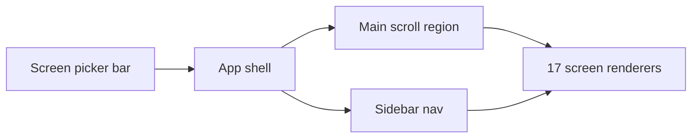

# Brainpules Admin UI — polished HTML

## Deliverable

One self-contained file at the project root:

**[`brainpules-admin-ui.html`](brainpules-admin-ui.html)**

Leave [`references/Brainpules Admin – 17 UI Screens.html`](references/Brainpules Admin – 17 UI Screens.html) untouched as the source of truth for screen content and structure.

## Problems in the current mock

- Fixed `1440×900` frame with `transform: scale()` — not responsive
- `overflow: hidden` — no real scrolling; feels clipped
- Sharp / unfinished: Inter, emoji icons, weak hover/focus, numbered tab strip only
- Dense borders and flat chrome without surface hierarchy

## Design constraints (locked)

**Keep exact brand colors** from the source:

| Token | Value |
|-------|-------|
| `--bg` | `#eef1f6` |
| `--ws` | `#f6f8fb` |
| `--card` | `#fff` |
| `--tx` | `#14213d` |
| `--mu` | `#6b778c` |
| `--bd` | `#e3e8ef` |
| `--pr` | `#2563eb` |
| `--pl` | `#e8f0ff` |
| `--nv` | `#0f1b3d` |
| `--nv2` | `#1a2a57` |

Extend into a 3-layer token system (design-system): primitives → semantic (`--surface-*`, `--text-*`, `--accent`, `--success/warn/danger`) → component (`--btn-*`, `--sidebar-*`, `--pill-*`). Soften with radius/shadow/spacing tokens only — **no recoloring**.

**Typography:** Plus Jakarta Sans (UI/headings) + Source Sans 3 (body/data) via Google Fonts with `display=swap` — not Inter.

**Icons:** inline SVG (Lucide-style strokes), no emoji as structural icons.

**Visual direction:** soft enterprise admin — 12–16px card radius, light borders, subtle elevation (`0 1px 2px` / `0 4px 12px`), 8px spacing rhythm, one primary CTA per toolbar.

## Architecture

- Sticky top **screen switcher** (named labels, not bare `1…17`) for reviewing all 17 mocks
- App shell: dark sidebar + light workspace (same as source)
- Sidebar items drive the same screen set; create/settings sub-routes map to the matching screens
- Main area scrolls; tables use horizontal scroll wrappers on small widths
- Mobile (`<1024px`): sidebar becomes off-canvas drawer + menu button; overlay dismiss

## Softening + UX polish (ui-design / ui-ux-pro-max / design-build)

- Hover / focus-visible / active / disabled on buttons, nav, row actions
- Status pills keep existing semantic colors (green / amber / red / blue / gray) with icon or text — not color-only
- Form labels visible; create-wizard step bar remains; softer step chips
- Charts stay lightweight SVG (same data as source) with clearer labels/tooltips via `title`
- Micro-motion 150–250ms on nav/button/panel; honor `prefers-reduced-motion`
- Touch targets ≥44px on mobile controls
- Skip link to `#main`

## Performance (design-optimize)

- No JS libraries — vanilla JS screen registry (port screen builders from source)
- `content-visibility: auto` + `contain-intrinsic-size` on below-fold dashboard blocks
- `contain: layout style paint` on cards
- Lazy font load; single HTML file; charts as inline SVG only
- Avoid layout thrash: no resize-scale transform; use fluid CSS Grid/Flex

## Screen coverage (same 17 as source)

1. Dashboard  
2. Students  
3. Users  
4. Assessments list  
5. Assessment Question Banks  
6. Create Assessment  
7. Assessment Registrations  
8. Assessment Reports  
9. Quizzes list  
10. Quiz Question Banks  
11. Create Quiz  
12. Quiz Registrations  
13. Quiz Reports  
14. General Settings  
15. User & Access Settings  
16. Notification Settings  
17. System Settings  

Reuse the same sample India-focused data and column sets; rewrite markup/CSS for polish and responsiveness.

## Implementation approach

1. Build HTML shell: tokens, fonts, layout, sidebar, header, screen picker, drawer
2. Port helpers (`cards`, filters, tables, pills, create form, reports) into cleaner template functions
3. Register all 17 screens; wire picker + sidebar
4. Responsive CSS: breakpoints ~640 / 1024 / 1280; sticky table headers where useful
5. Pass: keyboard focus, reduced-motion, no horizontal page scroll, openable in browser

## Out of scope

- No React/Vite app scaffolding
- No backend wiring
- No changes under `references/`
- No new markdown docs
