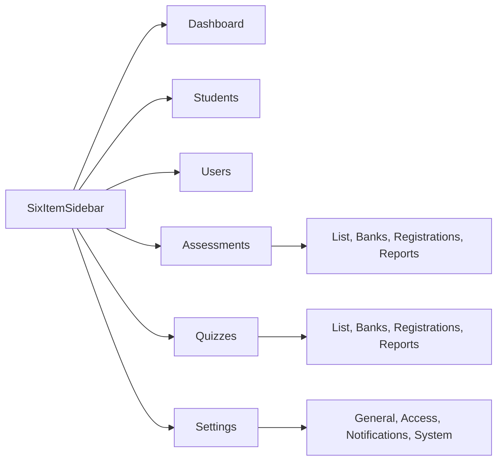

# Admin shell and page chrome revamp

## Decisions

- Sidebar items are only Dashboard, Students, Users, Assessments, Quizzes, and Settings.
- Assessment, Quiz, and Settings children become an on-page link row. Create stays the existing button on the list page, not a menu item.
- Desktop labels always show. There is no icon rail. The header button hides the whole sidebar (`collapsible="offcanvas"`), which is the shadcn alternative to icon collapse.
- Below 1024px the menu is still shadcn’s sheet. It is short, and choosing a link already closes it in [admin/src/components/ui/sidebar.tsx](admin/src/components/ui/sidebar.tsx). Overlay, Escape, and the in-sheet close button stay.
- Visual shell is the official inset layout: light chrome, rounded content panel, account menu in the sidebar footer. Header keeps the menu button and breadcrumb. Theme and notifications move into that account menu.
- Routes, fixture data, and visible copy stay. Table columns, form fields, charts, and status filters stay.

## Shell

Rebuild [admin/src/layouts/admin-layout.tsx](admin/src/layouts/admin-layout.tsx):

- `Sidebar` uses `variant="inset"` and `collapsible="offcanvas"`. Drop the `268px` width override and the `brainpulses-sidebar` localStorage flag so a refresh no longer restores a collapsed rail. Default is open.
- Header brand stays the activity icon and “Brainpules”, linking to `/dashboard`.
- Footer is an account menu (`DropdownMenu` + `SidebarMenuButton`): Meera Joshi, Super Admin. Items are the existing theme toggle and the existing Notifications control. Notifications still has no page.
- Header is the sidebar trigger, a vertical `Separator`, and a breadcrumb. Remove the title, theme button, bell, and avatar from the header.
- One main landmark: put `id="main"` on `SidebarInset` (it already renders `<main>`). Do not nest a second `<main>`. Keep the skip link and the focus-on-navigate behavior.

Breadcrumbs stay the same words from [admin/src/routes/meta.ts](admin/src/routes/meta.ts), but parents become links: Brainpules to `/dashboard`, Assessment to `/assessments`, Quiz to `/quizzes`, Settings to `/settings`. The current page stays `BreadcrumbPage`.

The sidebar highlights the section you are in, including create and child routes (`/assessments/new` still highlights Assessments). Dashboard, Students, and Users stay exact matches.

## Page chrome

Add a small module nav used by the layout, not the `Tabs` widget. These links change routes, so they belong in a `<nav>` with `aria-current="page"`. Style them like the existing wrapping tab list so long labels (“Registrations & Student Data”) wrap on a phone.

- Assessments: All assessments, Question Banks, Registrations & Student Data, Reports & Results.
- Quizzes: All quizzes, Question Banks, Registrations & Student Data, Reports & Results.
- Settings: General Settings, User & Access Settings, Notification Settings, System Settings.

Show that row on every route under those three sections, including create. No tab is current on `/assessments/new` or `/quizzes/new`. The list page’s status tabs stay underneath, unchanged.

Move each page’s `h1` out of the header and into the content, still read from `pageMeta.title`. Page bodies in `admin/src/pages/` keep their current sections.

## Color

In [admin/src/index.css](admin/src/index.css), make the inset visible without a new palette:

- Light: sidebar chrome uses the current gray page background (`#eef1f6`). The inset panel uses white. Primary stays `#2563eb`. Card, KPI, success, and warning tokens stay.
- Dark: content stays the current navy page. The outer chrome uses the darker sidebar tone so the rounded inset still separates.
- Sidebar text and accent switch from the navy-rail colors to the same foreground and accent already used on the page, so a light menu stays readable.

Leave [admin/src/components/ui/sidebar.tsx](admin/src/components/ui/sidebar.tsx) in place. Icon-rail rules there simply go unused.

## Check

With the admin server already on port 5173, walk Dashboard, Students, one assessment child, create assessment, one quiz child, and all four settings routes. Confirm the sidebar has six labels, the account menu holds theme and notifications, and the header is only the trigger plus breadcrumb. Repeat at about 375px, 768px, and 1280px: the sheet closes after a link, and desktop never shows an icon rail. Then run `npm run typecheck`, `npm run lint`, and `npm run format:check` in `admin/`.
