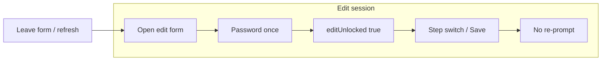

# Admin UX fixes (11 items)

## Defaults locked from your request

- Keep route `/participants`; rename **labels only** to “Registration Forms”.
- AND/OR evaluation: **left-to-right** fold (matches chip order).
- Contest/sponsor delete: **super admin only**, and contest delete **blocked while a registration form or activities remain** (no more wiping the form on contest delete).
- Assessment/round delete: open to **full kind access** admins (same bar as quiz today), plus super admin — not super-admin-only.
- Form-view “Add registration”: admin dialog with that form’s fields (via `ContestFormFieldInput`), pick a linked activity, ignore public open/close windows (manual API already skips dates).

---

## 1. Password once per edit session

**Cause:** hydrate effect in [`admin/src/pages/contest-form-wizard.tsx`](admin/src/pages/contest-form-wizard.tsx) re-runs after every save/refetch and does `setPassword(current ?? 'edit')`, reopening the dialog even when `editUnlocked` is already true.

**Fix:** only open the edit password when `!editUnlocked` (and form is published). Do not couple draft hydration to password. Leave `coreUnlocked` (contact-field unlock) alone. No password on `persist` / `goTo`.

---

## 2. Independent AND/OR between conditions

**Today:** one `rule.join` shared by every chip; API uses `every` / `some` in [`api/src/modules/contest-forms/rules.ts`](api/src/modules/contest-forms/rules.ts) `activitiesFor`.

**Change:**

- Data: `joins: Array<'and' | 'or'>` with length `conditions.length - 1` on `AssignmentRule` (admin [`contest-form.ts`](admin/src/lib/contest-form.ts) + API [`rules.ts`](api/src/modules/contest-forms/rules.ts) + Zod [`schema.ts`](api/src/modules/contest-forms/schema.ts)).
- Migrate legacy `{ join }` in `normalizeRules` → fill every edge with that value.
- UI: each chip in [`contest-form-rules.tsx`](admin/src/components/contest-form-rules.tsx) toggles **only its edge**; add/remove condition keeps `joins` in sync.
- Evaluate left-to-right: start with `hits[0]`, then fold with each edge.
- Update `ruleSentence` + [`api/test/contest-form-assignment.test.ts`](api/test/contest-form-assignment.test.ts).

---

## 3. Search debounce

[`Toolbar`](admin/src/components/toolbar.tsx) already debounces **300ms** via [`useDebouncedValue`](admin/src/hooks/use-debounced-value.ts) — all list pages using it are covered.

Wire the same hook into the three immediate local searchers:

- [`contest-form-builder.tsx`](admin/src/components/contest-form-builder.tsx) field palette
- [`activity-picker.tsx`](admin/src/components/activity-picker.tsx)
- [`question-banks.tsx`](admin/src/pages/question-banks.tsx) bulk-upload bank search

Keep input responsive (controlled local value); debounce only the value used to filter. Participant app has no list search bars — no change there.

---

## 4. “Participants” → “Registration Forms”

Label-only renames (path stays `/participants`):

- Sidebar: [`admin-layout.tsx`](admin/src/layouts/admin-layout.tsx)
- Crumbs/titles: [`routes/meta.ts`](admin/src/routes/meta.ts)
- Back links / copy: [`contest-form-view.tsx`](admin/src/pages/contest-form-view.tsx), [`contest-form-wizard.tsx`](admin/src/pages/contest-form-wizard.tsx)
- Dashboard CTA that points at `/participants`: [`dashboard.tsx`](admin/src/pages/dashboard.tsx)

Do **not** rename people KPIs (“Participants” counts), “Participants see:” preview copy, or API symbols.

---

## 5. Domains “+ Add” button

In `WhoCanRegister` inside [`contest-form-wizard.tsx`](admin/src/pages/contest-form-wizard.tsx): wrap the domains input in an input-group / adjacent control; button calls existing `addDomain(entry)`, disabled when empty. Keep Enter / comma / space.

---

## 6. QR enlarge dialog

In [`contest-form-share-card.tsx`](admin/src/components/contest-form-share-card.tsx): make the QR a button that opens a shadcn `Dialog` with a larger image (reuse the existing data URL). Keep Download as-is.

---

## 7–9. Form-view registrants: actions, add, detail

Primary surface: [`contest-form-view.tsx`](admin/src/pages/contest-form-view.tsx).

### API

Extend [`listFormRegistrants`](api/src/modules/contest-forms/service.ts) to return `participantId` (list `id` stays submission id).

Add:

- `GET /api/contest-forms/:id/registrants/:submissionId` — answers + participant fields for detail/edit
- `PATCH .../registrants/:submissionId` — update answers + synced participant name/email/phone (validate with `validateAnswers`; **do not** re-run assignment on edit)
- Delete: reuse `DELETE /api/participants/:id` + password (same as registrations list)

Manual create already ignores registration windows — use existing `POST /api/registrations/manual` with `formId` + `answers` + linked `activityId`.

### UI

- Header **Add registration** on form view (and keep list-page Add where it already exists).
- New form-scoped dialog (adapt [`add-registration-dialog.tsx`](admin/src/pages/add-registration-dialog.tsx)): form locked to this form; activity select from form’s linked quizzes/assessments; fields via `ContestFormFieldInput`; success step with copyable registration ID.
- Table: Actions column — Edit + Delete Registration (`RowActions` / password delete like [`registrations.tsx`](admin/src/pages/registrations.tsx)).
- `onRowOpen` → polished detail dialog showing all collected field answers (labels from form fields), not only the four columns.
- Edit → same field dialog prefilled from detail API.

---

## 10. Sponsor / contest delete → super admin + fully unlinked

| Entity | UI | API | Unlink |
|---|---|---|---|
| Sponsor | `canDelete = isSuperAdmin` in [`sponsors.tsx`](admin/src/pages/sponsors.tsx) | `requireRole('super_admin')` on DELETE | Keep existing block if contests/activities/forms &gt; 0 |
| Contest | same in [`contests.tsx`](admin/src/pages/contests.tsx) | same | **Also block** while a registration form exists; remove form-wipe path from [`deleteContest`](api/src/modules/contests/service.ts) |

Keep warnings + `confirmSensitiveDelete` password flow.

---

## 11. Delete assessment / round / quiz for full admins

Already hard-cascades in [`deleteActivity` / `deleteRound`](api/src/modules/activities/service.ts). Gaps are **who** can call them:

- Assessment delete: drop `super_admin`-only check; require kind **full** (same as quiz). UI: [`activity-list.tsx`](admin/src/pages/activity-list.tsx) + [`activity-wizard.tsx`](admin/src/pages/activity-wizard.tsx) use `canFullKind` for both kinds.
- Round hard delete: change route from `requireRole('super_admin')` to assessment **full** access; service allows `canFull` equivalent; wizard shows hard-delete for `canFull` (not only super admin). Keep “at least one round”, password + detailed warning copy.
- Quiz: already `canFullKind` — keep; ensure warning copy stays clear about cascade (attempts, results, registrations, local banks, form links).

---

## Checks

- `admin/`: `typecheck`, `lint`, `format:check`
- `api/`: contest-form assignment tests + any delete/access tests touched
- `graphify update .` after code changes
