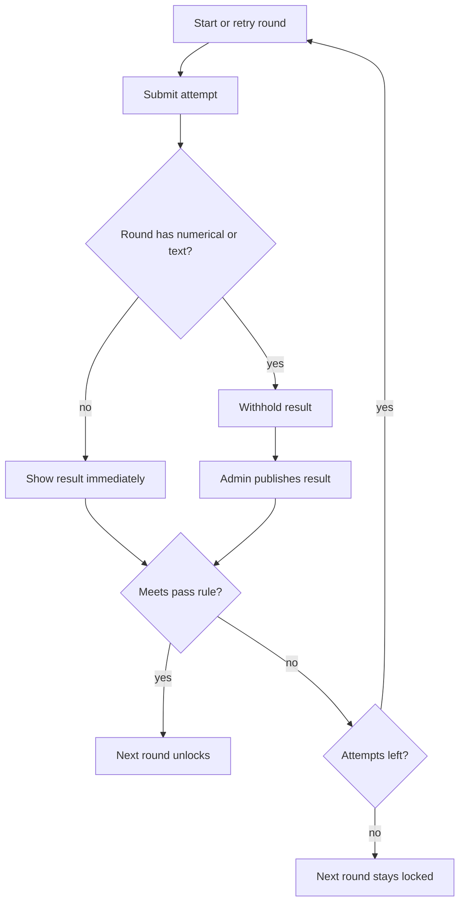

# Assessment module

Assessments already share the quiz shell (list, wizard, banks, registrations, participant library) and stay on their own `ActivityKind`, banks, and rounds. This work fills the gaps. Quizzes keep today’s authoring (single choice and multiple choice; legacy image questions stay readable) and activity-level settings.

## What already exists

- Separate assessment activities, banks, registrations, and a Define Rounds step in [`admin/src/pages/activity-wizard.tsx`](admin/src/pages/activity-wizard.tsx) (add, rename, reorder, delete, link banks, add questions).
- [`ActivityRound`](api/prisma/schema.prisma) has name, order, optional duration, linked banks, and a local question bank.
- The attempt player already renders the seven answer shapes in [`participant/src/components/attempt-question-block.tsx`](participant/src/components/attempt-question-block.tsx).
- Results can be withheld and published via [`publishResult`](api/src/modules/results/service.ts).
- Unlock today is “any submitted attempt on every earlier round,” and a submitted round cannot be retried ([`api/src/modules/attempts/service.ts`](api/src/modules/attempts/service.ts) around the assessment `startAttempt` gate).

## Behaviour to add

**Question types.** Assessment authoring and import allow only: single choice, multiple choice, true/false, numerical, short text, long text, comprehension. Drop image multiple choice and image selection from the assessment picker ([`ASSESSMENT_AUTHORABLE_TYPES`](api/src/modules/banks/schema.ts), [`typesForKind`](admin/src/pages/bank-question-types.ts)). Existing rows of those types stay readable. Scoring stays as in [`api/src/modules/attempts/scoring.ts`](api/src/modules/attempts/scoring.ts): choice and numerical (with tolerance) auto-score; short/long exact-match the reference answer when one exists, otherwise they are left out of the total. No AI grader.

**Round settings.** Each round stores its own copy of today’s quiz behaviour, not one setting for the whole assessment:

- Timer: overall minutes or per-question seconds
- Marks: negative marking on/off and penalty (question points stay on each question)
- Navigation: one-at-a-time vs all-on-page, allow previous, question panel, compulsory answers (same constraints as quizzes: per-question timer forces forward-only)
- Attempts: a finite cap, or unlimited
- Pass rule: either a percentage of that round’s max score, or an absolute score

Persist this on `ActivityRound` (settings JSON plus the timer/pass columns the API needs). Quiz settings stay on the activity.

**Unlock and results.**

- Rounds stay strictly ordered. Round 1 is open; a later round opens only after the previous round is passed.
- A failed attempt can be retried until the round’s attempt cap is used up. Exhausted and failed keeps the next round locked.
- If the round contains any numerical, short text, or long text question, the participant sees no score after submit. The next round opens only after an admin publishes that result and the pass rule is met.
- Objective-only rounds release the score on submit.

**Bulk import (assessment, not the reusable bank).** Download Sample is an Excel file with one filled row for each of the seven types and a Round column. Upload returns a preview: columns matched by header name (using the aliases already in [`api/src/modules/banks/import-export.ts`](api/src/modules/banks/import-export.ts)), a mapping the admin can correct, and the error rows. Confirm writes valid rows into the named rounds (create a missing round by that name). Invalid rows are skipped and listed. Quiz bank import is unchanged.

**Participant portal.** In [`participant/src/layouts/participant-shell.tsx`](participant/src/layouts/participant-shell.tsx), show Quizzes and/or Assessments only when that person has at least one of that kind and the org page is on. Both links appear only when they have both. Assessments stay directly after Quizzes.

- Assessments list keeps the quiz card layout in [`participant/src/pages/library.tsx`](participant/src/pages/library.tsx).
- Opening an assessment shows one card per round. Locked rounds are muted and not startable ([`participant/src/pages/activity-detail.tsx`](participant/src/pages/activity-detail.tsx)).

**Editing rounds after create.** Keep add, reorder, and delete on the assessment editor. Refuse deleting the last round, and refuse deleting a round that already has attempts. Reorder updates `sortOrder`; unlock follows the new order.

## Implementation order

1. **Round settings in the wizard and API** — save and reload timer, marks, navigation, attempts, and pass rule per round. Quizzes unchanged.
2. **Pass, retries, and publish gate** — attempt start/submit and participant round state follow the flowchart. Objective rounds publish themselves; mixed rounds stay withheld until `publishResult`.
3. **Seven assessment types** — picker, validation, and sample/import types match the list above.
4. **Assessment Excel import** — sample download, mapping preview, error list, confirm into rounds.
5. **Participant nav and round cards** — conditional sidebar; assessment cards; grey locked round cards.
6. **Round edit guards** — last-round and attempts-exist checks on delete; reorder still allowed.

## Verification

- API tests for unlock: fail then retry, pass opens the next round, text/numerical stays locked until publish, attempt cap blocks another start.
- `npm run typecheck`, `npm run lint`, and `npm run format:check` in `admin/`, `participant/`, and `api/` for touched packages.
- Browser: create an assessment with two rounds (one objective, one with a numerical question), import the sample, assign a participant, confirm nav, locked cards, withheld result, publish, then the second round.
