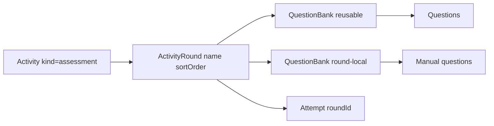

# Assessment rounds (LevelUP behavior, BrainPulses UI)

## Locked decisions

- **UI**: BrainPulses design system only ([`docs/design/DESIGN.md`](docs/design/DESIGN.md), admin chrome, client shell). Do not copy LevelUP layout/components.
- **Scope**: **Assessments only**. Quizzes keep today’s flat `ActivityBank` + single attempt.
- **Round content**: Each round can **link existing Question Banks** (reuse/upload via banks module) **and** hold **manually authored questions** on that round.
- **Student flow**: Ordered rounds; unlock next only after previous round attempt is submitted (LevelUP sequential subjects). Keep BrainPulses resume/autosave **within** a round (do not port LevelUP discard-on-reload in this work).

## Domain model

Add to [`api/prisma/schema.prisma`](api/prisma/schema.prisma):

- **`ActivityRound`**: `id`, `organizationId`, `activityId`, `name`, `sortOrder`, optional `durationMinutes`, optional `localBankId` (FK to `QuestionBank` for manual questions; created lazily on first manual add).
- **`ActivityRoundBank`**: `roundId` + `bankId` (reusable banks linked to the round). Unique `(roundId, bankId)`.
- **`QuestionBank`**: add `origin` enum `reusable | round_local` (default `reusable`). Round-local banks are hidden from the global banks list UI; still use existing Question CRUD under the hood.
- **`Attempt`**: add nullable `roundId`. For assessments, attempts are round-scoped; uniqueness for open attempts becomes `(studentId, activityId, roundId)` with at most one `in_progress`. Quizzes keep `roundId = null` and current behavior.

**Effective question pool for a round** = active questions from all linked reusable banks ∪ the round’s local bank (if any), latest `QuestionVersion` each — same selection style as today’s [`startAttempt`](api/src/modules/attempts/service.ts), but scoped to one round.

**Migration**: existing assessment `ActivityBank` rows → one default round named `"Round 1"` with those banks attached; then stop using `ActivityBank` for **new** assessment writes (keep table for quizzes + back-compat reads during migrate).

## API changes

| Area | Change |
|------|--------|
| [`api/src/modules/activities/`](api/src/modules/activities/) | Create/update accept `rounds: [{ name, sortOrder, durationMinutes?, bankIds[] }]` when `kind === 'assessment'`. Persist rounds + round banks; reject empty rounds on publish. Quizzes still use `bankIds`. |
| Round questions | Nested routes under activity or bank: create/update questions targeting `round.localBankId` (lazy-create local bank). Reuse banks module question schemas. |
| [`api/src/modules/attempts/`](api/src/modules/attempts/) | `startAttempt(activityId, roundId?)`: assessments require `roundId`; enforce previous round completed; timer = round `durationMinutes` ?? activity `durationMinutes`. |
| [`api/src/modules/student-portal/`](api/src/modules/student-portal/) | Assessment detail payload includes ordered `rounds[]` with `locked \| available \| in_progress \| completed` + `openAttemptId` / result ids (port LevelUP `buildSubjectStates` logic). Quizzes unchanged. |
| Results | Keep 1:1 `Result` ↔ `Attempt` (per-round). Admin reports list shows round name; optional activity rollup later — not required for v1. |

## Admin UI ([`admin/src/pages/activity-wizard.tsx`](admin/src/pages/activity-wizard.tsx))

For **assessment** wizard only, replace step **“Select Question Banks”** with **“Define Rounds”**:

- Ordered list of rounds (add / rename / reorder / remove) — BrainPulses `Card` + controls, not LevelUP Sheet.
- Per round: multi-select **reusable** banks (same bank picker pattern as today).
- Per round: **Add question** using existing bank question form patterns ([`bank-form.tsx`](admin/src/pages/bank-form.tsx) / banks API) writing into the round’s local bank; list/edit those questions inline or in a small sheet.
- Review step lists round names + bank counts + local question counts.
- Quiz wizard: leave bank multi-select as-is.

Wire types/mappers in [`admin/src/services/types.ts`](admin/src/services/types.ts), [`api-mappers.ts`](admin/src/services/api-mappers.ts), [`services/index.ts`](admin/src/services/index.ts). Fixture mode: extend fixtures with sample assessment rounds so list/wizard still work offline.

## Client UI

- [`client/src/pages/activity-detail.tsx`](client/src/pages/activity-detail.tsx): for assessments, show ordered round list with status + Start/Resume/View (LevelUP hub behavior, BrainPulses styling). Quizzes keep single CTA.
- [`client/src/pages/attempt.tsx`](client/src/pages/attempt.tsx) + [`api.ts`](client/src/services/api.ts): start with `{ activityId, roundId }`; show round name in chrome; after submit, return to assessment detail (next round unlocked).
- Types in [`client/src/services/types.ts`](client/src/services/types.ts).

## Explicitly out of scope (this plan)

- LevelUP discard-on-reload, copy/paste block, AI subjective scoring, Subject catalog table, nested `/rounds/:id/questions` as a separate admin route (wizard-inline is enough).
- Changing quiz model to rounds.
- Full activity-level score rollup dashboard beyond listing per-round results.

## Delivery slices (stacked)

Each slice is end-to-end verifiable; ship in order.

1. **Schema + assessment round persist** — migration, activities create/update with rounds, seed/migrate existing assessments to one round; quiz path untouched.
2. **Round question pool + attempt gate** — start/resume/submit scoped to round; sequential unlock in API; student-portal round states.
3. **Admin Define Rounds wizard** — UI for banks + manual questions; publish validation.
4. **Student assessment hub + take** — detail round list, attempt wiring, return-to-hub; smoke via [`docs/handoff/CUSTOMER_TEST.md`](docs/handoff/CUSTOMER_TEST.md) assessment path.

## Verification

- `api`: migrate, typecheck, existing attempt tests + new round-gate tests.
- `admin` / `client`: typecheck, lint, format:check on touched packages.
- Manual: create assessment with 2 rounds (bank + manual Q) → publish → assign → student completes round 1 → round 2 unlocks → results show per round.
