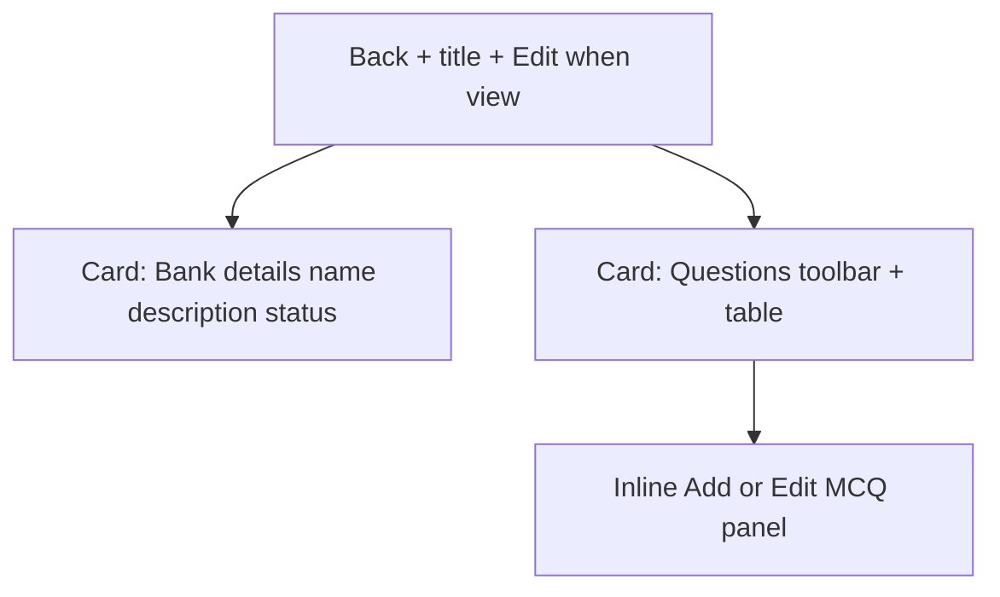

# Question bank view/edit revamp

## Problem

[`admin/src/pages/bank-form.tsx`](admin/src/pages/bank-form.tsx) today:

- **Edit/view**: read-only bullet list of stems; **no Add question**; Save only patches name/description.
- **Create**: one awkward “starter MCQ” embedded in the same form; correct answer is a free-text letter field.
- Ignores existing APIs: `POST /api/banks/:id/questions`, `PATCH .../questions/:questionId`, and CSV import.

Admin GET already returns items via [`getBank`](api/src/modules/banks/service.ts), but **`mapQuestionPublic` strips `isCorrect` / answer keys**, so the UI cannot hydrate an edit form without an API tweak.

## Locked approach

- **Admin only** (same quiz/assessment bank routes). Stay on BrainPulses DS: `Card`, `Field`, `Table`, `Button`, `Select`, `Checkbox`, `Textarea`, `PageHeaderActions` / header Edit link — tokens from [`admin/src/index.css`](admin/src/index.css) / [`docs/design/DESIGN.md`](docs/design/DESIGN.md).
- **Question type for this revamp: `single_mcq` only** (matches quiz product + activity-wizard manual questions). Other Prisma types stay API-only.
- **Inline add/edit panel** (same pattern as Define Rounds manual questions in [`activity-wizard.tsx`](admin/src/pages/activity-wizard.tsx) ~L825–929), not a new Dialog. Use existing `Sheet` only if the panel needs mobile overflow; default is in-page bordered panel under the table.
- **Soft-remove**: deactivate via `isActive: false` (extend update schema) rather than hard delete.

## UX structure

1. **Header** — back link; title by mode; view mode keeps primary **Edit** (as today).
2. **Bank details** — name*, description; edit mode Save updates bank only (`updateQuestionBank`). Create mode: Save creates bank then stays on **edit** URL (or navigates to `.../banks/:id/edit`) so questions can be added immediately — drop the mandatory starter-question gate (bank may be empty until first Add).
3. **Questions card**
   - Toolbar row: count + **Add question** (`outline`, Plus) when not view.
   - Empty state copy when zero items.
   - **Table** in `Card`: Code | Stem | Type | Points | actions (view: none or “View”; edit: Edit opens panel). No decorative avatars.
   - Search filter on stem/code (client-side) if list is long; skip pagination unless >50 items.
4. **Add / Edit panel** (edit mode only)
   - Stem (textarea), points (number, default 1), options A–D (or 2–4 rows with Checkbox for correct — same as wizard: exactly one correct).
   - Save question → `addBankQuestion` or `updateBankQuestion`; reload bank items; close panel.
   - Cancel clears draft.
   - View mode: expanding a row shows read-only stem + options (correct marked) without edit controls.

## API / admin client

| Change | Where |
|--------|--------|
| Include `isCorrect` on options (and `answerKey` or `correctLabels`) for **authenticated admin** `GET /api/banks/:id` | [`mapQuestionPublic`](api/src/modules/banks/service.ts) — rename/split to admin mapper used by `getBank` only (student portal must not gain keys) |
| Allow `isActive` on question PATCH | [`updateQuestionSchema`](api/src/modules/banks/schema.ts) + [`updateQuestion`](api/src/modules/banks/service.ts) |
| `updateBankQuestion`, richer `getQuestionBank` item type (options + correct) | [`admin/src/services/index.ts`](admin/src/services/index.ts) |
| Optional deactivate control in row kebab | UI calls PATCH `{ isActive: false }` then refresh |

CSV import (`POST .../import`) stays out of this UI pass unless a secondary **Import** outline button is trivial; prefer not in v1 of the revamp.

## Implementation notes

- Extract a small presentational helper module if needed for Fast Refresh (e.g. `bank-question-form.tsx` + `bank-form.tsx` page) so the page file stays maintainable.
- Reuse wizard validation: stem required; ≥2 filled options; exactly one correct.
- Preserve routes/modes in [`admin/src/routes/index.tsx`](admin/src/routes/index.tsx); update meta copy in [`meta.ts`](admin/src/routes/meta.ts) if titles/descriptions mention “starter question”.
- Responsive: stack option rows on mobile; table in horizontal overflow like other list pages.
- After change: `npm run typecheck` / `lint` / `format:check` in `admin/`; API typecheck if schema/service touched.

## Out of scope

- Multi-type editors (numeric, passage, match, etc.).
- Bulk CSV UI, bank clone, or reordering UI.
- Client student app changes.
