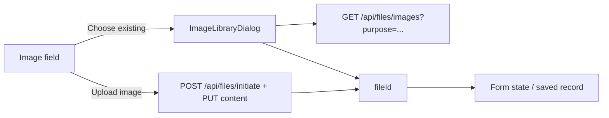

# Choose existing image (reuse uploaded images)

## Current state
- There are two image controls:
  - [admin/src/components/catalog-image-field.tsx](admin/src/components/catalog-image-field.tsx), used by the sponsor and contest forms. The file is held locally and uploaded on Save through `uploadCatalogImage`, which returns a `fileId`.
  - [admin/src/components/question-image-field.tsx](admin/src/components/question-image-field.tsx), used by [bank-question-form.tsx](admin/src/pages/bank-question-form.tsx) and [activity-wizard.tsx](admin/src/pages/activity-wizard.tsx). It uploads immediately and stores the string `/api/files/<id>`.
- `FileObject` in [api/prisma/schema.prisma](api/prisma/schema.prisma) has no purpose tag. Finalized files are never deleted, and sponsors and contests already reference files by id. Several records can point at the same file without any schema change.
- The API has no endpoint that lists files. [api/src/modules/files/routes.ts](api/src/modules/files/routes.ts) registers `GET /:id` (UUID-validated) before the router-wide auth middleware.

## Backend (api/)
- **Service** in [api/src/modules/files/service.ts](api/src/modules/files/service.ts): add `listImages(organizationId, { purpose, q, limit, cursor, order })`.
  - Filters: same organization, `finalizedAt` is set, and `originalName` contains `q` (case-insensitive) when given.
  - `purpose: 'catalog'`: PNG, JPEG, or WebP only, and `sizeBytes <= CATALOG_IMAGE_MAX_BYTES`. This matches `assertCatalogImage`, so every image the picker shows passes the sponsor and contest save checks.
  - `purpose: 'question'`: PNG, JPEG, WebP, or GIF, and `sizeBytes <= QUESTION_IMAGE_MAX_BYTES`.
  - Pagination uses `prismaCursorArgs` (newest first) plus `buildPage` and a `count` from [api/src/lib/pagination.ts](api/src/lib/pagination.ts).
  - Returned fields: `id`, `originalName`, `mimeType`, `sizeBytes`, `createdAt`. The storage path is never returned.
- **Route** in [routes.ts](api/src/modules/files/routes.ts): add `GET /images`, declared before `GET /:id` so `images` is not parsed as an id.
  - Middleware: `requireAuth, requireUser, withTenantContext, requireOrgAccess('view')`.
  - Query validation: `listQuerySchema.extend({ purpose: z.enum(['catalog','question']) })`. The response uses `listEnvelope`.
- **Tests**: add tests modeled on [api/test/file-download.test.ts](api/test/file-download.test.ts). They cover:
  - another organization's files are never listed;
  - unfinalized files are excluded;
  - GIF and oversized files are excluded for `catalog`;
  - students and unauthenticated callers are rejected.
- **Docs**: add the endpoint to [api/openapi.yaml](api/openapi.yaml) and [docs/architecture/API_STRUCTURE.md](docs/architecture/API_STRUCTURE.md).

## Admin service layer
- In [admin/src/services/index.ts](admin/src/services/index.ts), add `getImageLibraryPage({ purpose, q, cursor })`.
  - It calls `apiRequest<ListEnvelope<LibraryImage>>`, because the dialog needs `page.nextCursor`.
  - With `VITE_USE_FIXTURES`, it returns an empty page.
- Add a `LibraryImage` type in `services/types`.
- Add a query key `adminQueryKeys.imageLibrary(orgId, purpose, q)`.
- After a successful `uploadCatalogImage` or `uploadQuestionImage`, invalidate the `imageLibrary` key so new uploads show up in the picker.

## New shared component
[admin/src/components/image-library-dialog.tsx](admin/src/components/image-library-dialog.tsx) exports only `ImageLibraryDialog`.
- Props: `open`, `onOpenChange`, `purpose`, `selectedFileId?`, `onSelect(fileId)`.
- Layout: shadcn `Dialog` from `@/components/ui/dialog`, with a search `Input` (debounced) and a thumbnail grid (`grid-cols-2 sm:grid-cols-3 lg:grid-cols-4`).
  - Each tile is a `Button`-wrapped `AuthImage` in an `AspectRatio`, with a truncated file name and `aria-pressed` for the current selection.
  - Pages load with `useInfiniteQuery`, 24 images per page, and a "Load more" button.
- States:
  - Loading: skeleton tiles.
  - Empty: "No images uploaded yet." When a search has no matches: "No images match your search."
  - Error: an inline alert.
- Footer: Cancel, plus a primary "Use image" button that stays disabled until a tile is selected.
- Constraints: semantic tokens only; no new heights, because controls already use `--control-h`; the dialog scrolls internally on narrow screens. The layout will be checked at about 375, 768, and 1280px.

## Field changes (additive; existing behavior kept)
- **`QuestionImageField`**: add an outline "Choose existing" button (`ImagesIcon`) next to "Upload image", hidden when `disabled`.
  - Choosing an image calls `onChange('/api/files/<id>')` and clears any error. The URL input, upload, and preview are unchanged.
  - The bank question form and the wizard need no edits.
- **`CatalogImageField`**: add an optional `onPickExisting?: (fileId: string) => void` prop. The "Choose existing" button appears only when the prop is passed and the field is not disabled.
  - On pick, the component clears its local `file` and preview and resets the hidden input, then calls `onPickExisting`.
  - The preview then renders the chosen id through the existing `AuthImage` path, and the label shows "Current image".
  - The "Choose image" / "Change" upload button keeps its current label and behavior.
- **[sponsor-form.tsx](admin/src/pages/sponsor-form.tsx) and [contest-form.tsx](admin/src/pages/contest-form.tsx)**:
  - Pass `onPickExisting={(id) => { setFile(null); setImageFileId(id); setDirty(true); }}`. `setDirty` is needed because the dialog does not fire the form's `onChange`.
  - Keep the loaded id in `initialImageFileId`. In edit mode, change the update payload from `...(file ? { imageFileId } : {})` to also send `imageFileId` when it differs from `initialImageFileId`.
  - The create flow is unchanged: it already sends `imageFileId` when no new file was chosen.

## Verification
- `api/`: `npm run typecheck`, `npm run lint`, `npm test`.
- `admin/`: `npm run typecheck`, `npm run lint`, `npm run format:check`.
- Manual check on the running servers (ports 3002 and 5173 are reused, not restarted):
  - Reuse a sponsor image on a new contest.
  - Swap a contest's image to an existing one in edit mode.
  - Reuse a question image in a bank question and in a wizard answer option.
  - Confirm that Upload still works and that view mode shows no picker buttons.
- Run `graphify update .` after code edits.

## Out of scope
- Deleting or renaming library images.
- Automatic duplicate detection by content hash.
- The student `client/` app, which has no image upload controls.
