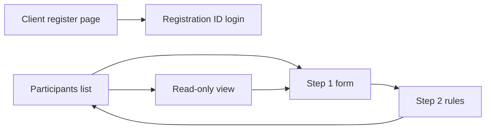

# Contest registration flow

The spec in [BrainPulses Registration Flow.md](BrainPulses%20Registration%20Flow.md) wins over [BrainPulses-registration-flow_applied.html](BrainPulses-registration-flow_applied.html). Your decisions override both where they differ:

- The nav item and page title stay **Participants**. Copy that says “Students” in the spec is written as Participants.
- Visuals follow [docs/design/DESIGN.md](docs/design/DESIGN.md) and the existing admin chrome in [admin/src/layouts/admin-layout.tsx](admin/src/layouts/admin-layout.tsx). The prototype’s purple rail, fonts, and 860px drawer are not built.
- Items marked **[Proposed]** in the spec are out of this work: 5-try / 15-minute password lock, an audit row per unlock, and the “removing a quiz” rule.
- There is no mailer in `api/` (only phone OTP). Quiz-given and Registration ID emails are not sent. Toasts will not claim that people were emailed.
- Quiz and assessment **assignment** registrations (`/quizzes/registrations`, `/assessments/registrations`, model `Registration` in [api/prisma/schema.prisma](api/prisma/schema.prisma)) stay. This work adds a separate contest-form model. “Give a quiz” creates those existing assignment rows.

## What the Participants page becomes

[admin/src/pages/participants.tsx](admin/src/pages/participants.tsx) is replaced by the spec’s list (section 4): KPI cards, one row per saved form (newest first), and a table of people who registered through a form (Registration ID, name, email, sponsor, contest, quizzes given, registered date).

Removed from this page, because the spec leaves add-one and bulk import out of scope and this page is the form flow: create-participant dialog, spreadsheet upload, activate/deactivate, and the current columns (course, city, cohort, last login). The existing participant APIs stay so quiz assignment and old records keep working. Deactivate-login has no screen in the in-scope spec, so it is not added here.

Create, view, and edit are real routes under `/participants` (the app’s pattern), with the spec’s two-step stepper, not the prototype’s single-file overlay:

- `/participants` — list
- `/participants/forms/new` — create, steps 1 and 2
- `/participants/forms/:formId` — read-only view
- `/participants/forms/:formId/edit` — edit after password check

`/students` already redirects to `/participants` and stays that way.

## Data

New contest-form records, one per contest, holding the section 13 fields: sponsor, contest, window, seats, welcome message, header chips, ordered fields (including locked flags), link slug, link active, quizzes given, domain rule, returning-participant rule, and draft vs saved.

A submission row stores one registration through a form: participant, contest form, answers for admin-defined fields, and the email/mobile captured on that registration when they differ from the saved profile (spec section 7.4).

Participant changes required by the spec, which the current schema cannot express (`Participant` is one `name`, `code` unique per organization, email and phone unique per organization, codes from [api/src/lib/codes.ts](api/src/lib/codes.ts) as `BP-24NNN`):

- Store first name and last name for people who register through a form. Existing rows keep `name`; they are not split.
- Registration IDs issued by this flow are `BP` plus 8 digits, unique across all organizations.
- Existing `BP-24NNN` codes are not rewritten and still sign in. New form registrations do not use that generator.
- Drop the per-organization unique constraints on email and phone so the match rules (shared email or mobile, different first name) can be stored. `code` becomes globally unique.

Quiz labels on the form use the activity’s existing `FlowStatus` plus `startsAt` / `endsAt`. No new status enum: draft stays Draft; active with a future start is Scheduled; active and inside the window is Active; `completed`, `archived`, or a past `endsAt` is Ended and cannot be given.

Public link: slug stored on the form. The URL is the client app’s registration route. `bp.link` is not configured in this repo and is not hardcoded.

## Behavior kept from the spec

Step 1 and Step 2 fields, defaults, validation messages, live preview (desktop/mobile, light/dark, full preview, preview-only submit), resize handle with the spec’s width rules, locked fields, one form per contest, link on/off and regenerate, domain tags, returning-participant match rule, and the read-only view.

Admin password for **Edit form** and **Unlock locked fields** uses the existing check in [api/src/lib/verify-acting-password.ts](api/src/lib/verify-acting-password.ts). Wrong password uses the spec’s “Incorrect password.” line without a tries-left count, because the lockout is [Proposed]. Empty password uses “Enter your password.”

**Give a quiz** does not ask for a password. It attaches the contest’s quizzes to the form and creates an assignment `Registration` for each person already registered through that form. The email switch is saved; nothing is sent.

Public registration (client page opened from the link and from **Open as participant**): section 6.3 closed/full/not-yet-open states, section 12 messages, domain check, seat check, inactive or old slug, and the match rule. A valid new registration creates the participant and the submission. A match reuses the Registration ID and does not overwrite the saved profile. Preview on the admin builder still saves nothing.

Login: remove the phone tab and OTP calls from [client/src/pages/login.tsx](client/src/pages/login.tsx) and stop accepting `/api/auth/participant/request-otp`, `resend-otp`, and `verify-otp`. Sign-in stays on the code endpoint in [api/src/modules/auth/service.ts](api/src/modules/auth/service.ts), labeled Registration ID, accepting `BP` + 8 digits and existing `BP-24NNN` codes. The post-login quiz portal is otherwise unchanged, except a participant with no assigned quiz sees “No quizzes yet. You’ll get an email when one is ready.”

## Slices

Each slice is one vertical change on the current admin and API. Checks for a slice: `npm run typecheck` and `npm run lint` in the packages that slice touches, plus the API tests for the new rules.

1. **Save a form and see it.** Schema, form APIs, and the Participants list plus the two-step create flow. Draft save skips checks. Final save returns to the list with the spec toast, adjusted so it does not claim an email was sent.
2. **Open, edit, give a quiz.** Read-only view, password gate, edit with sponsor and contest locked, and Give a quiz writing assignment rows.
3. **Public register and Registration ID login.** Client registration page, match rules, seats, domains, link state, ID issuance, and removal of phone OTP. Existing codes still sign in.
