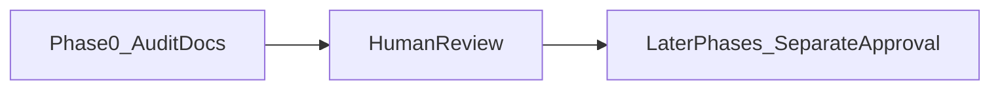

# Phase 0 baseline audit

The [Engineering Excellence Plan](docs/BrainPulses_Engineering_Excellence_Plan.md) forbids a repo-wide rewrite and says the first run is audit-only. Application code stays untouched until this audit is reviewed. Later phases (security tests, service splits, UI dedup, CI) are a sequenced backlog, not this change.

## What this delivery produces

Documentation only, under existing doc folders. Do not create a shared package, split large files, or edit Prisma migrations.

- [docs/engineering/BASELINE_AUDIT.md](docs/engineering/BASELINE_AUDIT.md) — verified architecture summary, git/Node/lockfile state, source vs generated inventory, env **names** only, command-result table, UI capture notes, and contradictions with older docs.
- [docs/architecture/DEPENDENCY_MAP.md](docs/architecture/DEPENDENCY_MAP.md) — critical-flow traces (route to auth/tenant to service to persistence) and known cross-layer edges. Link [api/openapi.yaml](api/openapi.yaml), [docs/architecture/API_STRUCTURE.md](docs/architecture/API_STRUCTURE.md), and [docs/architecture/DB_STRUCTURE.md](docs/architecture/DB_STRUCTURE.md). Do not replace those files in this pass.
- [docs/engineering/REFACTORING_REGISTER.md](docs/engineering/REFACTORING_REGISTER.md) — prioritized backlog with severity, evidence, acceptance criteria, and dependencies. This is the “first deliverable” backlog from section 19 of the excellence plan.
- Short progress report in the chat, using the template in section 18 of the excellence plan.

Missing today (confirmed): `BASELINE_AUDIT.md`, `DEPENDENCY_MAP.md`, `REFACTORING_REGISTER.md`. No root `.github` workflows. Client has no test script.

## Facts the audit must record, not rediscover from scratch

- Three apps, Node `>=22`. Root [package.json](package.json) forwards scripts. `npm run check` expands to API typecheck + lint + format check + API tests, then admin typecheck + lint + format check, then admin Vitest, then client typecheck + lint + format check. It does not build, and it does not run a client test suite.
- API is implemented: Express in [api/src/app.ts](api/src/app.ts), 14 modules, Prisma at [api/prisma/schema.prisma](api/prisma/schema.prisma), nine migrations, OpenAPI at [api/openapi.yaml](api/openapi.yaml), `node:test` suites in `api/test/`. Controllers call services; tenant scope is `withTenantContext` plus the Prisma extension in [api/src/lib/prisma.ts](api/src/lib/prisma.ts).
- Docs disagree with that code. [docs/README.md](docs/README.md) and [docs/engineering/TRD.md](docs/engineering/TRD.md) still say the API/database/auth are proposed and admin data is fixtures. [docs/architecture/API_STRUCTURE.md](docs/architecture/API_STRUCTURE.md) says local UAT is implemented and also still says “confirm before implementation.” Record the discrepancy. Do not rewrite product docs in this pass.
- Large files match the plan’s line counts (activity wizard 1,278; attempts service 948; activities service 862; admin services index 828; banks service 741; question banks 671; bank form 654; import-export 662; client CSS 4,026; admin CSS 1,015). Line count is a signal, not a split order.
- Exact duplicates: `use-debounced-value` and `use-leave-guard` in admin and client. Date-time pickers are near-copies. Leave-guard sits on React Router 8 (admin) vs 7 (client). Do not extract a workspace package.

## How the audit will be gathered

Read-only inspection plus non-mutating commands. Never read `.env` or print secret values. Never run `db:reset`, `prisma migrate`, format-write, or lint `--fix`.

1. Git state: branch, status, recent commits. Do not stash or reset.
2. Inventory: source, tests, fixtures, `api/src/generated`, `graphify-out` (generated; do not hand-edit), migrations, and whether real `.env` files are tracked (`git ls-files` / `git check-ignore` only).
3. Checks, recorded as PASS / FAIL / NOT RUN with the reason. Run each package separately so a failure is attributable:
   - `api`, `admin`, `client`: `npm run typecheck`, `npm run lint`, `npm run format:check`, `npm run build`
   - `api`: `npm run test` (needs local Postgres/Redis if the suite connects; if it cannot start, record the blocker and do not invent a pass)
   - `admin`: `npm run test`
   - `client`: tests NOT RUN — no script
   - `npm run audit:all` from the root; report high/critical counts only, no upgrades
4. Trace these journeys into the dependency map from code, not from the stale TRD: admin sign-in, student OTP, one tenant-scoped read, activity publish, attempt start/save/submit. Name authorization and the failure status already implemented.
5. UI evidence, only if it does not disturb an existing dev server. Admin is port **5173**, client **5174**, API **3002**. If a port is already listening, use it. If free and a capture is still needed, start only that app and stop only processes this session started. Capture a short set (dashboard or sign-in, one list, one student flow) at about 375, 768, and 1280, light and dark where the app supports it. Store images under `docs/engineering/baseline/` and link them from the audit. If login or fixtures block a screen, say so.
6. Write the three docs. Label each finding verified, hypothesis, or unknown. Severity, evidence path, next action, and acceptance criteria go in the register.
7. Stop. The recommended first **implementation** task will be chosen from audit evidence. The likely candidate, pending that evidence, is the first missing negative test for tenant isolation or attempt integrity — not splitting [admin/src/pages/activity-wizard.tsx](admin/src/pages/activity-wizard.tsx).

## Explicitly out of this approval

Phases 2–10: module splits, shared UI extraction, token/CSS cleanup, type-suppression cleanup, new CI workflows, performance work, and rewriting [docs/engineering/TRD.md](docs/engineering/TRD.md). Each of those waits for a later approval after this audit is reviewed.
