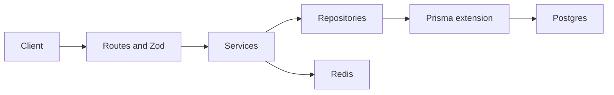

# Express API for BrainPulses

The admin app stays on fixtures. This adds `api/` only, plus root Compose and script forwards. Decisions below close the open items in [docs/architecture/API_STRUCTURE.md](docs/architecture/API_STRUCTURE.md) and [docs/architecture/DB_STRUCTURE.md](docs/architecture/DB_STRUCTURE.md).

## Locked decisions

- **Tenancy:** shared database. `User.email` is globally unique. A `Membership` ties a user to an `Organization` with a role. The access token carries `organizationId`. Every tenant-owned row has `organizationId`. Services and a Prisma query extension refuse queries that omit it. Sign-in with one membership issues a token immediately. Sign-in with several returns the org list and a short-lived selection token; choosing an org issues the session.
- **Auth:** email and password (`bcrypt`). Access JWT ~15 minutes. Refresh token family in Redis (hashed, rotated, reuse revokes the family). HttpOnly refresh cookie. No TOTP and no external identity provider in this pass.
- **Roles:** `super_admin` and `admin`, matching the users page. Admins also have `assessmentAccess` and `quizAccess` of `full | edit | view | none`.
- **Activities:** one `Activity` model with `kind: assessment | quiz`, as the admin already does. Status flow: `draft → active → completed`, plus `archived` from draft or active. Human codes (`BP-`, `ASM-`, `QUZ-`, `QB-`) are separate from UUID primary keys.
- **Attempts:** server owns `startedAt`, `deadlineAt`, and `submittedAt`. States: `in_progress`, `submitted`, `auto_submitted`, `voided`. Saves require a revision and return the next one (`409` on a stale revision). Submit requires `Idempotency-Key` and returns the same body on retry. Deadline expiry auto-submits. Answer keys never appear on read models. Objective items score on submit. Short text stays unscored until regrade. No LLM grader.
- **Results:** withheld until `releaseStatus = published`. Regrade appends a score revision and an audit event.
- **Files:** private local directory (gitignored). Initiate / finalize / time-limited download token. Not a public `/uploads` static mount.
- **Lists:** the architecture envelope. Lists add `total` so a later admin footer can show “Showing X to Y of Z”.
- **Errors:** `{ error: { code, message, requestId, fields? } }` with 400, 401, 403, 404, 409, 422, 429, 500.
- **Out of this pass:** wiring `admin/`, email delivery (notification rows are stored only), S3, and AI grading.



## Docker Compose

Root [docker-compose.yml](docker-compose.yml), loopback ports so this stack can sit beside LevelUP (`5432`, CloudBeaver `8979`) and PGDM (`5433`, Redis `6379`/`6380`, CloudBeaver `8978`):

- `postgres:18` on `127.0.0.1:5434`. Volume at `/var/lib/postgresql` (Postgres 18 image layout, not the old `/var/lib/postgresql/data` mount). Healthcheck `pg_isready`. Database `brainpulses`.
- `redis:8` on `127.0.0.1:6381`, AOF, password from env with a local default, `redis-cli ping`.
- `redis/redisinsight:3.8` on `127.0.0.1:5540`.
- `dbeaver/cloudbeaver:26` on `127.0.0.1:8977`. If that tag is missing on Docker Hub, pin `dbeaver/cloudbeaver:26.1.4` (the tag both reference projects use). No API reverse proxy; the UI is loopback-only.
- Named volumes, `restart: unless-stopped`, json-file log caps, TZ `Asia/Kolkata` on Postgres.

[`.env.example`](.env.example) at the repo root (Compose) and [api/.env.example](api/.env.example) (API) hold placeholders only. Compose defaults let `docker compose up` run without a real `.env`.

## API layout

Industry feature modules (the reference apps keep this idea in `modules/*/routes.ts`; layers live inside each module):

```text
api/
  prisma/schema.prisma
  prisma/seed.ts
  src/index.ts
  src/app.ts
  src/config/env.ts
  src/middleware/          auth, org context, validate, request id, errors, rate limit
  src/lib/                 prisma, redis, jwt, password, pagination, errors
  src/modules/<feature>/   routes, controller, service, repository, zod schema
  openapi.yaml
  test/
```

Modules: `auth`, `students`, `users`, `activities`, `banks`, `registrations`, `attempts`, `results`, `dashboard`, `settings`, `audit`, `files`. Questions live under banks. Dashboard reads aggregates. Redis caches dashboard summaries with a short TTL and org-scoped keys; mutations delete those keys.

Stack: Node `>=22`, ESM, TypeScript, Express 5, Zod, Prisma (current stable), `ioredis`, `helmet`, `cors`, `cookie-parser`, `express-rate-limit` with a Redis store, `bcryptjs`, `jsonwebtoken`. Scripts: `dev` (tsx), `build`, `start`, `typecheck`, `lint`, `test` (`node --test`). Root [package.json](package.json) forwards `dev:api`, `db:up`, `db:migrate`, and the check scripts, and its description stops saying the API comes later.

## Schema (tenant-owned unless noted)

- `Organization`, `User` (global), `Membership` (org, role, assessment access, quiz access, active flag).
- `Student` (code, name, email, phone, course, city, active). Deactivate, do not hard-delete.
- `QuestionBank` (kind, code, description, presentation, status) and `Question` plus `QuestionOption`. Editing a live question writes a new `QuestionVersion`; attempts pin that version. Types: single MCQ, multiple MCQ, numeric, short text, passage, match, image MCQ.
- `Activity` (kind, code, name, subtitle, status, window, duration, passing percent, presentation). `ActivityBank` join.
- `Registration` unique on org + activity + student. Assign / unassign.
- `Attempt`, `AttemptResponse` (revision, idempotency key). `Result` and `ResultRevision` (score, release status).
- `Setting` groups: general, access, notifications, system. `Notification` event rows. `AuditEvent` (actor, action, target, metadata). `FileObject` metadata; bytes on disk.
- Timestamps are `timestamptz`. Uniqueness and indexes follow list filters (org + kind + status, org + code).

Seed one organization, a super admin, and a handful of students, banks, activities, and registrations so the routes can be called.

## HTTP surface

Prefix `/api`. `GET /health` and `GET /health/ready` (Postgres + Redis).

- **Session:** `POST /auth/sign-in`, `POST /auth/select-organization`, `GET /auth/session`, `POST /auth/refresh`, `POST /auth/sign-out`.
- **Students:** list, detail, create, patch, deactivate.
- **Users:** list, invite, role and access change, deactivate. Invite creates the membership in the caller’s org.
- **Activities:** list, detail, create, patch, publish, archive. Kind is a query or path segment so quizzes and assessments share one module.
- **Banks:** list, detail, create, patch, CSV import (row errors, formula-injection stripped). Question CRUD nested under the bank.
- **Registrations:** list, assign, unassign, CSV export (scoped, audited).
- **Attempts:** start, save, resume, submit. Student bearer token, separate from admin tokens. Eligibility: active registration, activity `active`, inside the window, no other open attempt.
- **Results:** list, detail, publish, regrade.
- **Dashboard:** summary and recent activity.
- **Settings:** read and patch each group.
- **Audit:** list and detail, super admin only.
- **Files:** initiate, finalize, download.

Sort and filter fields are allowlisted. Mutations that must not double-apply (submit, publish, assign, import) take `Idempotency-Key`.

## Tests and checks

`node --test` covers: wrong password, refresh reuse, cross-tenant read and write denied, view-only admin cannot publish, stale attempt revision, duplicate submit returns the first result, answer keys absent from bank list payloads. After implementation, run typecheck, lint, and the test script in `api/`. Update the graph with `graphify update .`.

Do not start the admin Vite server. Start the API only if a manual request check is needed, then stop that process. Leave any existing listener on port 5173 alone.
