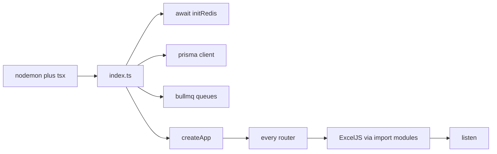

# Faster API dev startup

Admin ([admin/src/routes/app-routes.tsx](admin/src/routes/app-routes.tsx)) and participant ([participant/src/App.tsx](participant/src/App.tsx)) already lazy-load pages. Vite is not the main stall. The API is: `npm run dev:api` runs nodemon, which runs `tsx src/index.ts`, and that file pulls the whole server graph before `listen`.

## What makes boot slow

- [api/src/index.ts](api/src/index.ts) statically imports [api/src/lib/prisma.ts](api/src/lib/prisma.ts) and [api/src/lib/queue/queues.ts](api/src/lib/queue/queues.ts). Prisma 7’s generated client under `api/src/generated/prisma` is about 3.3MB, and BullMQ loads even when `QUEUE_INLINE=true` (the local default in [api/.env.dev.example](api/.env.dev.example)).
- [api/src/app.ts](api/src/app.ts) statically imports every router. Users, participants, banks, activities, and both report exporters import ExcelJS at module scope ([api/src/lib/spreadsheet-import.ts](api/src/lib/spreadsheet-import.ts), [api/src/lib/xlsx-upload.ts](api/src/lib/xlsx-upload.ts), and the `import-export` / `assessment-import` modules). ExcelJS evaluates a large dependency tree on first load. That cost shows up on most starts and disappears once the OS file cache is warm, which matches a slow boot on most runs.
- Redis is still awaited in `main()` before `listen`. That stays. A healthy Redis on `127.0.0.1` is not the stall, and auth, refresh tokens, and the rate-limit store must still see a ready client when the process is up.
- Restarts add a second wait. Shutdown in [api/src/index.ts](api/src/index.ts) uses `server.close()` and does not drop idle keep-alive sockets from the Vite proxies, so nodemon often sits until those sockets time out. [api/nodemon.json](api/nodemon.json) also walks `src` with chokidar before tsx even starts; on Windows that scan is uneven.

## Changes

### 1. Mount API routers on first request

In [api/src/app.ts](api/src/app.ts), stop importing routers at the top. Mount each existing path (`/api/auth`, `/api/users`, and the rest of the current list) through a small wrapper:

- Cache one `import()` per router.
- On a request, wait for that import, then call the same router Express already uses.
- Share one in-flight promise so parallel first requests cannot double-load.
- Return that promise so Express 5 still forwards a rejected import to `errorHandler`.
- Load Prisma inside `/health/ready` with `import('./lib/prisma.js')` so a health check does not pull the client at boot. `/health` stays synchronous and does not touch Postgres.

`createApp()` stays synchronous. [api/test/helpers.ts](api/test/helpers.ts), [api/test/security.test.ts](api/test/security.test.ts), and [api/scripts/smoke-health.ts](api/scripts/smoke-health.ts) keep calling it the same way. Paths, middleware order, rate limits, and handlers do not change. The first call to a module pays the import once; later calls use the cached router.

### 2. Keep ExcelJS off ordinary requests

Routers for users, participants, and banks import their services, and those services import workbook modules that import ExcelJS even for list/get. Switch those workbook modules to `import type` plus `await import('exceljs')` inside the functions that open or write a workbook:

- [api/src/lib/spreadsheet-import.ts](api/src/lib/spreadsheet-import.ts)
- [api/src/modules/users/import-export.ts](api/src/modules/users/import-export.ts)
- [api/src/modules/participants/import-export.ts](api/src/modules/participants/import-export.ts)
- [api/src/modules/banks/import-export.ts](api/src/modules/banks/import-export.ts)
- [api/src/modules/activities/assessment-import.ts](api/src/modules/activities/assessment-import.ts)
- [api/src/modules/assessment-reports/export.ts](api/src/modules/assessment-reports/export.ts)
- [api/src/modules/quiz-reports/export.ts](api/src/modules/quiz-reports/export.ts)

Move `IMPORT_MAX_BYTES`, `isXlsxFilename`, and `xlsxOnlyRejectedMessage` into a tiny module with no ExcelJS import, and point [api/src/lib/xlsx-upload.ts](api/src/lib/xlsx-upload.ts) at that. Upload limits and file-type checks stay the same. Job processors already dynamic-import the report exporters; those call sites keep working.

### 3. Do not load Prisma or BullMQ until they are needed

In [api/src/index.ts](api/src/index.ts), drop the static imports of `disconnectPrisma` and `closeJobQueue`. On SIGINT/SIGTERM, `await import()` them and then disconnect, in the same order as today. [api/src/lib/queue/queues.ts](api/src/lib/queue/queues.ts) should import `processJobPayload` only inside `runInlineJob`, so importing the queue module does not pull processors at boot. `getJobQueue()` still constructs the BullMQ `Queue` on first real enqueue. Worker entry [api/src/worker.ts](api/src/worker.ts) stays eager.

### 4. Make the dev process start and restart faster

Replace the nodemon exec with Node 22’s watcher, still via tsx, in [api/package.json](api/package.json):

- `node --watch-path` pointed at `src/modules`, `src/lib`, `src/middleware`, `src/config`, `src/index.ts`, and `src/app.ts` (not `src/generated`, `dist`, `uploads`, or `test`).
- Set `NODE_ENV=development` the way [api/nodemon.json](api/nodemon.json) does today, so env-file selection in [api/src/config/load-env.ts](api/src/config/load-env.ts) does not change.
- Do not add `--conditions=development`. Dev currently resolves `#prisma` to the built client in `dist`, which is the faster load. Tests and the worker already opt into the TypeScript client.

On shutdown, call `server.closeIdleConnections()` before `server.close()`. In development only, if the process is still up about a second later, call `server.closeAllConnections()` so a Vite keep-alive cannot block the next boot. Production `npm start` keeps waiting for in-flight work.

Leave [api/nodemon.json](api/nodemon.json) in place only if nothing else references it; otherwise remove it with the script change so there is one dev entry.

Admin and participant Vite configs stay as they are, including `host: '0.0.0.0'` (that bind is what makes LAN and tunnel access work).

## Checks

- Time a throwaway boot of the API on an ephemeral `PORT` (so a server already on 3002 is left alone): process start to the listening log, then shut it down and delete the script.
- From `api/`: `npm run typecheck`, `npm run lint`, `npm run format:check`, and `npm run test`.
- Hit `/health`, one auth or list route, and one xlsx import/export path through the existing tests (they already cover those modules) so the lazy wrapper and dynamic ExcelJS import are exercised.
- Run `graphify update .` after the code edits.
