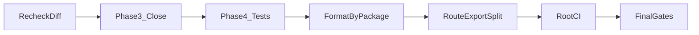

# Finish the excellence mission in phases

Work stays on branch `fixes` at `ac881f3`. Do not stash or reset the uncommitted audit, test, tenant-guard, and Excel-sanitizer changes. Do not change how published assessments reveal correct answers in [`api/src/modules/student-portal/service.ts`](api/src/modules/student-portal/service.ts): `includeKeys` stays tied to `releaseStatus === 'published'` for non-quiz activities. Quizzes stay gated by `answersVisibleToStudent` (default false). That is recorded as a kept product rule, not an open stop.

Student start and resume already omit `isCorrect` and `answerKey` ([`api/test/attempt-payload.test.ts`](api/test/attempt-payload.test.ts)). Do not reopen that mapper.

## Phase A — Recheck what is already changed

Read `git diff` for the uncommitted API, admin, client, and docs edits. Re-run `npm run test`, `typecheck`, and `lint` in `api/`. Confirm [`api/src/lib/tenant-scope.ts`](api/src/lib/tenant-scope.ts) still throws on a foreign `organizationId` and that Excel export still prefixes formula cells. Fix any regression this recheck finds before new work.

## Phase B — Close Phase 3 without a policy change

- Add one API test that a published assessment result from `getMyResult` still includes review fields, and that a quiz with `answersVisibleToStudent: false` does not. This locks today’s rule. It does not hide assessment keys.
- Read file download ([`api/src/modules/files/routes.ts`](api/src/modules/files/routes.ts)) and submit idempotency ([`api/src/modules/attempts/service.ts`](api/src/modules/attempts/service.ts)). Add a test only where a real gap exists (expired or unknown download token already returns 403; duplicate submit is already tested). Do not invent a route to force the tenant-mismatch 500.
- Update [`docs/engineering/THREAT_MODEL.md`](docs/engineering/THREAT_MODEL.md) only where a sentence now disagrees with the code (answer keys are withheld on attempt start/resume; published assessment review is intentional).

## Phase C — Phase 4 tests that later edits can lean on

- Keep API `node:test` as the integration layer.
- Add a client unit test only if it does not need a new UI harness. Login validation is already covered. A rendered login test needs Testing Library in `client/`; add it only for one screen (Unique ID field and sign-in button), matching admin’s Vitest style.
- Do not add a coverage percentage gate. There is still no coverage script; leave that as a measured follow-up in the register rather than a fake number.

## Phase D — Format, one package at a time

Prettier is red on tracked files only (`graphify-out` is already ignored). Run `prettier --write` inside `api/`, then `admin/`, then `client/`, and re-run that package’s `format:check`, `lint`, and tests before the next package. Do not format generated Prisma output or `graphify-out`. This phase is formatting only, after behavior tests are green, so the diff stays reviewable.

## Phase E — Clear the admin lint warnings

[`admin/src/routes/index.tsx`](admin/src/routes/index.tsx) has 23 `react-refresh/only-export-components` warnings from non-component exports. Move those exports into a sibling module and leave the route tree’s behavior the same. Re-run admin lint until those warnings are gone. Do not restyle pages.

## Phase F — Large-file splits only behind a test

Do not split [`admin/src/pages/activity-wizard.tsx`](admin/src/pages/activity-wizard.tsx), [`api/src/modules/attempts/service.ts`](api/src/modules/attempts/service.ts), or [`api/src/modules/activities/service.ts`](api/src/modules/activities/service.ts) to hit a line count. Extract one cohesive function only when an existing or new test fails if that function’s result changes. If a file cannot be split without an untested behavior change, leave it and say so in the register.

## Phase G — CI and the final report

Add one root GitHub Actions workflow that runs, on Node 22, `npm ci` per package and then typecheck, lint, format check, test, and build for `api`, `admin`, and `client`. No deploy, no migrate against a production database.

Re-run those same commands locally. Record chunk-size warnings from the admin and client builds. Code-split only if one chunk is a single lazy route and the split does not change what the user sees. Otherwise record the warning and leave the bundles.

Update [`docs/engineering/PROGRESS.md`](docs/engineering/PROGRESS.md) with the implementation ledger: implemented and verified, verified unchanged, documented only, deferred. A phase is complete only when its checks were run. The mission stops with that report, not with a claim of ISO or WCAG certification.
