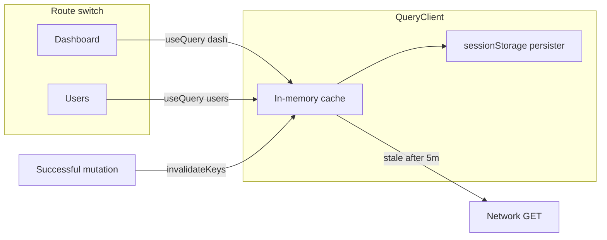

# Flow safety + client-side data cache (admin + client)

## Locked decisions

- **Apps:** both admin and client.
- **Leave / write safety:** full package — `beforeunload` + router `useBlocker`, idempotent critical mutations, attempt autosave flush + resume, post-reload status alignment.
- **Cache invalidation:** mutation invalidation **plus** **5-minute** freshness TTL (`staleTime: 5 * 60_000`).
- **Storage “safety” (concrete):**
  - **Auth:** unchanged — httpOnly refresh cookie + short-lived bearer (not stored in the query cache).
  - **List/detail API data:** TanStack Query in-memory + **persist to `sessionStorage`** (org/student-scoped key). Cookies are not used for list payloads (4KB limit / sent on every request). Session storage clears when the tab session ends and is safer on shared machines than long-lived `localStorage`.
  - Clear persisted cache on **sign-out** and org switch.
- **Overlay interaction:** narrow the existing full-screen API overlay to **mutations only** (POST/PATCH/DELETE/upload). Cached GETs and background refetches must not block navigation — otherwise caching cannot deliver “switch pages freely.” Skeletons stay for true cache misses / first load.

---

## Part A — Do not lose critical writes

### A1. Shared leave guard

Add a small hook in each app (same behavior):

- `useLeaveGuard(when: boolean)` → `beforeunload` when `when` is true; React Router `useBlocker` when `when` is true (RR already in both apps).
- Message: short, product-neutral (“You have a save in progress. Leave anyway?”).

**Wire `when` true for:**

| App | When |
|-----|------|
| Admin | Activity wizard `persist` / publish / archive in flight; other forms while submit/save in flight; dirty wizard with unsaved edits (block navigate until Save or Discard) |
| Client | Attempt open and not submitted; pending debounced save; submit in flight |

Files: new `admin/src/hooks/use-leave-guard.ts`, `client/src/hooks/use-leave-guard.ts`; wire in [`activity-wizard.tsx`](admin/src/pages/activity-wizard.tsx), key admin forms that already track saving, [`attempt.tsx`](client/src/pages/attempt.tsx).

### A2. Idempotency

**API — activity publish** ([`activities/controller.ts`](api/src/modules/activities/controller.ts) / [`service.ts`](api/src/modules/activities/service.ts)):

- Accept optional `Idempotency-Key` (same audit-metadata pattern as results/registrations).
- Replay stored result if the same key already published successfully; if already published without key conflict, return current published activity (safe retry).

**Admin client** — always send `Idempotency-Key` (UUID per user action) on:

- `publishActivity`, `archiveActivity` (if mutating), `publishResult`, registration assign, bank import — via [`admin/src/services/index.ts`](admin/src/services/index.ts) / api-client header support.

**Client** — keep submit key ``submit-${attempt.id}``; ensure retries reuse the **same** key for that attempt (store in component ref / sessionStorage for the attempt id).

### A3. Attempt autosave + pagehide flush

Already: 400ms debounce + revision save in [`attempt.tsx`](client/src/pages/attempt.tsx).

Add:

- `pagehide` / `visibilitychange` → **flush** pending save with `fetch` **`keepalive: true`** (best-effort when tab closes).
- Leave guard while answers dirty or save/submit in flight.
- On load: if attempt already submitted, navigate to result (resume / no double submit).

### A4. Post-reload status alignment

- Admin activity wizard/detail: after timeout/error on publish, next load uses GET activity — UI shows Published if server committed.
- Client: after submit timeout/error, reload attempt; if submitted, go to result and toast success/info so the student is not stuck on “submit again.”

### A5. Overlay = mutations only

Update admin/client [`api-client.ts`](admin/src/lib/api-client.ts) tracking: call `trackLoading` only for non-GET (or explicit `mutation: true`). GETs power skeletons via React Query `isPending` / existing page skeletons — no full-screen block on list navigation.

---

## Part B — Cache so page switches do not refetch without need

### B1. Dependencies

Install in **`admin/`** and **`client/`** (not root):

- `@tanstack/react-query`
- `@tanstack/react-query-persist-client`
- `@tanstack/query-sync-storage-persister`

Stable current majors; run `npm audit` in each package after install.

### B2. QueryClient setup

- `QueryClient`: `staleTime: 5 * 60_000`, `gcTime` ≥ staleTime (e.g. 30 minutes).
- `PersistQueryClientProvider` + sync persister → `sessionStorage`.
- Persist key: `bp-aq:${organizationId}` (admin) / `bp-cq:${studentId}` (client). Do not persist until identity is known; **clear** on logout.
- Wrap in [`admin/src/App.tsx`](admin/src/App.tsx) and [`client/src/App.tsx`](client/src/App.tsx) (outside or inside auth so logout can `removeClient()` / clear storage).

### B3. Query keys + hooks

Replace remount-refetch [`useAsyncService`](admin/src/hooks/use-async-service.ts) on list/summary pages with `useQuery`:

**Admin (minimum set matching your example + siblings):** dashboard, students, users, activities list, banks, registrations — keys like `['dashboard', orgId]`, `['users', orgId]`, etc.

**Client:** dashboard/library/results lists similarly.

Keep service functions in [`admin/src/services/index.ts`](admin/src/services/index.ts) / [`client/src/services/api.ts`](client/src/services/api.ts) as `queryFn`s.

### B4. Invalidation on mutation success

After successful create/update/delete/publish/assign/import:

- `queryClient.invalidateQueries({ queryKey: [...] })` for affected domains (e.g. publish activity → activities + dashboard; create user → users + dashboard).
- Prefer targeted keys over `invalidateQueries()` global.

Within 5 minutes and no invalidation → **no network** on Dashboard ↔ Users switches; UI reuses cache (no remount loading flash if `placeholderData` / cached data present).

### B5. What stays server-side

Existing Redis dashboard cache ([`api/src/lib/cache.ts`](api/src/lib/cache.ts)) stays; frontend cache reduces repeat GETs; server cache still helps multi-user load.

---

## Part C — Verify

- Admin/client: typecheck, lint, format on touched packages.
- Manual: Dashboard → Users → Dashboard → Users with no edits → Network tab shows **no** repeat list GETs within 5 minutes; edit a user → Users (and dashboard if invalidated) refetch.
- Publish with leave attempt → browser warn + blocker; double Publish with same key → one publish.
- Attempt: type answers, refresh → answers restored from server; submit, kill tab mid-flight → reload lands on result if server committed.
- `graphify update .` after code changes.

## Out of scope

- Putting API list JSON in cookies.
- Encrypting sessionStorage cache at rest.
- Changing API rate-limit numbers.
- Replacing attempt soft-proctor with a different product policy.
