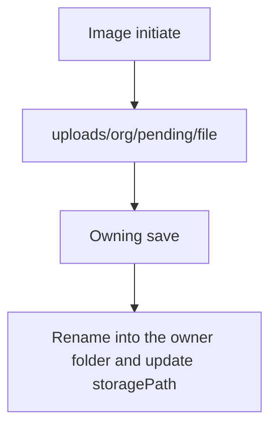

# Hierarchical image uploads

Images are served by file id (`/api/files/{id}`), and [`api/src/modules/files/service.ts`](api/src/modules/files/service.ts) stores the real path on `FileObject.storagePath`. Today `initiateUpload` writes every file to `uploads/{organizationId}/{uuid}.ext`. Spreadsheet imports stay in memory and are out of scope.

LevelUP’s grade/subject tree does not apply. This app’s owners are question banks, activities, rounds, sponsors, and contests.

## Target tree

`uploads/{organizationId}/` then:

- `questions/assessments/{bank-slug}/` — reusable assessment-bank images
- `questions/quizzes/{bank-slug}/` — reusable quiz-bank images
- `activities/assessments/{activity-slug}/` — assessment cover
- `activities/assessments/{activity-slug}/rounds/{round-slug}/` — round cover
- `activities/assessments/{activity-slug}/rounds/{round-slug}/questions/` — images for that round’s own bank (`origin: round_local`)
- `activities/quizzes/{activity-slug}/` — quiz cover
- `activities/quizzes/{activity-slug}/questions/` — images for that quiz’s own bank (`origin: quiz_local`)
- `sponsors/{sponsor-slug}/` — sponsor logo
- `sponsors/{sponsor-slug}/contests/{contest-slug}/` — contest image
- `pending/` — image just uploaded, parent not saved yet

A slug is the LevelUP shape: sanitized lowercase name, plus the first 4 hex characters of the id (`grade-5-midterm-assessment-0ee6` style). Renaming a record does not move files already in a typed folder. The filename stays `{uuid}{ext}`.

Non-image `initiate` uploads (no `purpose`) keep today’s flat `{organizationId}/` path.

## New uploads

In [`api/src/modules/files/service.ts`](api/src/modules/files/service.ts), an image `initiate` (`purpose: catalog` or `question`) writes under `pending/`. The admin client can keep calling initiate the same way.

After the row that owns the file is saved, a shared place helper renames the file and updates `storagePath`. It only moves a file that is still in `pending/` or in the legacy flat `{organizationId}/{file}` folder. A path that already has a typed folder is left alone.

Call sites:

- [`api/src/modules/sponsors/service.ts`](api/src/modules/sponsors/service.ts) create and update — sponsor logo
- [`api/src/modules/contests/service.ts`](api/src/modules/contests/service.ts) create and update — contest image under its sponsor
- [`api/src/modules/activities/service.ts`](api/src/modules/activities/service.ts) create and update — activity cover, then each saved round cover once the round id exists
- [`api/src/modules/banks/service.ts`](api/src/modules/banks/service.ts) question create and update — file ids in `questionImageUrl` and option `imageUrl` (`/api/files/{uuid}`). Destination follows the bank: reusable bank under `questions/{kind}/`, `round_local` under that round’s `questions/` folder, `quiz_local` under that quiz’s `questions/` folder
- The activity round-question write path in [`api/src/modules/activities/service.ts`](api/src/modules/activities/service.ts), if it stores those same image URLs

If a `round_local` or `quiz_local` bank cannot be tied to a round or quiz yet, the file stays in `pending/` until a later save can place it. A failed save leaves the file in `pending/` (same orphan outcome as today, different folder). Reads keep using `storagePath`, so the image still loads.

## Existing files

Add a one-shot script under `api/` (not on server startup) that, per organization:

- Activity, round, sponsor, and contest images move when that file id has a single owner
- Question images move when every `/api/files/{uuid}` reference in question versions and option `imageUrl` values belongs to one bank
- A file with two owners, or no owner (library-only), stays where it is
- The script prints what it moved and what it skipped

[`api/prisma/seed.ts`](api/prisma/seed.ts) writes its sponsor and contest PNGs through the same path helper so a reseed matches the tree.

## Checks

- API tests for the slug, the pending path, a single-owner move, and a two-owner file left in place
- `npm run typecheck` and `npm run lint` in `api/`
- Run the relocation script once against the local database after the code is in place
- `graphify update .` after the code change
