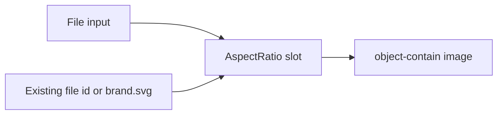

# In-place image previews

Image uploads live only in admin. Spreadsheet import on the question-bank form stays a file picker with no preview. The student client has no image upload, so this stays in `admin/`.

## Component

Add [`admin/src/components/ui/aspect-ratio.tsx`](admin/src/components/ui/aspect-ratio.tsx) with `npx shadcn@latest add aspect-ratio` from `admin/`. Match the other primitives: import `AspectRatio` from `radix-ui` (already depends on `@radix-ui/react-aspect-ratio`), set `data-slot="aspect-ratio"`, and do not add a second UI kit. `radix-ui` is already in [`admin/package.json`](admin/package.json).

Record the mapping in [`docs/design/DESIGN.md`](docs/design/DESIGN.md) section 4: image previews use `AspectRatio`.

The frame reserves space so the preview does not jump the layout. Images use `object-contain` on a `bg-muted` fill so the full file is visible. Alt text stays on the image. The Choose / Change / Upload button stays the existing outline `Button` at the shared 44px height.

## Where the image renders

- [`admin/src/components/catalog-image-field.tsx`](admin/src/components/catalog-image-field.tsx) — contest and sponsor forms. Replace the 56px crop with a 1:1 `AspectRatio` (`w-24 shrink-0`). Empty, current `fileId` (`AuthImage`), and the new object URL all use that same slot. Keep the filename, hint, and Choose / Change button.
- [`admin/src/components/question-image-field.tsx`](admin/src/components/question-image-field.tsx) — question and option images in the activity wizard and bank question dialog. When a URL or uploaded file is present, render it in a 16:9 `AspectRatio` (`w-full max-w-md`) directly under the upload button. `QuestionImagePreview` uses the same frame, including the read-only question summary. Give those images a text alternative (`Question image` / `Answer image`) instead of `alt=""`.
- [`admin/src/pages/settings-general.tsx`](admin/src/pages/settings-general.tsx) — logo and favicon. Today the file name changes and both previews stay `/brand.svg`. Store an object URL for the selected file, show it in the existing 1:1 slot, revoke it on replace, reset, and unmount, and fall back to `/brand.svg`. Do not add an upload API; the page already says selection updates the preview only.

[`admin/src/components/auth-image.tsx`](admin/src/components/auth-image.tsx) keeps its `size-10` default for the contest and sponsor list cells. Callers that pass `size-full object-contain` fill the aspect frame; `cn` already lets that class win.

Skip the bank import input in [`admin/src/pages/bank-form.tsx`](admin/src/pages/bank-form.tsx). It accepts CSV and Excel, not images.

## Checks

From `admin/`: `npm run typecheck`, `npm run lint`, `npm run format:check`. Then `graphify update .`.

In the running admin app, choose an image on a contest or sponsor form, a question and an option image, and Settings → Brand assets. Confirm the picture appears in that control, Reset on settings restores the brand mark, and the bank Import button still imports a spreadsheet. Check about 375px and a desktop width, in light and dark.