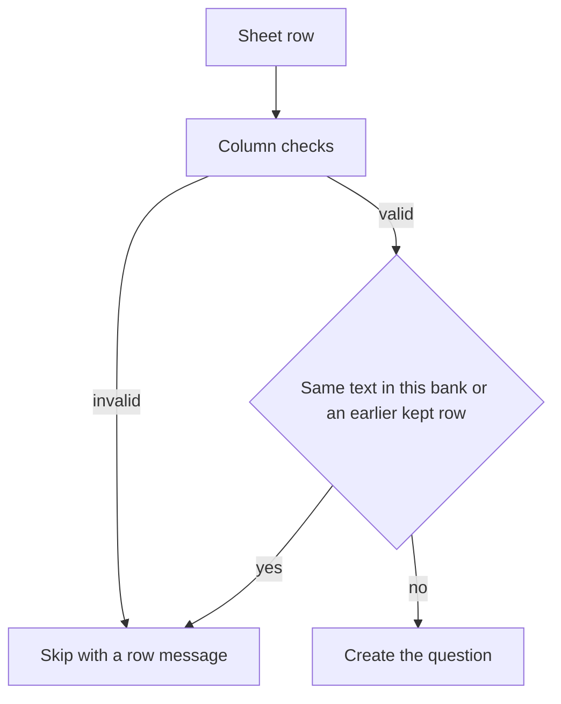

# Skip duplicate import rows

Uploading the same spreadsheet again will keep the first copy and skip the rest. Other valid rows in the file still import. Each skipped row uses the existing [`formatImportIssue`](api/src/lib/spreadsheet-import.ts) line: sheet row, column, cell value, why it is a duplicate, and what to change.

Users have no spreadsheet import. Creating a user already rejects a duplicate email. That stays as it is.

## What counts as the same question

Match inside the destination bank only. For an assessment round import, that bank is the round’s local bank, so the same text in two different rounds is still imported.

- Compare question text after trim, collapsed internal spaces, and lowercasing. `What  is 2+2?` matches `what is 2+2?`.
- Type, options, points, correct answer, and passage are ignored. A later row with the same text and different options is skipped.
- A quiz row with no question text matches on the question image link (`stemImageUrl`), trimmed and lowercased.
- Inactive questions already in the bank still count.
- The first row in the file is kept. Later rows with that text are skipped. A row that fails validation does not block a later row with the same text.

## Question messages

Examples the importer will return:

- Already saved: `Sheet row 12, column “Question”: “What is 2+2?” — this question text is already in this question bank. What to enter: delete this row. Changing the options does not make it a new question. Change the question text only when it is a different question.`
- Earlier in the file: `Sheet row 12, column “Question”: “What is 2+2?” — the same question text is already on sheet row 4. What to enter: delete this row, or change the question text if it is a different question. Row 4 is the one that will be imported.`
- Assessment round already saved: same sentence, with `already in round “Round 1”` instead of `already in this question bank`. Add that the same text is allowed in a different round.
- Image-only quiz row: column `Question image link`, the URL as the value, and say this image is already the question (no text) in this bank or on an earlier sheet row.

## Quiz and assessment banks

Both use [`importFromRows`](api/src/modules/banks/service.ts) in [`api/src/modules/banks/service.ts`](api/src/modules/banks/service.ts).

- Add a pure helper in [`api/src/modules/banks/import-export.ts`](api/src/modules/banks/import-export.ts): content key, and the issue text above.
- Before creating rows, load that bank’s questions (`question` plus the latest version `answerKey` for the image link) and seed a seen-set.
- In the existing per-row loop, skip a duplicate before `createQuestion`. Add the key to the seen-set only after that row is saved.
- Keep returning `{ created, issues }`. The import dialog already lists `issues`.
- Update the sample workbook instruction that says import only adds questions, so it says matching question text is skipped.
- In [`admin/src/components/import-result.ts`](admin/src/components/import-result.ts), change the partial-import tip. It currently tells the user to re-import only the failed rows so successful ones are not added again. After this change, uploading the same file again skips those rows.

## Assessment round import

[`confirmAssessmentImport`](api/src/modules/activities/assessment-import.ts) always creates a new code today. Preview currently does not look at saved questions.

- Pass `organizationId` and the activity id from [`previewAssessmentQuestions`](api/src/modules/activities/controller.ts) into preview.
- After the current row validation, load each named round’s local bank (round name match stays case-insensitive, as [`ensureRoundLocalBank`](api/src/modules/activities/assessment-import.ts) already does).
- Duplicate rows become preview issues and are left out of `validCount`. The dialog already renders those messages and disables Import when nothing is left to add.
- Confirm runs the same check again while saving, so a second upload cannot append copies if the preview was stale.
- When some rows are new, confirm still imports those and returns the skipped rows in `issues`.
- Update the success toast in [`admin/src/pages/assessment-import-dialog.tsx`](admin/src/pages/assessment-import-dialog.tsx). It currently says to import only the fixed rows next time so questions are not added again. Say the skipped rows are listed above, and uploading the file again will not add the duplicates.

## Participants

[`importParticipantsFile`](api/src/modules/participants/service.ts) already skips a repeated email, Unique ID, or phone inside one file. It does not check email or phone against people already in the organization, because those columns are not unique in the database. A second upload with blank Unique IDs creates more people.

- At the start of the import, load existing `name`, `email`, `code`, and `phone` for the organization.
- Skip a row when Unique ID, email, or phone matches someone already saved. Check Unique ID, then email, then phone, and report the first match.
- Name the person and the other identifier in the message, for example: `Sheet row 8, column “Email”: “asha@college.edu” — this email is already used by Asha Verma (Unique ID BP-00012). What to enter: delete this row, or use a different email.`
- Do not add a database unique constraint. Existing duplicate people stay, and the one-by-one create form is unchanged. This only stops the spreadsheet from adding another copy.
- Update sample instruction 4 so email and phone must also be unique in the organization, not only Unique ID.
- The admin participants page does not call this import today. The API and sample workbook still get the check.

## Tests

Extend [`api/test/bank-import-export.test.ts`](api/test/bank-import-export.test.ts) and [`api/test/spreadsheet-import.test.ts`](api/test/spreadsheet-import.test.ts) for the pure helpers, with no database:

- Same text differs only by case or extra spaces: skip, and the message names the earlier sheet row or the bank.
- Same text with different options: still skip.
- Same text in two assessment rounds: both kept.
- Image-only quiz rows match on the image link.
- A participant row whose email or phone is already in the loaded org list is skipped, and the message names that person.
