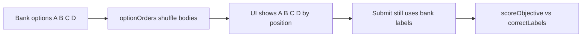

# Linear option letters when shuffle is on

## Problem

Quiz `shuffleOptions` already works on the API: [`buildShuffleOrders`](api/src/modules/attempts/service.ts) stores a per-question option-id order, and [`presentQuestions`](api/src/modules/attempts/service.ts) reorders options for the attempt.

Each option still carries its **bank** `label` (`A`/`B`/`C`…). The attempt UI renders that label:

```90:90:client/src/components/attempt-question-block.tsx
                  <span className="option-letter">{op.label}</span>
```

So after shuffle the student can see letters like `C, A, D, B`. Scoring is already by those bank labels via [`scoreObjective`](api/src/modules/attempts/scoring.ts) (`correctLabels` vs `{ label }` / `{ labels }`), so remapping letters for storage would break scoring unless the answer key is remapped too.

## Approach (display-only)

Render the letter from **visual index** (`A` at 0, `B` at 1, …). Keep selection/submit keyed to **`op.label`** (stable identity). No API, shuffle, or scoring changes.



When shuffle is off, bank order already matches `A,B,C…`, so display matches today.

## Changes

1. **[`client/src/components/attempt-question-block.tsx`](client/src/components/attempt-question-block.tsx)**  
   - In the options `map`, use `const letter = String.fromCharCode(65 + i)` (or a tiny helper) for `option-letter`.  
   - Leave `chosen` checks and `onAnswer({ label: op.label })` / `{ labels }` on `op.label`.  
   - Keep `key={op.id}`.

2. **Optional tiny helper** in [`client/src/lib/attempt-answers.ts`](client/src/lib/attempt-answers.ts) (e.g. `optionLetterAt(index)`) if that keeps the block cleaner; otherwise inline is fine.

3. **Out of scope**  
   - Results review ([`client/src/pages/results.tsx`](client/src/pages/results.tsx)) already shows bank-order options with bank letters matching stored answers — leave as is.  
   - No API / `presentQuestions` / scoring changes.

## Verify

- Quiz with shuffle options on: letters always A, B, C… top-to-bottom; bodies change between attempts.  
- Select each choice; saved answer still uses bank labels; score matches known correct option.  
- Multi-select and single-select both work.  
- Shuffle off: unchanged look and scoring.  
- Run client typecheck/lint for touched files.