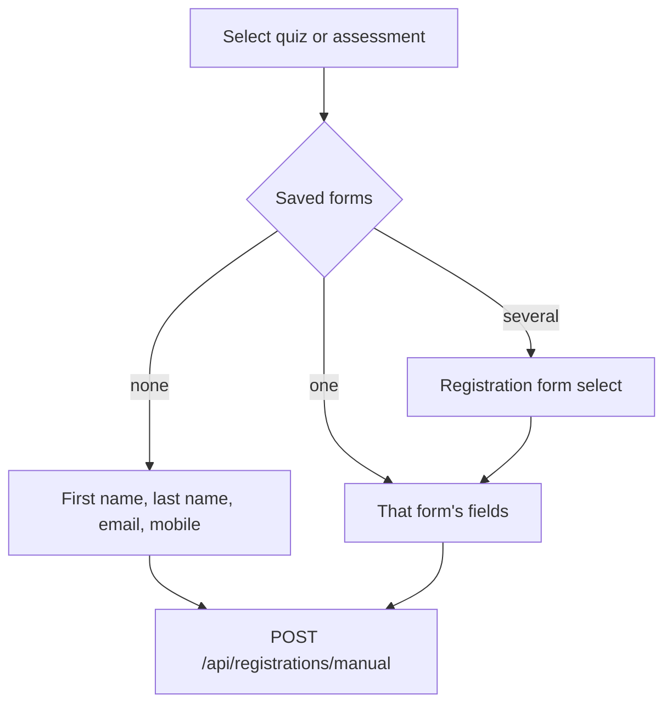

# Manual registration uses the custom form

The quiz or assessment select stays first in [admin/src/pages/add-registration-dialog.tsx](admin/src/pages/add-registration-dialog.tsx). What appears under it depends on saved registration forms whose quizzes include that activity (`status: 'saved'` only; drafts are ignored).

## Dialog

Load forms with the existing `getContestFormOverview()` (fields and `quizzes` are already on each form). Reset answers when the activity or the chosen form changes.

- **No form.** Replace the current full name, course, and city inputs with first name, last name, email, and mobile. First name, last name, and email are required. Mobile is required and must be a 10-digit number, matching the default registration form.
- **One form.** Show that form’s fields immediately. No extra picker.
- **Several forms.** A **Registration form** select (form name: contest name, or the form’s contest name). Fields render only after one is chosen.

Render fields with the same controls the form preview already uses. Move `PreviewField` out of [admin/src/components/contest-form-preview.tsx](admin/src/components/contest-form-preview.tsx) into a shared component so the dialog and the preview both use it (text, number, email, phone, textarea, dropdown, multi-select, consent). Label each field, mark required fields, and show the field error under the control.

Before save, run the existing `previewIssues` in [admin/src/lib/contest-form.ts](admin/src/lib/contest-form.ts). The server repeats the check with `validateAnswers` in [api/src/modules/contest-forms/rules.ts](api/src/modules/contest-forms/rules.ts). Closed window, seat limit, and email-domain restriction stay admin overrides: this dialog does not apply them.

## Save

Change `manualRegistrationSchema` in [api/src/modules/registrations/schema.ts](api/src/modules/registrations/schema.ts) and `createManual` in [api/src/modules/registrations/service.ts](api/src/modules/registrations/service.ts):

- `activityId` plus either basic identity (`firstName`, `lastName`, `email`, `phone`) or `formId` and `answers` (string, string array, or boolean, keyed by field id).
- **No `formId`.** Create a new `BP########` participant from those four fields and assign only the selected activity. No contest submission. Course and city stay empty.
- **With `formId`.** The form must be saved and must include `activityId`. Validate answers. Read first name, last name, email, and mobile from the fields whose keys are `first_name`, `last_name`, `email`, and `mobile`. Store the full answers on one `ContestFormSubmission` for that form only. Assign every activity on that form, which includes the one selected in the dialog. Do not write submissions for the other forms that also contain this activity.

Still always create a new Registration ID. Do not reuse a returning participant the way the public link does.

Update `createManualRegistration` in [admin/src/services/index.ts](admin/src/services/index.ts) to send the new body. The toast still shows the new Registration ID.

Edit registration stays the participant name, email, phone, course, and city form. Custom answers are not edited there.
