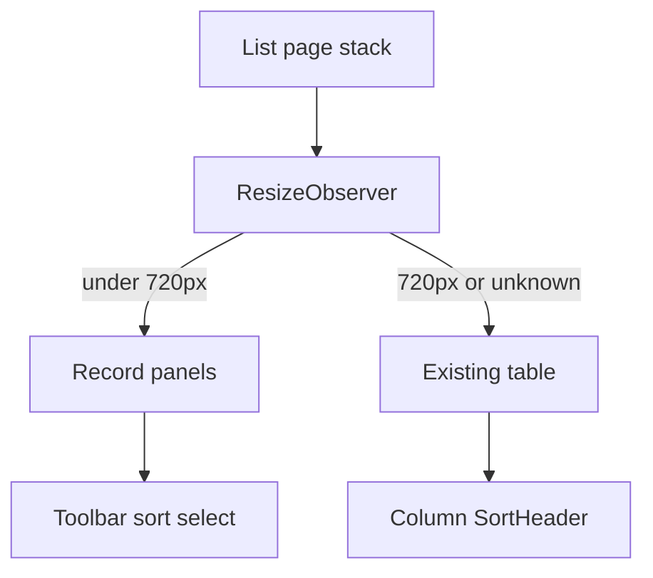

# Mobile record panels

Locked decisions from the research: stacked panels inside the current card (flat, 1px border, no new elevation), one layout mounted at a time, switch at **720px of the list container** (not the viewport), primary fields visible and the rest behind Details, sort moved into the toolbar only while panels are showing.

## Where it applies

- **Panels:** Students, Users, Registrations, Assessments, Quizzes, Question Banks, Contests, Sponsors, and Reports in [admin/src/pages](admin/src/pages). Reports is the only user of [admin/src/components/data-table.tsx](admin/src/components/data-table.tsx).
- **Compact rank rows** (same shell, no Details dump): admin quiz leaderboard in [admin/src/pages/quiz-leaderboard.tsx](admin/src/pages/quiz-leaderboard.tsx). Individual: rank, name, score; Unique ID and cohort on the second line. Group: cohort, then members / average / best.
- **Permission stack:** [admin/src/pages/settings-access.tsx](admin/src/pages/settings-access.tsx). Each permission names Super Admin and Admin. The matrix stays when the container is wide.
- **Student results:** [client/src/pages/results.tsx](client/src/pages/results.tsx) and the `.results-table` rules in [client/src/styles.css](client/src/styles.css). Below 640px the row stays one button, header hides, and type, date, and score show with real text labels. Remove the `min-width: 650px` scroll lock.
- **Leave as they are:** the question table in [admin/src/pages/bank-form.tsx](admin/src/pages/bank-form.tsx) (an editor), and the student leaderboard, which already stacks under 768px in [client/src/styles.css](client/src/styles.css). Library is already cards.

Field priority:

- Students: name, Unique ID, status, email, phone. Details: registration date, assigned activities, last login.
- Users: name, email, role, status. Details: assessment access, quiz access, last login.
- Registrations: student, Unique ID, attempt status, activity, assignment status. Details: email, phone, date, question bank.
- Assessments / Quizzes: name, status, registered, assigned, attempts. Details: question banks, start, end.
- Question banks: name, status, question count, last updated. Details: types or presentation, used in, description.
- Contests: thumbnail, name, sponsor. Sponsors: thumbnail, name.
- Reports: student, status, score, percentage, activity. Details: attempt, submitted. Action stays “View result”.

## Shared admin behavior

Add a container-width hook and one `ResponsiveRecords` component under [admin/src/components](admin/src/components). Pages keep their data, filters, selection state, and `RowActions`. They pass column placement (`title`, `identity`, `status`, `media`, `primary`, `details`) and the existing cell render.

- Measure the page stack (toolbar + card) with `ResizeObserver`. Under 720px, render a `ul` of panels. At 720px and above, render the current `Table`. Unmeasured width (jsdom) defaults to the table so [admin/src/pages/students.test.tsx](admin/src/pages/students.test.tsx) still finds one “Ada Lovelace”.
- Do not use `display:block` on table elements or `::before` labels. `hidden` is not enough if both trees stay mounted: checkboxes and “View” would duplicate for tests and assistive tech.
- Panel: checkbox (44px target), title, status pill, identity line, primary description list, a Details `Button` that toggles the rest, then existing View / Edit / Deactivate. Selected panel uses the same selected-row treatment as `data-state=selected`.
- “Select all on this page” sits above the stack with the current accessible name. Pagination, empty copy, and the card stay shared below the list.
- Sort: while panels show, a toolbar `Select` lists the same sortable columns and calls the page’s existing `toggleSort`. Choosing the active column toggles direction. Column `SortHeader`s remain on the table.
- Contests and sponsors keep their real thumbnail in the panel header.
- [admin/src/components/loading-skeletons.tsx](admin/src/components/loading-skeletons.tsx) `ListPageSkeleton` uses the same hook: stacked ghosts when narrow, the current header-and-rows ghost when wide.
- Update the Tables and Responsive paragraphs in [docs/design/DESIGN.md](docs/design/DESIGN.md) so narrow lists are panels and wide lists stay tables. Scroll remains the rule for the bank question editor.

## Slices

1. Hook, `ResponsiveRecords`, skeleton, design-doc wording, and Students end to end.
2. Users, Registrations, Assessments, Quizzes, Question Banks, Contests, Sponsors, and Reports on that component.
3. Admin leaderboard rank rows and the access permission stack.
4. Student results list: stacked labeled rows, no sideways scroll.

## Checks

After each slice, `npm run typecheck`, `npm run lint`, and `npm run format:check` in `admin/` (and `client/` for slice 4). In the browser, exercise Students (then the other lists) at about 375, 768, and 1280: search, sort, select one and select all, Details, View, empty filters, and pagination. Confirm the table is unchanged when the content column is wide, including a tablet width with the 16rem sidebar open. Reuse port 5173 if it is already listening.