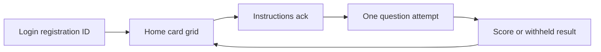

# Clone the participant HTML into `participant/`

The source file is a shell that injects five live screens: **login**, **home**, **instructions**, **quiz**, and **result**. `participant/` is a copy of [`client/`](client/) (Vite 8, React 19, React Router, TanStack Query, the same auth and attempt services). Replace the UI in `participant/` only. Do not edit [`client/`](client/).

The running mock is not the extra unused login CSS (OTP, split variants, keyboard themes). Clone the DOM the script actually renders.

## Keep the client architecture

Leave these in place and call them from the new screens:

- Providers and lazy routes in [`participant/src/App.tsx`](participant/src/App.tsx)
- [`participant/src/contexts/auth.tsx`](participant/src/contexts/auth.tsx) `signInWithCode`
- [`participant/src/services/api.ts`](participant/src/services/api.ts) and [`participant/src/services/types.ts`](participant/src/services/types.ts) (`durationMode`, `perQuestionSeconds`, `forwardOnly`, results release)
- Attempt save, revision, leave guard, and submit logic already in [`participant/src/pages/attempt.tsx`](participant/src/pages/attempt.tsx)

Do not embed the HTML in an iframe, and do not ship the mock fixture (`Riya Sharma`, `BP-24112`, “any Registration ID signs you in”). Names, codes, activities, timers, and scores come from the API.

## Package split

`participant/vite.config.ts` still binds **5174**, the same port as `client/`. Move this app to **5175** (`strictPort`) and rename the package to `brainpulses-participant`.

Add root scripts `dev:participant`, `build:participant`, `typecheck:participant`, `lint:participant`, and `test:participant` in [`package.json`](package.json). Do not add `participant` to the default `dev` / `build` / `check` chains, so the existing client portal stays the one `npm run dev` starts.

## Screens

Shared chrome goes in a rewritten [`participant/src/layouts/participant-shell.tsx`](participant/src/layouts/participant-shell.tsx): collapsible left panel, Quizzes and Assessments counts, participant name and code, log out, light/dark (`body.dk2`), mobile overlay at 860px. The HTML nav only paints Quizzes; Assessments uses that same item pattern because the client already has both kinds and the mock copy already switches “quiz” / “assessment”.

- **Login** — [`participant/src/pages/login.tsx`](participant/src/pages/login.tsx). Split layout: “Where sharp minds compete.”, Registration ID, Sign in, theme control, keyboard / medal / star art. One field calls `signInWithCode`. API errors render in the mock’s error line. Phone OTP is not on this screen.
- **Home** — [`participant/src/pages/library.tsx`](participant/src/pages/library.tsx) becomes the landing grid (`/`, `/dashboard`, `/quizzes`, `/assessments`). Welcome line, pulse stroke, “All quizzes/assessments”, poster cards, status dot, close/open, duration, attempts, CTA: Start, Continue, View result, or disabled Opens date. Activity images use the existing image helper; missing art gets a poster fallback.
- **Instructions** — [`participant/src/pages/activity-detail.tsx`](participant/src/pages/activity-detail.tsx). Facts row, overall vs per-question bullets, acknowledgement checkbox, Start/Resume disabled until checked, then the existing start/resume routes.
- **Attempt** — restyle [`participant/src/pages/attempt.tsx`](participant/src/pages/attempt.tsx) to the quiz bar: brand, segment dots, timer, exit, one card, single/multi choice, mark for review, previous/next, submit and leave dialogs, image lightbox. Keep current persistence, proctoring, and `per_question` / `forwardOnly` behavior.
- **Result** — [`participant/src/pages/results.tsx`](participant/src/pages/results.tsx) detail view only: banner, score ring or withheld “results later” state, try again when attempts remain, back to the list. No separate results index in the nav; `/results` redirects home.

Profile and Help are not in the HTML. Remove them from the participant router and nav. Leave their API methods unused.

## Styles and assets

Replace [`participant/src/styles.css`](participant/src/styles.css) with the mock’s live CSS (tokens `--ink`, `--vio`, `--paper`, `--clay`, and the classes `.side`, `.card`, `.qbar`, `.rcard`, `.wrap`). Split login rules into a login stylesheet imported by the login page. Load Sora through a font package in `participant/` instead of the base64 face in the HTML. Put the logo and decorative SVGs in `participant/src/components/` as React nodes. Keep the Tailwind Vite plugin so the toolchain matches `client/`; the cloned screens use the mock classes, not a new palette in `index.css`.

## Checks

Update [`participant/src/pages/login.test.tsx`](participant/src/pages/login.test.tsx) for the registration-id form. Run `typecheck`, `lint`, and `format:check` in `participant/`. Verify in the browser on port 5175: sign-in error, home cards, instructions gate, attempt navigation, and the result screen, at desktop and about 375px. Do not start or stop anything already on 5173 or 5174.