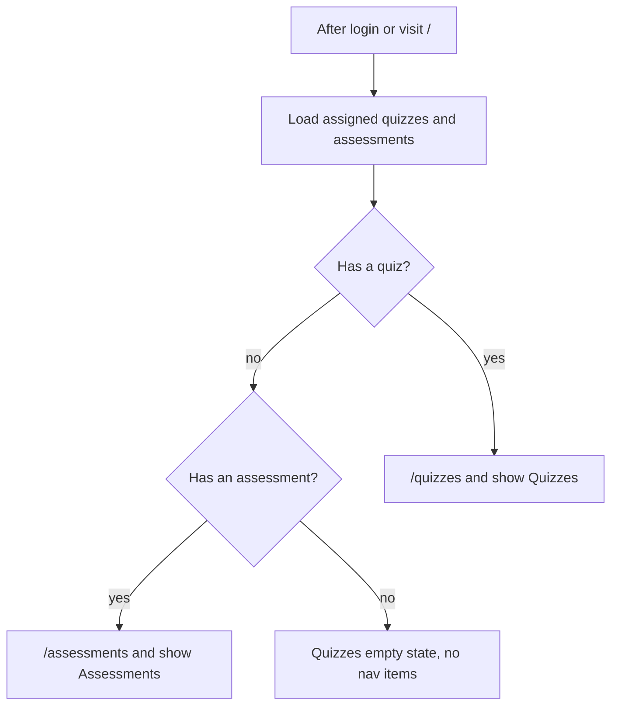

# Open the participant portal by allotment

The admin **Participant portal** screen ([admin/src/pages/settings-participant-portal.tsx](admin/src/pages/settings-participant-portal.tsx)) stores org-wide switches (`participantPageQuizzes`, `participantPageAssessments`, and the other page flags). The API then returns 403 for a turned-off page, and the participant app sends everyone to `/dashboard` (the quiz library) after login. Navigation already hides an empty list after it loads, but the other link still appears while loading, and a direct URL still opens the empty library.

Assigned work is a registration with `status: 'assigned'` on an active or completed quiz or assessment ([api/src/modules/participant-portal/service.ts](api/src/modules/participant-portal/service.ts)). That list is the source of truth.

When both are assigned, show **Quizzes** and **Assessments**, and land on `/quizzes`.

## Admin

Remove the settings screen and its entry points:

- Delete [admin/src/pages/settings-participant-portal.tsx](admin/src/pages/settings-participant-portal.tsx)
- Drop the route, lazy import, and `/settings/student-portal` redirect in [admin/src/routes/app-routes.tsx](admin/src/routes/app-routes.tsx). Point that old path at `/settings`.
- Remove the nav item from [admin/src/layouts/admin-layout.tsx](admin/src/layouts/admin-layout.tsx) and [admin/src/components/module-nav.tsx](admin/src/components/module-nav.tsx)
- Remove the meta entry in [admin/src/routes/meta.ts](admin/src/routes/meta.ts)

Phone login lives on that same screen. The participant login form is already Registration ID only. Leave the API setting and its default (`participantPhoneLogin: true`) in place so existing sign-in behavior does not change; there will just be no admin switch.

## API

Stop reading those page flags for access:

- In [api/src/lib/participant-pages.ts](api/src/lib/participant-pages.ts), `getParticipantPages` returns every page enabled. `assertParticipantPageEnabled` / `assertActivityPageEnabled` no longer throw.
- In `listMyActivities`, return both kinds. Do not 403 when a stored `participantPageQuizzes` or `participantPageAssessments` value is false.
- Leave the keys in settings defaults so old rows do not break; the admin UI will no longer write them.
- Replace the “turns a participant page off” case in [api/test/participant-portal.test.ts](api/test/participant-portal.test.ts) so a stored `participantPageQuizzes: false` still allows the quiz list and attempt start.

## Participant app

Replace org page flags with allotment for landing and visibility. Keep results, profile, and help available (the portal stays fully open aside from the unused quiz or assessment section).

- Add a small hook that loads `listActivities('quiz')` and `listActivities('assessment')` (React Query already caches these for the shell).
- Landing path: any assigned quiz → `/quizzes`; otherwise any assigned assessment → `/assessments`; otherwise `/quizzes` with the existing empty copy and no section links.
- [participant/src/pages/login.tsx](participant/src/pages/login.tsx) and [participant/src/contexts/require-auth.tsx](participant/src/contexts/require-auth.tsx): default post-login target is `/`, not `/dashboard`. Honor `from` only when that path’s kind is assigned (a quiz-only participant sent to `/assessments/...` goes to `/quizzes` instead).
- [participant/src/layouts/participant-page-guard.tsx](participant/src/layouts/participant-page-guard.tsx): wait until both lists resolve, then redirect `/`, `/dashboard`, and a hidden kind (`/quizzes` or `/assessments`, including detail routes) to the landing path. Show the loader while counts are unknown so the wrong section does not flash.
- [participant/src/layouts/participant-shell.tsx](participant/src/layouts/participant-shell.tsx): render **Quizzes** only when the quiz list has items, **Assessments** only when the assessment list has items. Brand home uses the same landing path.
- Drop the org-page checks in library, results, activity detail, and attempt that hide results or bounce on “page turned off”.

Seed data assigns every NextGen participant (including `BP-24101`) to **Launch Quiz** only, so quiz-only is the seeded login. Assessment-only and both need an assigned assessment registration in the running admin data.
