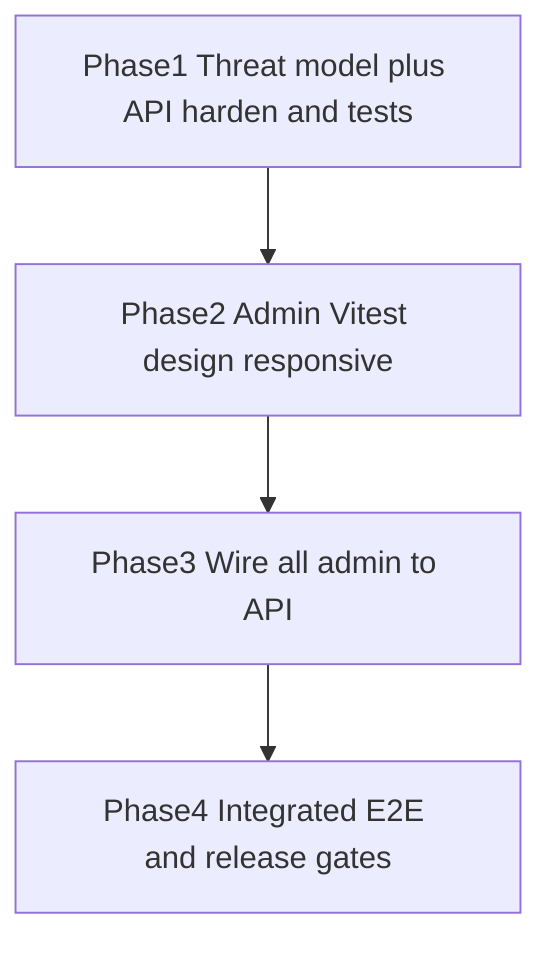

# Production readiness: security, testing, and full admin wiring

**Locked choices:** **1-B** — harden/test first, then wire **all** admin pages so the app actually works. **2-B** — written threat model + remediations (no exploit PoCs).

## Current baseline

- Admin is 100% fixtures: sync getters in [`admin/src/services/index.ts`](admin/src/services/index.ts) / [`fixtures.ts`](admin/src/services/fixtures.ts). No `fetch`, no `VITE_*`, no Vitest, no vite proxy.
- No login route; [`admin/src/App.tsx`](admin/src/App.tsx) has Theme/Tooltip/Router only; only `localStorage` use is theme.
- API (port **3002**) already has auth, modules, Prisma 7 + adapter, refresh rotation + family revoke on reuse, Helmet/CORS/rate limits, and a small `api/test/` suite.
- Confirmed security gaps (from [Explore api security gaps](1233e383-81a3-4b6a-a00e-fc88a9c3399f)): `requireAccess` unused on routes (only activities via `assertActivityAccess`); JWT no `algorithms`/`iss`/`aud` and `JWT_SECRET` floor is 16 chars; `COOKIE_SECURE` optional/default false with no prod refine; file MIME client-claimed and PUT body size not re-checked vs initiate; any org member can mint download tokens for any org file; activity list/detail does not filter `view`/`none`; OpenAPI incomplete vs ~45 live routes; rate limit falls back to in-memory when Redis not ready; tests miss banks/users/files/settings/flood/headers.

## Phase 1 — Threat model + API hardening

Grounded in OWASP API Top 10 2023 and Multi-Tenant Security Cheat Sheet. No exploit payloads—defensive remediations and automated abuse-case tests only.

### Threat model doc

Add [`docs/engineering/THREAT_MODEL.md`](docs/engineering/THREAT_MODEL.md): assets, trust boundaries, tryhackme-style attack checklist mapped to each `/api/*` family, expected control, and the test that proves it. Link from [`docs/engineering/SECURITY_PRIVACY.md`](docs/engineering/SECURITY_PRIVACY.md).

Deferred (document only, not this pass): MFA/TOTP, Postgres RLS, S3, email, student portal UI, full Prisma 8 rewrite.

### Hardening (implement then prove)

1. **JWT (API2)** — [`api/src/lib/jwt.ts`](api/src/lib/jwt.ts): pin `algorithms: ['HS256']`, require `iss`/`aud` from env, reject wrong `typ` / `alg:none`. In [`api/src/config/env.ts`](api/src/config/env.ts): when `NODE_ENV=production`, require `JWT_SECRET` length ≥ 32 and `COOKIE_SECURE=true`.
2. **Function-level auth (API5)** — Mount `requireAccess` on mutations for **banks, students, registrations, results, settings, files, users** (view vs edit vs full). Keep activities’ `assertActivityAccess` as defense in depth. Also filter activity **list/detail** and dashboard for `none`/`view` as appropriate.
3. **Object-level / IDOR (API1)** — Expand beyond the one student cross-tenant case: activities, banks, results, files → 404 uniform. Scope file **download-token** minting (uploader or role with edit/full—not every org member for every file).
4. **Mass assignment (API3)** — `.strict()` Zod on create/update bodies; strip unknown keys.
5. **Files (API8)** — MIME + extension allowlist on initiate; re-check **byte length on PUT** against declared `sizeBytes` (reject oversize); magic-byte / Content-Type on finalize; reject dangerous extensions; prefer header-based download token over query string where practical (document residual Referer risk if query kept).
6. **Auth abuse / rate limits** — Keep auth limiter on `/api/auth`; identical failure messages; `Retry-After` on 429. In production, fail ready/boot if Redis is required for distributed rate limits (document in threat model; avoid silent in-memory multi-instance).
7. **Cookies** — Prod gate for `COOKIE_SECURE`; keep refresh `httpOnly`, path `/api/auth`, SameSite from env.
8. **Refresh** — Remove or implement `detectRefreshReuse`; keep rotate-path family revoke (already tested).
9. **Errors** — Production never returns stack traces—add assertion test.
10. **OpenAPI inventory (API9)** — Sync [`api/openapi.yaml`](api/openapi.yaml) with live routes (users PATCH/deactivate, activities archive, banks CRUD/import, registrations unassign/export, files PUT/download-token, etc.).
11. **Dependencies** — `npm audit` in `api/` and `admin/`; fix high/critical or document accepted risk.

### New API tests

Extend `api/test/`: view-role mutation matrix (banks/students/registrations/results/settings/users/files), IDOR matrix including download-token scope, JWT wrong `aud`/`typ`, strict body rejection, auth flood 429 (test env override), MIME reject, PUT oversize reject, no stack traces. Existing coverage to keep: refresh reuse, viewer blocked on activity create/publish, answer-key omission, stale revision.

## Phase 2 — Admin Vitest, design consistency, responsive

1. **Harness** — Vitest + RTL + jsdom + user-event in `admin/`; scripts `test` / `test:watch`. Query by role/label/text only—no `data-testid`.
2. **Tests** — Dashboard KPI labels, Students “Showing…”, ModuleNav active, StatusPill tones, Toolbar Clear Filters; empty/error once wired.
3. **Design audit** — Fix real violations only (raw hex, non-`--control-h` controls, Create in Toolbar, decorative avatars in name columns, KPI tints). Follow [`docs/design/DESIGN.md`](docs/design/DESIGN.md) and `admin-ui-consistency`.
4. **Responsive** — Reuse existing 5173; snapshots at **375, 428, 768, 1280, 1536**; fix overflow / stacked filters / tap targets.

## Phase 3 — Wire all admin to the live API

Goal: working app end-to-end ([DESIGN.md](docs/design/DESIGN.md) rule 10). Default path is live API; fixtures only behind `VITE_USE_FIXTURES=true`.

### Auth and HTTP

1. [`admin/.env.example`](admin/.env.example): `VITE_API_URL=http://127.0.0.1:3002`, `VITE_USE_FIXTURES=false`.
2. [`admin/src/lib/api-client.ts`](admin/src/lib/api-client.ts): `credentials: 'include'`, Bearer access token, 401 → `POST /api/auth/refresh` then retry once; map `{ error }` to `ApiError`.
3. Login page + route `/login`; org-select when sign-in requires `select-organization` (seed admin is in `demo` + `other`).
4. `AuthProvider`: access token **in memory** (not localStorage); protect `AdminLayout` routes; sign-out clears state + calls API.
5. Seed login for smoke: `admin@brainpulses.com` / `Password123!` (org `demo`).

### Service layer → API pairing

Replace sync getters in [`admin/src/services/index.ts`](admin/src/services/index.ts) with async API calls + thin mappers so existing page chrome/types stay. Filter option arrays (`studentCities`, `presentationTypes`, etc.) stay static until the API exposes facets.

| Admin surface | Read | Write (wire existing UI actions) |
|---|---|---|
| `/dashboard` | `GET /api/dashboard/summary` | — |
| `/students` | `GET /api/students` | create / patch / deactivate |
| `/users` | `GET /api/users` | invite / patch / deactivate |
| `/assessments`, `/quizzes` | `GET /api/activities?kind=` | publish / archive / patch |
| `*/banks` | `GET /api/banks?kind=` | create / patch / questions / import |
| `*/new` ([`create-activity.tsx`](admin/src/pages/create-activity.tsx)) | banks for picker | `POST /api/activities` (stop preventDefault-only) |
| `*/registrations` | `GET /api/registrations?kind=` | assign / unassign / export |
| `*/reports` | `GET /api/results?kind=` | publish / regrade |
| `/settings` ([`settings-general.tsx`](admin/src/pages/settings-general.tsx)) | `GET /api/settings/general` | `PATCH` + logos via `/api/files/*` |
| `/settings/access` | settings access + users | `PATCH` access / users |
| `/settings/notifications` | `GET …/notifications` | `PATCH` (stop local-only Save) |
| `/settings/system` | system settings + `GET /api/audit` | `PATCH` system |
| Header bell ([`notifications-menu.tsx`](admin/src/components/notifications-menu.tsx)) | No notifications API | Keep local UI; optionally mirror dashboard activity feed if present—do not invent a notifications backend |

### Mutations UX

Toast / success UI only after successful API response. Preserve list chrome (PageHeaderActions, ModuleNav, Toolbar, Card table). Do not restyle pages while wiring.

Student attempt UI is out of scope; student API stays HTTP-tested only.

## Phase 4 — Integrated gates

1. Root scripts: `check:api`, `check:admin`, `test:api`, `test:admin`, umbrella `check`.
2. Smoke: `db:up` → migrate/seed → `dev:api` + existing `dev:admin` → login → students/activities from DB → create/settings Save persist.
3. Update SECURITY_PRIVACY release gates with threat model + test commands.
4. Review wiring/security diffs against review skills before done.
5. `graphify update .` after code changes.

## Explicit non-goals

- Full Prisma 8 `orm-postgres` rewrite
- MFA, S3, email, student portal UI, dedicated notifications API
- Offensive exploit development or third-party lab attacks
- New admin visual language

## Done means

- Threat model doc + OWASP-mapped API security tests green
- Admin Vitest green; responsive checklist recorded; design violations fixed
- Login works against seed; **all** listed pages load and mutate real data (header bell local-only as above)
- `typecheck` / `lint` / tests pass in both packages; `npm audit` high/critical addressed or accepted in writing
