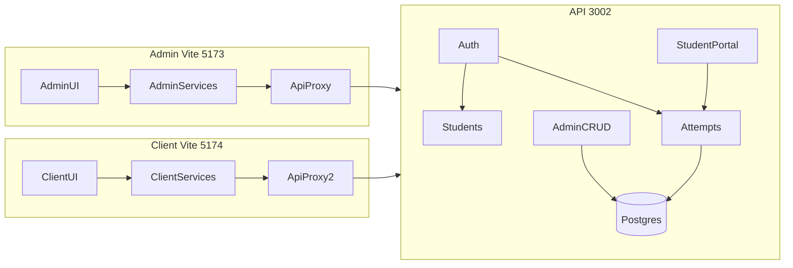

# Production readiness: handoff → live admin + client + API

## Current reality (not a greenfield UI port)

| Surface | Handoff (`BrainPulses v2.0 - Production Readiness QA Handoff/`) | Main repo today |
|---|---|---|
| Admin | Full routes + mock `record-page.tsx` create/view/edit | Same list pages already exist; **auth + list GETs** already hit API via [`admin/src/services/index.ts`](admin/src/services/index.ts) when `VITE_USE_FIXTURES=false` |
| Client | Monolithic [`client/src/App.tsx`](BrainPulses%20v2.0%20-%20Production%20Readiness%20QA%20Handoff/client/src/App.tsx) + custom CSS; browser-local attempts | **No `client/`** |
| API | None (explicitly mock-only) | Express + Prisma + OpenAPI on **:3002**; attempts lifecycle exists; **no student catalog/results APIs** |

**Defaults for this plan (confirm if you want otherwise):**
- Handover target = **local production-like stack** (Docker Postgres/Redis + API + Admin + Client + preview builds + runbook). Cloud deploy is a later optional phase.
- First ship = **thin vertical E2E** (admin sees data → student attempts → result visible), then expand full admin CRUD.
- Client keeps the handoff **visual language** (copy `styles.css` / layout), then refactor into modules + React Router; do **not** rebuild on admin shadcn in the first passes.
- Treat the handoff folder as **read-only source**; copy into `admin/` / `client/`, do not leave the monorepo depending on that path. Prefer excluding it from git once ported (it is not currently ignored).

## Confirmed from exploration

- Handoff is **frontend-only QA** (fixtures + localStorage); production blocked by its `docs/PRODUCTION_GATES.md`.
- Handoff **admin has no login**; main admin already has real JWT auth — **keep main’s login**, do not regress to open routes.
- Handoff **client does not gate routes** after demo login; production port must require student auth on all non-login routes.
- Main admin already live-reads most lists; still always-fixture: `getPermissions`, `getMonths`. Create/Bulk Upload buttons are largely unwired.
- Handoff Phase 2 route shape to implement with **live** forms (not toast `RecordPage`): `/:entity/new`, `/:id`, `/:id/edit` for students, users, banks, registrations, activity detail/edit, report detail.
- Seed credentials for handover: `admin@brainpulses.com` / `Password123!`, `student1@mail.com` / `Student123!`.

## Gaps that block a real end-customer demo

1. **Student portal APIs missing** — attempts work (`POST /api/attempts/start|save|submit`, `GET .../resume`), but students cannot list assigned activities or their own results (`/api/results` is `requireUser` admin-only).
2. **Admin mutations incomplete** — Create/Edit buttons and handoff `RecordPage` are still local/toast; API already has create/patch for students, banks, activities, registrations, users.
3. **Seed is thin** — one assessment, one question, three students ([`api/prisma/seed.ts`](api/prisma/seed.ts)). Need a quiz + more questions for a believable client library.
4. **CORS / ports** — API `CORS_ORIGIN` is admin-only (`http://localhost:5173` in [`.env.dev.example`](api/.env.dev.example)); client needs **5174** (or equivalent) allowlisted.
5. **Docs drift** — [`docs/architecture/API_STRUCTURE.md`](docs/architecture/API_STRUCTURE.md) still says fixtures-only; update after contracts land.

---

## Phase 0 — Foundation (shippable local “staging”)

**Goal:** Anyone can boot a working stack and sign in; fixtures off by default.

- Ensure Docker + migrate + seed: `npm run db:up` → `db:migrate` → `db:seed`.
- Confirm admin `.env` / `.env.example`: `VITE_USE_FIXTURES=false`, proxy to `127.0.0.1:3002`.
- Expand seed: ≥1 quiz + ≥1 assessment, ≥5 questions each, registrations for demo students, published/active activities.
- Smoke: `npm run check:api`, admin login (`admin@brainpulses.com` / `Password123!`), lists load from API.
- Root scripts: add `dev:client` once client exists; document three-terminal (or concurrently) run.

**Exit:** Admin login + Students/Activities/Banks lists show seeded DB rows. API health/ready green.

---

## Phase 1 — Thin E2E slice (first “production” iteration)

**Goal:** One complete customer journey works without fixture lies.

### 1A — Student portal API

Add a small **student-scoped** module (names final in OpenAPI), e.g.:

- `GET /api/student/me` — profile from JWT
- `GET /api/student/activities` — registrations joined to activities (kind, status, duration, question count, attempt state)
- `GET /api/student/results` + `GET /api/student/results/:id` — **own** results only; answer-key / explanations only after submit + release policy (match attempt scoring already in [`api/src/modules/attempts`](api/src/modules/attempts))
- Reuse existing attempt routes; no answer keys in `start`/`resume` payloads (already options-only)

Tests in [`api/test/`](api/test/) for tenancy (student A cannot see B) and catalog shape.

### 1B — Client: copy then refactor

1. Copy handoff `client/` → repo `client/` (package, `App.tsx`, `styles.css`, `storage.ts`, public assets).
2. Immediately refactor (do not ship the monolith as-is):
   - React Router routes matching handoff paths (`/login`, `/dashboard`, `/quizzes`, `/assessments`, `/attempt/:id`, `/results`, `/results/:id`, `/profile`, `/help`)
   - Extract page components from handoff functions
   - `lib/api-client.ts` + auth context (bearer student token; mirror admin patterns in [`admin/src/lib/api-client.ts`](admin/src/lib/api-client.ts))
   - Vite proxy `/api` → 3002; port **5174**; update API CORS
3. Wire:
   - Login → `POST /api/auth/student/sign-in`
   - Libraries → student activities
   - Start → `POST /api/attempts/start` (map `questionVersionId` options; drop client-side scoring/answer keys)
   - Autosave → `POST .../save` with revision
   - Timer → server `deadlineAt` (not only local countdown)
   - Submit → `POST .../submit` + Idempotency-Key
   - Results → student results APIs
4. Remove demo banner / “any password” once live auth works; keep storage fallback only for theme, not attempts.

### 1C — Admin visibility of that slice

- Ensure create/publish activity + assign registration work for the demo path (minimal UI: wire existing create-activity + registrations assign to API if not already).
- Reports list shows submitted attempt for the student.

**Exit:** Seeded student completes a real attempt; score appears in client and admin reports. `npm run typecheck` / lint / API tests pass for touched code.

---

## Phase 2 — Admin CRUD (replace handoff RecordPage with live forms)

**Goal:** List actions that look real **are** real. Copy handoff route shape from handoff [`admin/src/routes/index.tsx`](BrainPulses%20v2.0%20-%20Production%20Readiness%20QA%20Handoff/admin/src/routes/index.tsx), but implement against API—not toast prototypes.

Order (matches [`docs/engineering/IMPLEMENTATION_PLAN.md`](docs/engineering/IMPLEMENTATION_PLAN.md) Phase 4):

1. **Students** — create / edit / deactivate → `/api/students`; replace dead header buttons; optional CSV later.
2. **Users** — invite / patch access / deactivate → `/api/users`.
3. **Question banks** — create bank, add/edit questions, CSV import → `/api/banks*`.
4. **Activities** — detail/edit/archive/publish; keep shared `kind: assessment | quiz` pages.
5. **Registrations** — assign/unassign/export → existing registration routes.
6. **Reports** — result detail/publish/regrade; drop fixture-only filter crutches where API supports filters.
7. **Settings** — finish copy that still says “local prototype”; permissions matrix can stay static if API has no RBAC editor.

Follow existing admin chrome ([`docs/design/DESIGN.md`](docs/design/DESIGN.md), ModuleNav, Toolbar, StatusPill). Prefer dedicated forms over the generic handoff `RecordPage`; use handoff only for field/UX ideas.

**Exit:** Admin can provision a new student, bank, activity, assignment without seed edits; student can take it.

---

## Phase 3 — Harden attempt UX + integrity

- Resume open attempt after refresh (session token + `GET .../resume`).
- Auto-submit on deadline (server already has `autoSubmitIfExpired`; client shows server time remaining).
- Practice vs timed: if product distinguishes modes, map to activity presentation/duration; otherwise document that practice feedback is post-submit only until a dedicated practice mode exists server-side.
- Idempotent double-submit; conflict handling for revision mismatches.
- Expand API/client tests for the happy path + one failure path each.

**Exit:** Timed attempt survives refresh; double-submit safe; no answer key before submit.

---

## Phase 4 — Production-like handover package

Deliverables (not a showpiece):

1. **`docs/handoff/LOCAL_PRODUCTION.md`** (or similar): boot order, ports (5173 / 5174 / 3002 / 5434 / 6381), credentials from seed, CORS notes, how to reset DB, known limitations vs [`PRODUCTION_GATES.md`](BrainPulses%20v2.0%20-%20Production%20Readiness%20QA%20Handoff/docs/PRODUCTION_GATES.md).
2. **Customer test script** adapted from handoff [`TESTING.md`](BrainPulses%20v2.0%20-%20Production%20Readiness%20QA%20Handoff/TESTING.md) but rewritten for **live** persistence (no “local-only toast” caveats for wired flows).
3. Verify gates: `npm run check` (api + admin), client `typecheck` + `build`, `npm run preview` for both SPAs against running API.
4. Optional stretch: docker-compose service definitions that run API + static `dist` behind nginx—only after local preview path is solid.
5. Update OpenAPI + root `package.json` scripts; run `graphify update .` after code changes.

**Exit:** You can follow the runbook cold and complete admin + student journeys as an end user.

---

## What we will explicitly not do in early phases

- Cloud hosting / real IdP / MFA / full privacy program (document as remaining gates).
- Blind overwrite of main admin pages with handoff mocks (main admin is already ahead on API reads).
- Shipping client with client-side scoring as “production.”
- Adding a parallel UI kit on admin (shadcn stays).

## Key files to leverage

- Admin services/auth: [`admin/src/services/index.ts`](admin/src/services/index.ts), [`admin/src/lib/api-client.ts`](admin/src/lib/api-client.ts), [`admin/src/contexts/auth.tsx`](admin/src/contexts/auth.tsx)
- API modules: [`api/src/modules/attempts`](api/src/modules/attempts), [`api/src/modules/auth`](api/src/modules/auth), [`api/openapi.yaml`](api/openapi.yaml)
- Handoff client source: [`BrainPulses v2.0 - Production Readiness QA Handoff/client/src/App.tsx`](BrainPulses%20v2.0%20-%20Production%20Readiness%20QA%20Handoff/client/src/App.tsx)
- Handoff admin routes/record UX: handoff `admin/src/routes/index.tsx`, `record-page.tsx`
