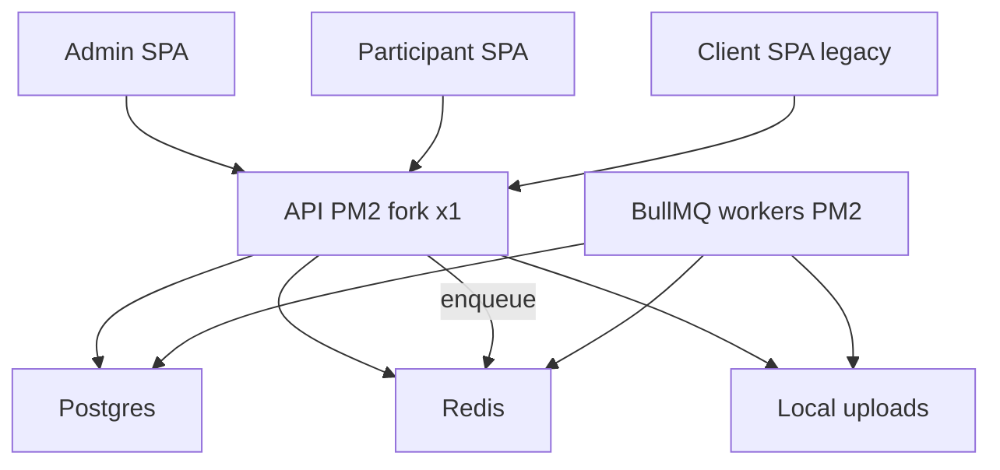

# Production Hardening Mission (1A + 2B)

## Locked decisions

- **Queue/LB:** Introduce **BullMQ on existing Redis** with dedicated PM2 worker process(es). Keep **`brainpulses-api` at `instances: 1` / fork**. Document the path to multi-instance API; **do not enable cluster** until shared upload storage is approved.
- **Frontends:** Harden **both** [`participant/`](participant/) (production SPA) and legacy [`client/`](client/). Preserve each design system separately from admin. Do **not** merge or retire `client/` in this run.
- **Contracts:** Preserve existing `{ data }` / `{ error }` envelopes. Add job APIs as **additive** endpoints; no breaking handshake rewrite.
- **Execution after plan approval:** Continuous phases without mid-run approval for routine work. **Stop and ask** before: live VPS deploy, destructive DB ops, shared/NFS/S3 upload migration, secrets/credential changes, paid services.

## Current baseline (verified)

| Area | State |
|---|---|
| SoT | Admin/client/participant talk HTTP only; Prisma/Redis only in `api/` |
| Timeouts | Client `REQUEST_TIMEOUT_MS=30000`; API middleware + `server.requestTimeout` |
| Env | API [`load-env.ts`](api/src/config/load-env.ts): prod `.env.prod`→`.env`, else `.env.dev`→`.env` |
| Deploy | [`setup.sh`](setup.sh), [`update-deploy.sh`](update-deploy.sh), nginx, Compose PG/Redis, [`api/ecosystem.config.cjs`](api/ecosystem.config.cjs) single fork |
| Queue | **None** — Excel export/import and SMS OTP stay on request path |
| CI | **No root** `.github/workflows` (docs claim otherwise) |
| Gaps | Admin fixtures / always-fixture `getMonths`; participants table not on `ResponsiveRecords`; docs drift |

Reuse existing excellence artifacts under [`docs/engineering/`](docs/engineering/) (BASELINE_AUDIT, register, checklists). Add mission-named docs where missing; **update** stale docs instead of inventing a parallel tree.

## Phase map (continuous after approval)

### P0 — Fresh audit + gate evidence

- Refresh [`docs/REPOSITORY_AUDIT.md`](docs/REPOSITORY_AUDIT.md) from live tree (apps, stack, risks, decisions 1A/2B).
- Run without auto-fix: `api`/`admin`/`participant`/`client` typecheck, lint, format:check, tests, production builds. Record pass/fail in the audit.
- Port check only (reuse 3002/5173/5174/5175 if up; ask before starting servers).
- Skills as needed: project `accessibility` / `vite` for UI; skip inventing bash-only steps on PowerShell.

### P1 — Server as SoT + frontend hardening

- Admin: remove production SoT holes — hard-disable fixture bypass for live paths; wire `getMonths()` to API or document/remove if unused; keep fixtures only behind explicit non-prod flag if still needed for unit tests.
- Align [`admin/src/lib/api-client.ts`](admin/src/lib/api-client.ts), [`client/src/lib/api-client.ts`](client/src/lib/api-client.ts), and participant’s api-client: 30s timeout, timeout UX, mutation overlay, safe retry (no blind duplicate POSTs).
- Responsive: migrate [`admin/src/pages/participants.tsx`](admin/src/pages/participants.tsx) to existing `ResponsiveRecords` pattern; spot-check both SPAs at 375/768/1280 without redesign.
- Preserve admin shadcn tokens and participant/client CSS systems — no cross-app design merge.

### P2 — BullMQ queue (smallest useful surface)

**Library:** `bullmq` + reuse existing `ioredis` / `REDIS_URL` (Redis already required in production).

**First jobs only** (proven request-path heavies):

1. Quiz/assessment **report export** ([`quiz-reports`](api/src/modules/quiz-reports/), [`assessment-reports`](api/src/modules/assessment-reports/))
2. Spreadsheet **imports** that buffer Excel on the HTTP thread (banks/participants/activities import paths)
3. **SMS OTP** delivery (replace fire-and-forget `void sendSmsOtp` with queued job; keep auth response unchanged)

**API shape (additive):**

- `POST …/export` (or import) validates auth + payload, enqueues job, returns **202** with `{ data: { jobId, status: 'queued' } }` (or existing list envelope style — match local module conventions).
- `GET /api/jobs/:jobId` (authz: same org/actor) → `{ data: { status, result?, error? } }` for polling.
- Admin/participant/client: after 202, poll with **per-request 30s timeout**; show processing state; never treat accept as complete.

**Worker:**

- Entry e.g. `api/src/worker.ts` → `dist/worker.js`
- Concurrency limits, attempts + exponential backoff, job timeout, failed-job retention, idempotency keys where retries are safe
- Graceful SIGTERM drain
- Backpressure: BullMQ max queue / rate limits; return clear **503/429** when overloaded — never silent drop

**Do not** queue every CRUD; keep attempts/scoring synchronous unless measured otherwise.

### P3 — Reliability without multi-instance API

- Keep nginx → single `127.0.0.1:3002`; LB docs describe future `upstream` + shared storage prerequisites.
- Extend [`api/ecosystem.config.cjs`](api/ecosystem.config.cjs) with `brainpulses-worker` (fork, memory limits, same `env_production`).
- Correlation: keep `x-request-id`; attach to job metadata.
- Upload layout: document/normalize under existing `UPLOAD_DIR` (pending/placed trees already exist); tighten validation only; **no** provider migration.
- Env examples: ensure `.env.example` / `.env.prod.example` list queue concurrency knobs with placeholders only; extend load-env only if missing required names — keep prod/dev file isolation.

### P4 — Dependencies, security, tests

- `npm audit` per package (`api`/`admin`/`participant`/`client`); patch compatible versions; no blind majors; document residual vulns.
- Tests stay outside app source where practical: extend `api/test/` for enqueue, worker handler (mocked Redis or test Redis), overload, idempotency, job status authz; frontend vitest for timeout + critical login/flows on **both** client and participant.
- Do **not** weaken tests to pass.

### P5 — CI / PM2 / docs (no live deploy)

- Add root [`.github/workflows/check.yml`](.github/workflows/check.yml) (push/PR): typecheck/lint/test/build with ephemeral services as feasible — **no deploy**.
- Add **manual-only** [`.github/workflows/deploy.yml`](.github/workflows/deploy.yml) (`workflow_dispatch` only) that documents/parameters apps + environment; uses secrets; **does not** auto-run on push. Prefer invoking existing `update-deploy.sh` patterns; never hardcode credentials. Do not actually deploy.
- Docs sync (update + create as needed):
  - [`docs/REPOSITORY_AUDIT.md`](docs/REPOSITORY_AUDIT.md)
  - [`docs/QUEUE_SYSTEM.md`](docs/QUEUE_SYSTEM.md), [`docs/PM2_CONFIGURATION.md`](docs/PM2_CONFIGURATION.md), [`docs/LOAD_BALANCING.md`](docs/LOAD_BALANCING.md) (single-instance now; cluster blocked on shared uploads)
  - Update [`docs/ops/DEPLOY.md`](docs/ops/DEPLOY.md), root [`DEPLOY.md`](DEPLOY.md), [`docs/engineering/PROGRESS.md`](docs/engineering/PROGRESS.md), DEPENDENCY_MAP, LOCAL_PRODUCTION (`participant` vs `client`), README(s)
  - [`docs/FINAL_ENGINEERING_REPORT.md`](docs/FINAL_ENGINEERING_REPORT.md) with evidence-only pass/fail/skipped

### P6 — Verification

- Re-run typecheck/lint/format/tests/builds for all four packages.
- E2E against running local stack **only if ports already up or user approves start**: auth, list flows, one queued export accept→poll→complete, timeout message, invalid upload, mobile nav smoke.
- `graphify update .` after code changes.
- Final report distinguishes verified vs blocked (no VPS, no shared FS, no prod credentials).

## Explicit non-goals this run

- Live production deploy / certbot / nginx cutover
- PM2 cluster / multiple API listeners
- Object-storage or NFS upload migration
- Merging admin ↔ participant design systems
- Retiring `client/`
- Destructive DB reset or migration squash
- Breaking API response schema rewrite

## Stop-and-ask triggers

Shared upload storage for multi-instance API; any production deploy; `migrate reset` / volume wipe; Twilio or other credential changes; paid infra.