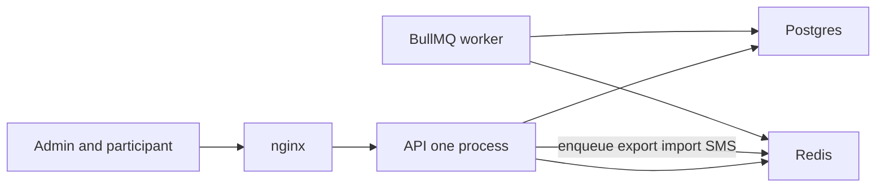

# Production stability hardening

BrainPulses already has Express 5, Postgres, Redis, a single PM2 API fork, a BullMQ worker, request timeouts, and admin polling for queued jobs ([admin/src/lib/jobs.ts](admin/src/lib/jobs.ts)). The production failures that remain are concrete. This plan fixes those causes. It does not add Redis/Kafka, does not run a second API process (uploads are on local disk; see [docs/LOAD_BALANCING.md](docs/LOAD_BALANCING.md)), and does not turn ordinary HTTP into a global queue.

## What is actually unsafe

- [api/src/lib/prisma.ts](api/src/lib/prisma.ts) creates a `pg` `Pool` with `max: 20` and no `error` listener. An idle connection drop emits `error` and can kill Node. The worker imports the same pool, so API plus worker can open 40 connections on a shared 8 GB VPS.
- [api/src/worker.ts](api/src/worker.ts) listens for `failed` only. A BullMQ `error` (Redis blip) is unhandled and can exit the worker. There is no `unhandledRejection` / `uncaughtException` logging on API or worker.
- [api/src/app.ts](api/src/app.ts) `lazyRouter` remembers a rejected `import()`. One transient failure 500s that route until PM2 restarts.
- [api/src/index.ts](api/src/index.ts) force-exits shutdown after 1 second, inside a 10 second PM2 `kill_timeout`, so a reload can cut in-flight quiz writes.
- Global API rate limit is 120 requests per minute per IP, applied before auth ([api/src/app.ts](api/src/app.ts)). Participant autosave debounces at 400ms ([participant/src/pages/attempt.tsx](participant/src/pages/attempt.tsx)), about 150 saves per minute while answering. One student can be `429`d during an exam. A campus NAT shares one bucket across every student.
- Quiz export, assessment export, participant import, and bank import call `enqueueJob` with `forceInline: true` ([api/src/modules/quiz-reports/controller.ts](api/src/modules/quiz-reports/controller.ts), [api/src/modules/assessment-reports/controller.ts](api/src/modules/assessment-reports/controller.ts), [api/src/modules/banks/import-job.ts](api/src/modules/banks/import-job.ts)). That work runs on the API, holds a pool connection, and is cut by the 30s server timeout while the admin client waits up to 120s. The admin already accepts either an immediate file or `202` plus poll (`downloadQueuedExport`, `resolveImportResult`).
- SMS OTP uses the default 3 BullMQ attempts, so one send can be delivered more than once. Export files under `uploads/temporary/jobs` are never aged out. `inlineJobs` grows without a cap. `cacheGet` `JSON.parse`s Redis with no guard, so a bad cache value 500s the dashboard.
- PM2 logs under `api/logs/` have no rotation. Redis has no `maxmemory`. `/health/ready` checks Postgres and Redis only.

Indexes on attempts, registrations, and questions are already present in [api/prisma/schema.prisma](api/prisma/schema.prisma). No schema rewrite and no destructive migration.

## 1. Stop process crashes and stuck routes

In [api/src/lib/prisma.ts](api/src/lib/prisma.ts):

- `pool.on('error', ...)` logs and does not rethrow.
- Pool size from `DATABASE_POOL_MAX` (default 8). PM2 API keeps 8; worker sets 4 in [api/ecosystem.config.cjs](api/ecosystem.config.cjs).
- On each new connection, `SET statement_timeout` and `idle_in_transaction_session_timeout` just under `REQUEST_TIMEOUT_MS` so a slow query releases the connection instead of pinning it until the socket dies.

In [api/src/app.ts](api/src/app.ts), clear `lazyRouter`'s pending promise when `load()` rejects so the next request retries.

In [api/src/index.ts](api/src/index.ts) and [api/src/worker.ts](api/src/worker.ts):

- Log `unhandledRejection`. On `uncaughtException`, log and run the existing graceful shutdown so PM2 restarts a clean process. Do not swallow and continue after an uncaught exception.
- Production shutdown drain is 8 seconds (under PM2 `kill_timeout` 10s). Development stays short so nodemon can reload.
- Worker handles `error` and `stalled`, and keeps Redis reconnect behavior. Do not exit the worker on a single failed job.

In [api/src/lib/cache.ts](api/src/lib/cache.ts), treat Redis or JSON failures as a cache miss.

In [api/src/middleware/request-timeout.ts](api/src/middleware/request-timeout.ts), send `504` with `requestId` when the handler is still open, and do not write a second response after that. Leave query cancellation to `statement_timeout` rather than destroying the socket out from under Prisma.

## 2. Keep quiz traffic and cheap API calls responsive

Rate limiting stays on, but stops treating an exam as abuse:

- Auth sign-in stays at `AUTH_RATE_LIMIT_MAX` (20/min).
- Authenticated calls are bucketed by a hash of the bearer token (each participant, even behind one NAT). Default 240/min, above the 400ms autosave rate, still finite. Env: `RATE_LIMIT_MAX_ACTOR`.
- Calls with no token stay per IP at a higher ceiling (`RATE_LIMIT_MAX_IP`, default 600/min) so a registration burst is not capped at 120. Both remain env-configurable. `429` body and `Retry-After` stay as they are today.
- Do not add a global HTTP queue. Do not `503` attempt saves to “protect” the server.

`/health` stays a cheap liveness check. `/health/ready` adds Redis, a `SELECT 1`, pool `total` / `idle` / `waiting`, and event-loop lag. It returns `503` only when Postgres or Redis is actually unusable.

Add one completion log line per API request: method, path template, status, duration, `requestId`. No bodies, tokens, or passwords.

## 3. Run expensive work on the worker that already exists

Remove `forceInline: true` from quiz export, assessment export, participant import, and bank-question import. `enqueueJob` already returns quickly, rejects with `503` and a clear message when the queue depth hits `QUEUE_MAX_WAITING` (200), and persists the job in Redis if the worker is down. The job is not dropped.

Admin behavior stays the same from the user’s point of view: [admin/src/lib/jobs.ts](admin/src/lib/jobs.ts) already polls and then downloads or applies the import result. Adjustments:

- Poll budget covers `QUEUE_JOB_TIMEOUT_MS` (120s) plus a short margin, so the UI does not say “still processing” while the worker is still inside its lock.
- Blocking overlay still turns off in `finally` (already true in both API clients).
- SMS jobs enqueue with `attempts: 1` so a Twilio timeout cannot send the same OTP three times. Imports and exports keep the configured retry with exponential backoff. Retries stay idempotent via the existing import `jobId` / attempt `submitIdempotencyKey`.
- Cap the in-memory inline job map (tests and `QUEUE_INLINE` only) and sweep `uploads/temporary/jobs` files older than 24 hours from the worker. Do not delete an export file on the first download; the age sweep bounds disk.
- Add `dev:worker` and include it in the root `dev` script so local imports match production. Do not start that process during this work unless you ask.

`QUEUE_INLINE` remains the test and explicit-dev fallback. Production `.env.prod.example` already has `QUEUE_INLINE=false`.

## 4. VPS budget, without restarting production data services

Code and PM2 only. Do not recreate the Postgres or Redis containers from this change (that would blip production). Document these as the next planned ops step in the final report:

- Redis `--maxmemory 256mb --maxmemory-policy noeviction` so sessions and jobs are not evicted, and Redis cannot grow without bound. `noeviction` makes Redis return an error instead of deleting tokens.
- Postgres stays in its own container. Application pools of 8 and 4 are the cap this app will open.
- PM2 stays at one API fork and one worker, `max_memory_restart` 500M, existing restart backoff.
- Add an `api/logs` logrotate snippet (daily, size cap, compress, keep 7) and wire it from [setup.sh](setup.sh) for new machines. Call out that the live VPS needs that snippet installed once; this change will not SSH or reload production.

## 5. Prove the current features still work

Tests to add or extend:

- Pool `error` does not throw.
- Failed lazy route load succeeds on the next request.
- Actor rate-limit key is not the raw IP when a bearer token is present.
- Queue at capacity throws `503` `SERVICE_UNAVAILABLE`.
- SMS enqueue options use one attempt.
- Export/import controllers enqueue without `forceInline` and `respondExportOrAck` still streams a finished file or returns `202`.

Then run, and report real results:

- `npm run test`, `npm run typecheck`, and `npm run lint` in `api/`, `admin/`, and `participant/`.
- A small local concurrency script against a local API only (health, ready, and the rate-limit helper). No traffic to `server.brainpulses.com`.
- If admin (`5173`), participant (`5174`), and API (`3002`) are already listening, reuse them and walk one admin export/import ack and one participant save error/timeout path. If they are not up, do not start them; say what was not browser-checked.

After code edits, run `graphify update .` so the graph matches the repo.

## Acceptance

- A Postgres idle disconnect or a Redis worker error does not kill the process uncleanly.
- A participant saving on the 400ms debounce is not rate-limited, including behind a shared NAT.
- A large export or import returns immediately to the API and finishes on the worker, and the admin UI still delivers the file or the real import counts.
- Failed, timed-out, and full-queue operations return the existing error shape and clear loading state.
- Existing attempt submit idempotency, auth, and list behavior stay as they are.
- The report lists every file changed, tests actually run, capacity measured locally, and the Redis/logrotate steps that still need a planned VPS apply.
