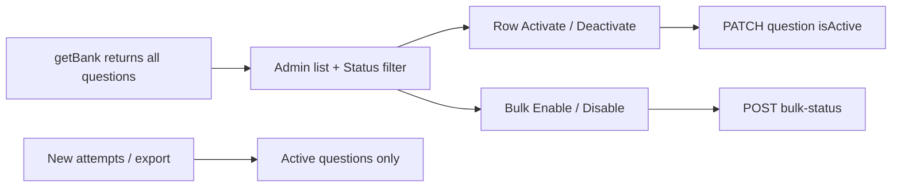

# View and bulk-toggle bank questions

## Problem

Deactivate sets `isActive: false`, but [`getBank`](api/src/modules/banks/service.ts) only loads `where: { isActive: true }`, so inactive questions vanish. There is no Activate action and no bulk status control. Row UI only has Deactivate ([`row-actions.tsx`](admin/src/components/row-actions.tsx)).

## Approach

Keep soft-deactivate. Return **all** questions from the bank detail API. In admin, show status, filter, activate/deactivate per row, and bulk Enable/Disable (same idea as students). Export and new attempts stay **active-only**.

## API

1. **[`api/src/modules/banks/service.ts`](api/src/modules/banks/service.ts)** — In `getBank`, drop `where: { isActive: true }` on the questions include so inactive rows are returned with `isActive`. Leave export / attempt selection filters that already use `isActive: true`.

2. **Bulk status** — `POST /api/banks/:id/questions/bulk-status` with body `{ ids: uuid[], isActive: boolean }`. Update matching questions in that bank/org in one transaction; audit once or per id using the existing pattern. Scope: edit access on the bank kind.

3. Wire route + controller + thin admin client `setBankQuestionsActive(bankId, ids, isActive)`.

## Admin UI (quiz + assessment)

Update both [`admin/src/pages/quiz-questions-panel.tsx`](admin/src/pages/quiz-questions-panel.tsx) and [`admin/src/pages/bank-form.tsx`](admin/src/pages/bank-form.tsx):

- **Status column** — `StatusPill` Active / Inactive from `item.isActive`.
- **Filter** — Toolbar (or inline select) Status: All | Active | Inactive. Default **All** so deactivated questions stay visible without hunting.
- **Row actions** — Active → Deactivate; Inactive → Activate (`updateBankQuestion(..., { isActive: true/false })` with the existing confirm copy).
- **Bulk** — Checkbox column + select-all on the filtered list; toolbar actions Enable / Disable for the selection (only ids that need the change). Confirm like students (“Enable N questions?” / “Disable N questions?”). Call the bulk endpoint; toast; reload.
- Empty copy when the filter yields no rows (e.g. no inactive).

Extend [`RowActions`](admin/src/components/row-actions.tsx) with an optional `activate` action (or a single status action with label) so Activate is first-class next to Deactivate.

Ensure `BankQuestionItem.isActive` is always set from the API map (already on the type).

## Out of scope

- Password confirm on activate/deactivate (deactivate has none today).
- Changing export to include inactive.
- Hard delete.