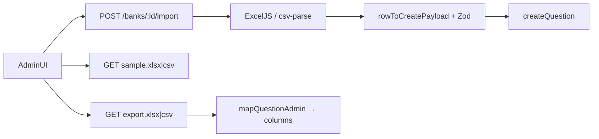

# Question bank CSV/Excel import and export

## Decisions (confirmed)

- **UI:** Sample / Import / Export on the bank edit questions toolbar; list **Bulk Upload** opens a bank picker and navigates into that flow.
- **Types:** All authorable types from [`admin/src/pages/bank-question-types.ts`](admin/src/pages/bank-question-types.ts) (not legacy `passage` / `match`).
- **Stack:** Match LevelUP + DISHA — **server-side** parse/generate with **ExcelJS** + multipart upload; admin only picks files and downloads blobs (no client xlsx).

## Current gaps

- API: [`importQuestions`](api/src/modules/banks/service.ts) is CSV-only (`{ csv: string }`), MCQ-letter oriented, sets empty `answerKey` (breaks numeric / comprehension / text), no sample or export.
- Admin: disabled Bulk Upload on [`question-banks.tsx`](admin/src/pages/question-banks.tsx); no I/O on [`bank-form.tsx`](admin/src/pages/bank-form.tsx).
- Deps: `csv-parse` / `csv-stringify` exist; **no** `exceljs` or `multer`.

## Sheet schema (sample = import = export)

One header row, shared by `.xlsx` and `.csv`:

| Column | Use |
|--------|-----|
| `type` | Authorable type value |
| `question` | Stem (`stem` alias on import) |
| `points` | Default `1` |
| `optionA`…`optionF` | Choice bodies (up to 6; empty skipped) |
| `correct` | Letters `A`–`F`, comma/`+` separated (DISHA-style) for choice types |
| `numericValue`, `numericTolerance` | `numeric` |
| `referenceAnswer` | Optional for `short_text` / `long_text` → `answerKey.value` |
| `stemImageUrl` | Optional stem image → `answerKey.stemImageUrl` |
| `optionA_imageUrl`…`optionF_imageUrl` | Required for filled options when `image_selection` |
| `passageText` | Required for `comprehension_mcq` |

**Per-type rules** (mirror [`createQuestionSchema`](api/src/modules/banks/schema.ts) / [`validateDraft`](admin/src/pages/bank-question-draft.ts)):

- `single_mcq` / `image_mcq` / `comprehension_mcq`: ≥2 options, exactly one correct letter; comprehension needs `passageText`.
- `multiple_mcq` / `image_selection`: ≥2 options, ≥1 correct; image_selection needs image URLs on filled options.
- `true_false`: if options blank, default True/False as A/B; exactly one correct.
- `numeric`: `numericValue` required; no options.
- `short_text` / `long_text`: options empty; `referenceAnswer` optional.
- Unknown / blank `type` → reject row (do not silently coerce to `single_mcq`).

Round-trip: export writes the same columns so re-import recreates equivalent questions (new codes).

## API

**Deps (in `api/`):** `exceljs`, `multer` (memory, ~10 MB, `.csv`/`.xlsx`/`.xls`).

**New module** [`api/src/modules/banks/import-export.ts`](api/src/modules/banks/import-export.ts) (keep [`service.ts`](api/src/modules/banks/service.ts) thinner):

- `parseBankQuestionsFile(buffer, filename)` → rows (ExcelJS: prefer sheet `Questions`, else first with `type`+`question`; CSV via ExcelJS csv or existing `csv-parse`).
- `rowToCreatePayload(row)` → `createQuestionSchema` input (`options` + proper `answerKey`).
- `importQuestionsFromRows(...)` — per-row try/`createQuestion`; collect `{ created, issues: [{ row, message }] }` (partial success, DISHA quiz / LevelUP style). Validate each row with Zod before create.
- `buildSampleWorkbook()` / `buildExportWorkbook(questions)` — Instructions + Questions sheets (LevelUP-inspired); CSV via `csv-stringify` + [`sanitizeCsvCell`](api/src/lib/csv.ts).

**Routes** on [`banks/routes.ts`](api/src/modules/banks/routes.ts) (auth/`requireOrgAccess('edit')` same as today):

| Method | Path | Behavior |
|--------|------|----------|
| `GET` | `/:id/questions/sample.xlsx` | Template download |
| `GET` | `/:id/questions/sample.csv` | Same columns |
| `GET` | `/:id/questions/export.xlsx` | Current bank questions |
| `GET` | `/:id/questions/export.csv` | Same |
| `POST` | `/:id/import` | Multipart field `file`; keep JSON `{ csv }` as fallback for the old client |

Wire controller + OpenAPI entries. Reuse audit `bank.import` / add `bank.export`.

## Admin UI

**Bank edit** ([`bank-form.tsx`](admin/src/pages/bank-form.tsx)) — questions card header (edit + can edit only):

- Outline: **Sample Excel**, **Import**, **Export** (Export disabled when empty; toast pointing to Sample).
- Keep **Add question**.
- Hidden file input `.csv,.xlsx,.xls`; size check; FormData upload.
- Result **Dialog**: success / warning / error, created count + numbered issues (DISHA/LevelUP UX), then `reloadBank()`.
- Support `?import=1` (or location state) to auto-open the file picker after list Bulk Upload navigation.

**List** ([`question-banks.tsx`](admin/src/pages/question-banks.tsx)):

- Enable **Bulk Upload**.
- Dialog: select an existing bank of the current `kind` (searchable list from already-loaded banks) → navigate to `…/banks/:id?import=1`.
- Secondary link: “Create bank first” → `/…/banks/new` (no silent create-on-import).

**Services / client** ([`admin/src/services/index.ts`](admin/src/services/index.ts), [`api-client.ts`](admin/src/lib/api-client.ts)):

- `importBankQuestions(bankId, file)`, `downloadBankQuestionsSample`, `exportBankQuestions`.
- Blob download helper; FormData path must **not** force `Content-Type: application/json` (fix today sets JSON whenever `body` is set — fix for multipart).

Match existing admin chrome (Button, Dialog, PageHeaderActions patterns); no new visual language.

## Verification

- In `api/`: typecheck; manual/scripted import of sample covering each authorable type; export → re-import creates N new rows.
- In `admin/`: typecheck, lint, format:check for touched files.
- After code edits: `graphify update .`

## Out of scope

- Embedding binary images in the sheet (URLs only, same as references).
- List-page create-bank-from-file in one step.
- Changing student client or activity wizard.
