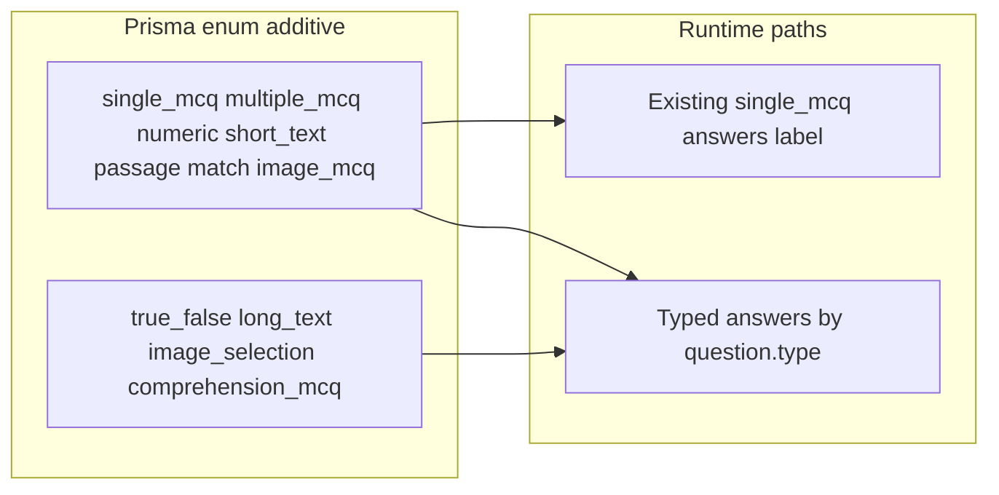

# Multi-type questions + add/edit dialog

## Goals

- Author and attempt **all LevelUP types**: `single_mcq`, `multiple_mcq`, `true_false`, `numerical` (BP keeps DB value `numeric`), `short_text`, `long_text`, `image_mcq`, `image_selection`, `comprehension_mcq`.
- **Do not break** existing `single_mcq` banks, saves, scoring, or attempt UX.
- Keep legacy BP enum values `passage` / `match` in the DB (no data migration of old rows); they stay API-loadable/scorable as today but are **not** in the new admin type picker.
- Replace bottom-of-page add/edit panel with a **Dialog** (responsive, BrainPulses DS).

## Compatibility strategy

- **Additive enum only** — never remove or rename `numeric` / `passage` / `match`.
- **Answer payloads stay backward compatible**: existing `{ label }` single-select continues to work; new types use `{ label }`, `{ labels }`, `{ value }`, or `{ text }` as appropriate (already partially supported in [`api/src/modules/attempts/scoring.ts`](api/src/modules/attempts/scoring.ts)).
- **Client state** upgrades from `Record<string, string>` to a typed answer map, with resume mapping that still reads old `{ label }` responses.
- **No OpenRouter / AI grader** in this pass (avoids new deps and runtime failures). `short_text` / `long_text` use **case-insensitive exact match** against `answerKey.value` when set; if no reference answer, score `null` and **exclude from maxScore** (fixes today’s percent deflation for unscored text).

## Data model / API

1. **Prisma** ([`api/prisma/schema.prisma`](api/prisma/schema.prisma))
   - Extend `QuestionType` with: `true_false`, `long_text`, `image_selection`, `comprehension_mcq`.
   - Add optional `imageUrl String?` on `QuestionOption` (for `image_selection`; null for others).
   - Migration SQL only adds enum values + nullable column (safe for existing rows).

2. **Zod** ([`api/src/modules/banks/schema.ts`](api/src/modules/banks/schema.ts), activities round schema)
   - Expand `questionTypeSchema`.
   - Option schema: optional `imageUrl`.
   - Light per-type validation on create/update (e.g. TF requires True/False; multiple ≥1 correct; numeric requires `answerKey.value`; comprehension requires `answerKey.passageText` + 2–4 options).

3. **Admin GET mapping** ([`mapQuestionAdmin`](api/src/modules/banks/service.ts))
   - Pass through `imageUrl` on options; expose `passageText` / `stemImageUrl` from `answerKey` as top-level admin fields (still never send raw full key to students).

4. **Attempt present DTO** ([`presentQuestions`](api/src/modules/attempts/service.ts))
   - Add safe student fields: `stemImageUrl?`, `passageText?`, `options[].imageUrl?` (from answerKey / option column — never `isCorrect` / correct labels).
   - Leave existing fields unchanged.

5. **Scoring** ([`scoring.ts`](api/src/modules/attempts/scoring.ts) + submit loop)
   - `true_false` / `image_mcq` / `comprehension_mcq` → same as single-label.
   - `image_selection` → same as `multiple_mcq` (set equality on labels/ids).
   - `numeric` unchanged; UI label “Numerical”.
   - `short_text` / `long_text` → exact match on `answerKey.value` (trim + lower); else `null`.
   - Submit: when score is `null`, **do not add points to maxScore** (behavior change only for unscored text — improves fairness; objective types unchanged).

## Admin UI

1. Add shadcn **`dialog`** to [`admin/src/components/ui/dialog.tsx`](admin/src/components/ui/dialog.tsx) (radix-nova, match existing Sheet tokens / `--control-h`).
2. Refactor bank question editor into a dialog-driven form:
   - [`admin/src/pages/bank-form.tsx`](admin/src/pages/bank-form.tsx) — open Dialog on Add / Edit / View; remove bottom inline panel.
   - Shared modules: extend [`bank-mcq.ts`](admin/src/pages/bank-mcq.ts) → `bank-question-draft.ts` + type-specific panels in `bank-question-form.tsx` (or sibling files for Fast Refresh).
   - Type `Select` at top of dialog; fields switch by type (mirror LevelUP [`question-types.ts`](references/LevelUP/levelup-admin/src/lib/question-types.ts) labels).
   - Mobile: full-width dialog / max height + scroll (`max-h-[90dvh] overflow-y-auto`), stacked option rows (same as current responsive option layout).
3. Image fields: **URL input** (optional), wired to existing file URLs when pasted; no new upload pipeline required for v1 (can paste `/api/files/.../content` later). Avoid blocking on upload UX.
4. `true_false`: fixed True/False options, one correct.
5. Table Type column uses human labels; search unchanged.

## Client attempt + results

1. [`client/src/pages/attempt.tsx`](client/src/pages/attempt.tsx) — branch on `q.type`:
   - single / TF / image_mcq / comprehension → radio-style option buttons (current UI).
   - multiple / image_selection → multi-select toggles (`{ labels }`).
   - numeric → number input (`{ value }`).
   - short / long text → textarea (`{ text }`).
   - comprehension → show `passageText` above stem (stacked on mobile).
   - image types → show `stemImageUrl` / option images with `max-w-full`, no overflow.
2. Persist/resume map all shapes; keep `{ label }` path for old attempts.
3. Copy/instructions per type (not always “Choose one…”).
4. Results review already somewhat label-aware ([`results.tsx`](client/src/pages/results.tsx) / `answerLabel`) — extend for `value` / `text` / multi labels; show passage/image when present on review DTO if easy (optional small portal present tweak).

## Out of scope (explicit, to protect stability)

- LevelUP OpenRouter subjective AI grading.
- New Passage table / multi-question shared passages (comprehension stores `passageText` on that question’s `answerKey`).
- Replacing or removing legacy `passage` / `match` rows.
- Bulk CSV columns for every new type (CSV keeps current behavior; unknown types still default safely).
- Activity-wizard round “Add question” full multi-type (reuse shared draft validators later; wizard stays single_mcq this pass unless trivial to share the dialog — prefer shared form component used by bank-form only first).

## Verification

- API: typecheck; targeted tests for scoring (single, multiple, TF, numeric, text, image_selection) + admin GET still omits `answerKey` raw key / includes `isCorrect` for admin.
- Admin: typecheck / lint / format on touched files; Dialog add + edit on long bank list (no bottom scroll trap).
- Client: typecheck; smoke each type render at ~375px width (manual or browser).
- Regression: create/resume/submit a classic `single_mcq` quiz unchanged.
