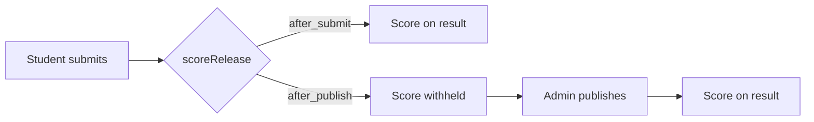

# Quiz behaviour changes

Assessments keep their Question Banks pages and round questions. Quizzes stop using a shared bank directory. Admin reattempt grants stay as an extra override on top of the new attempt cap.

## 1. Remove leaderboards

There is no leaderboard table. Rankings are computed in [`api/src/modules/leaderboards/`](api/src/modules/leaderboards/) from attempts, and the six flags live in `Activity.settings.quiz`.

Delete the API module, [`admin/src/pages/quiz-leaderboard.tsx`](admin/src/pages/quiz-leaderboard.tsx), [`client/src/pages/leaderboard.tsx`](client/src/pages/leaderboard.tsx), and [`client/src/components/podium-medals.tsx`](client/src/components/podium-medals.tsx). Unmount both routers in [`api/src/app.ts`](api/src/app.ts). Remove the admin nav item and route (`/quizzes/leaderboard`), the student route (`/quizzes/:activityId/leaderboard`), the Leaderboard button on [`client/src/pages/activity-detail.tsx`](client/src/pages/activity-detail.tsx), client `.leaderboard-*` CSS, and `leaderboardAvailable`.

Drop these JSON keys from [`api/src/lib/quiz-settings.ts`](api/src/lib/quiz-settings.ts), [`api/src/modules/activities/schema.ts`](api/src/modules/activities/schema.ts), the wizard switches in [`admin/src/pages/activity-wizard.tsx`](admin/src/pages/activity-wizard.tsx), seed, and fixtures:

- `dailyLeaderboardVisible`, `overallLeaderboardVisible`
- `dailyGroupLeaderboardVisible`, `overallGroupLeaderboardVisible`
- `countsForGroupLeaderboard`, `leaderboardReleasedAt`

Add a Prisma migration that strips those keys from `activities.settings`. Leave `Student.cohort` and disqualify / reattempt columns; other screens use them. Trim the leaderboard GETs out of [`api/test/quiz-ops.test.ts`](api/test/quiz-ops.test.ts) and keep the disqualify assertions. Update the Leaderboard step in [`docs/handoff/CUSTOMER_TEST.md`](docs/handoff/CUSTOMER_TEST.md).

## 2. MCQ and MSQ on quiz questions

`QuestionType` already has `single_mcq` and `multiple_mcq`. Scoring is all-or-nothing for multi-select. The quiz question dialog currently hides the type select and says “Single choice only” ([`admin/src/pages/bank-question-form.tsx`](admin/src/pages/bank-question-form.tsx)).

Show the type select for quiz questions: **MCQ (single option)** and **MSQ (multiple options)**. Single still clears other correct marks; multiple allows several. Excel import already accepts `multiple_mcq`.

On the student attempt, every MSQ shows one hardcoded note on the question label: **Select all that apply.** Use that sentence in [`client/src/lib/attempt-answers.ts`](client/src/lib/attempt-answers.ts) (`instructionForType` already returns a similar line under the stem in [`client/src/components/attempt-question-block.tsx`](client/src/components/attempt-question-block.tsx)). Do not write the note into the stored question text.

## 3. Question overview panel

Already implemented. Per-question timing forces presentation to “One question at a time”, turns `showQuestionPanel` off, and disables that switch ([`activity-wizard.tsx`](admin/src/pages/activity-wizard.tsx) around the duration-mode handler and the `quiz-showQuestionPanel` switch). Overall timing plus one-at-a-time still allows the panel. No behaviour change; confirm it while testing the wizard.

## 4. Number of attempts

Store `maxAttempts` on `settings.quiz`: integer `1–100`, or `null` for Unlimited. Default **1**, so existing quizzes stay one submission unless an admin grants a reattempt.

In [`api/src/modules/attempts/service.ts`](api/src/modules/attempts/service.ts) `startAttempt`:

- Resume an in-progress attempt as today.
- Count this student’s `submitted` and `auto_submitted` attempts (ignore `voided` and the open attempt).
- If that count is under `maxAttempts` (or the cap is Unlimited), start another attempt and mark the previous one `isAuthoritative: false`. Do not consume a grant.
- If the cap is reached, keep the current grant path (`continue` / `restart`).

Wizard control: number input plus an Unlimited switch that clears the number. Student quiz detail ([`client/src/pages/activity-detail.tsx`](client/src/pages/activity-detail.tsx)) shows used and available in the facts row, for example `Attempts: 1 of 3 used` or `Attempts: 2 used · Unlimited`. If an unused grant exists past the cap, add `· 1 extra attempt granted`. While attempts remain, the primary button is **Start again** instead of only **View results**. Show the same used/available line on the result screen. Assessments are unchanged.

## 5. Quiz questions live on the quiz

Remove quiz bank routes and nav only:

- [`admin/src/routes/app-routes.tsx`](admin/src/routes/app-routes.tsx) paths under `quizzes/banks`
- Quiz “Question Banks” items in [`admin/src/layouts/admin-layout.tsx`](admin/src/layouts/admin-layout.tsx) and [`admin/src/components/module-nav.tsx`](admin/src/components/module-nav.tsx)
- Quiz entries in [`admin/src/routes/meta.ts`](admin/src/routes/meta.ts)

Keep [`question-banks.tsx`](admin/src/pages/question-banks.tsx) and [`bank-form.tsx`](admin/src/pages/bank-form.tsx) for assessments. `listBanks` already filters `origin: 'reusable'`.

Add `quiz_local` to `BankOrigin`. On quiz create, create one private bank and attach it with `ActivityBank` (same idea as `ensureRoundLocalBank` in [`api/src/modules/activities/service.ts`](api/src/modules/activities/service.ts)). Quiz wizard step 2 replaces the bank checklist with a question list: add, edit, delete, and Excel/CSV import, reusing `BankQuestionDialog` and the existing import endpoint against that private bank. Adding a question on a new quiz saves the draft first (`persist({ stay: true })`), then writes the question.

Migration for quizzes that already point at reusable banks:

- One bank, used only by that quiz: set `origin` to `quiz_local`.
- Several banks, or a bank shared by more than one activity: copy questions into a new `quiz_local` bank and point the quiz at it. Leave the old rows in place so existing attempt versions still resolve. Those old quiz banks disappear from the UI because the quiz bank pages are gone.

## 6. Score release switch

Replace `scoreVisibleToStudent` with `scoreRelease: 'after_submit' | 'after_publish'`.

In the wizard, one switch with both labels visible: left / off = **After submit**, right / on = **After publish**. The answers switch stays “when published”.

Student score rule in attempts and [`api/src/modules/student-portal/service.ts`](api/src/modules/student-portal/service.ts):

- `after_submit`: send score, max, and percent as soon as the attempt is submitted, even if `releaseStatus` is `withheld`.
- `after_publish`: send them only after an admin publishes the result.
- Answer keys still require publish and `answersVisibleToStudent`.

Existing JSON: `scoreVisibleToStudent: true` becomes `after_publish`. Missing or `false` becomes `after_submit` (today’s off position). Quizzes that previously hid scores even after publish will show the score on submit. The migration rewrites the key and drops `scoreVisibleToStudent`.

## Checks

After the edits: `graphify update .`, then `npm run typecheck`, `npm run lint`, and `npm run format:check` in `admin/`, `client/`, and `api/`. Run the API quiz and attempt tests. In the browser, walk a quiz edit (MCQ, MSQ note, attempt cap, score switch, overview lock) and the student attempt/result screens on the existing dev servers. Do not restart those servers.