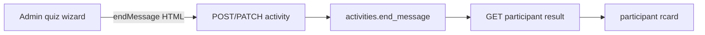

# Quiz End Message

## Defaults
- **Quiz only** in the admin UI (field sits next to Instructions on the quiz wizard). Column exists on `Activity` like `instructions`.
- **Empty field** keeps today’s static pass/fail / “Thanks for participating…” copy.
- **When set**, replace the whole `h1` + `p` block with one sanitized rich-text block (no separate heading).
- Same message for pass, fail, and score-withheld — one end message, shown whenever the result card loads.

## 1. Database + API
- Add `endMessage String? @map("end_message") @db.Text` on [`Activity`](api/prisma/schema.prisma) beside `instructions`.
- New Prisma migration under `api/prisma/migrations/`.
- Extend create/update schemas in [`api/src/modules/activities/schema.ts`](api/src/modules/activities/schema.ts) (`endMessage`, same max as instructions).
- Map create/update/list detail in [`api/src/modules/activities/service.ts`](api/src/modules/activities/service.ts) like `instructions`.
- In [`getMyResult`](api/src/modules/participant-portal/service.ts), return `endMessage: result.activity.endMessage ?? null` on the result payload.

## 2. Admin quiz wizard
- In [`admin/src/pages/activity-wizard.tsx`](admin/src/pages/activity-wizard.tsx): state `endMessage`, load/save/fingerprint next to `instructions`.
- Add a second `RichTextEditor` under Instructions (quiz step only), label **Quiz End Message**, description that it appears on the result screen after submit; reuse `sanitizeInstructionsHtml` / `isInstructionsEmpty`.
- Wire types + mappers in [`admin/src/services/types.ts`](admin/src/services/types.ts) and [`admin/src/services/index.ts`](admin/src/services/index.ts).

## 3. Participant result card
- Add `endMessage?: string | null` to [`ParticipantResultDetail`](participant/src/services/types.ts).
- In [`ResultDetailPage`](participant/src/pages/results.tsx): if end message is non-empty after sanitize, render a single `div.rich-instructions.end-message` (or reuse `rich-instructions`) with `dangerouslySetInnerHTML` instead of the static `h1`/`p`; otherwise keep current copy.
- Light CSS in [`participant/src/styles/portal.css`](participant/src/styles/portal.css) so the end-message block stays centered and readable inside `.rcard` (reuse/extend `.rich-instructions` from [`participant/src/styles.css`](participant/src/styles.css)).

## 4. Checks
- Run typecheck/lint in `api/`, `admin/`, and `participant/` for touched packages.
- Run `graphify update .` after code changes.
- Do not restart user-owned servers; migrate DB only if you approve applying the migration locally.