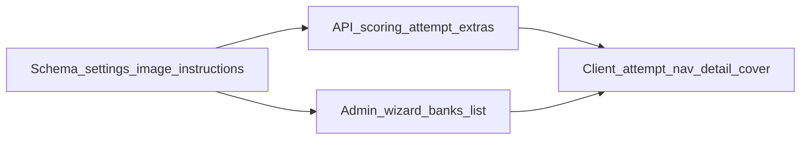

# Quiz features and settings

## Decisions locked

- **Marks:** keep `points` on each bank question only (already scored in [`api/src/modules/attempts/scoring.ts`](api/src/modules/attempts/scoring.ts)). No Behaviour-level marks field.
- **Statuses:** keep stored `FlowStatus` (`draft` | `active` | `completed` | `archived`). Add **display** labels **Scheduled** / **Expired** derived from `startsAt`/`endsAt` when stored status is `active`. **Archived** remains the admin “switched off” status (Inactive meaning; keep the Archived label in UI unless copy elsewhere already says Inactive).
- **Per-question timer:** forward-only — hide Previous and block sidebar jumps to earlier questions (same rule as a disabled Previous toggle).

## Already done (verify only)

- Presentation `all_on_page` end-to-end (admin → API → client attempt).
- Multi-select scoring all-or-nothing for `multiple_mcq` / `image_selection`.
- Timed card removed.

---

## 1. Forward-only navigation (per-question timer + Previous toggle)

**Admin Behaviour** ([`admin/src/pages/activity-wizard.tsx`](admin/src/pages/activity-wizard.tsx)):

- Add `allowPrevious: boolean` to `QuizActivitySettings` (default `true`).
- Toggle: “Allow Previous” (students can go back). When off, attempt is forward-only.

**Effective rule (client + document in API extras):**

```text
forwardOnly = durationMode === 'per_question' OR allowPrevious === false
```

When `forwardOnly`:

- Hide Previous.
- Sidebar / overview: only allow indices `>= currentIndex` (or `>= maxVisitedIndex` if we track visited; prefer `maxVisitedIndex` so Next then not regressing works).
- `all_on_page`: still hide Previous/Next chrome; restrict overview jumps to `>= maxVisitedIndex` when `forwardOnly`.

Wire `allowPrevious` + `durationMode` through attempt `mapAttempt` extras (same path as `presentation` in [`api/src/modules/attempts/service.ts`](api/src/modules/attempts/service.ts)) into [`client/src/pages/attempt.tsx`](client/src/pages/attempt.tsx).

When `durationMode === 'per_question'`, disable or force-off the Previous toggle in the wizard (helper text: per-question timer always blocks going back).

---

## 2. Quiz image (Basic Details)

- Add `imageFileId` (nullable UUID FK to `file_objects`) on `Activity` — same pattern as Sponsor/Contest.
- Migration + Zod create/update + `mapActivity`.
- Wizard Basic Details: reuse existing image picker ([`QuestionImageField`](admin/src/components/question-image-field.tsx) / catalog image pattern used on sponsors).
- Student cards: prefer activity `imageFileId`, then fall back to contest/sponsor in [`client/src/components/activity-images.tsx`](client/src/components/activity-images.tsx) (`coverOf`).

---

## 3. Multi-select for quiz banks

Today quiz banks are locked to `single_mcq` in [`admin/src/pages/bank-question-types.ts`](admin/src/pages/bank-question-types.ts).

- Allow `multiple_mcq` (and keep scoring as-is — all-or-nothing).
- Unlock in quiz bank form picker + API bank question create validation for quiz kind.
- Student UI already supports multi-select; no attempt UI invent.

---

## 4. Negative marking

- Add to `QuizActivitySettings`: `negativeMarkingEnabled: boolean`, `negativeMarkPoints: number` (required when enabled, `> 0`).
- Wizard Behaviour: Switch + numeric field.
- Scoring ([`scoring.ts`](api/src/modules/attempts/scoring.ts) / submit path): for objective items, if incorrect and enabled, award `-negativeMarkPoints` (clamp total score at 0 if product should not go negative — **default: clamp attempt `score` ≥ 0**). Unanswered: no negative (only wrong answered items).

---

## 5. Display statuses (derived Scheduled / Expired)

Keep DB enum unchanged.

Add shared helper (API map + admin list/client):

| Stored | Window | Display |
|--------|--------|---------|
| `draft` | — | Draft |
| `active` | `now < startsAt` | Scheduled |
| `active` | in window (or no endsAt / open) | Active |
| `active` | `now > endsAt` | Expired |
| `completed` | — | Completed (unchanged) |
| `archived` | — | Archived |

- Expose `statusDisplay` (or derive in admin `status` string already capitalized) from list/detail mappers in [`api/src/modules/activities/service.ts`](api/src/modules/activities/service.ts).
- Update KPIs/filters on [`activity-list.tsx`](admin/src/pages/activity-list.tsx) to include Scheduled / Expired as filter facets (filter by stored `active` + date predicates, not new enum values).
- `FlowStatusPill`: map Scheduled → warning/primary, Expired → muted/destructive tone as fits existing tones.
- Student start gate already uses dates; keep refusing starts outside window.

Archive remains the manual “off” action (Inactive meaning). No rename of DB value.

---

## 6. Instructions screen (student)

- Add `instructions` text on Activity (nullable `Text`, or `settings.instructions` — prefer **column** `instructions` for clarity).
- Wizard Basic Details: textarea “Instructions” (quiz).
- Student flow ([`activity-detail.tsx`](client/src/pages/activity-detail.tsx)):
  - Show instructions (markdown/plain; match existing copy style — plain text with newlines).
  - Checkbox: “I have read the instructions” required before **Start Attempt** enables.
  - Resume / Continue does **not** require the checkbox again.
- If instructions empty: keep current “Before you start” facts; still require checkbox with short default acknowledgement text, or skip checkbox when empty — **plan default: if empty, no checkbox; Start enabled as today**.

---

## 7. Marks (explicit non-work)

No Behaviour “marks per question” control. Ensure bank/round question editors continue to expose `points` clearly where missing for quiz multi-select questions.

---

## Implementation order



1. Prisma migration: `imageFileId`, `instructions`; regenerate client.
2. Extend `QuizActivitySettings` Zod + admin types (`allowPrevious`, negative marking).
3. Activity CRUD map + attempt extras.
4. Scoring negative marks + tests in `api/test/scoring.test.ts`.
5. Admin wizard UI (image, instructions, toggles) + bank multi-select unlock.
6. Status display helper + list KPIs/filters/pills.
7. Client: cover, instructions gate, forward-only nav.
8. typecheck/lint admin + client + api; `graphify update`.

## Out of scope

- Renaming `archived` → `inactive` in DB.
- Storing Scheduled/Expired as enum values.
- Quiz-level marks override.
- Reintroducing Timed card.
- API restart is user-managed after migration.