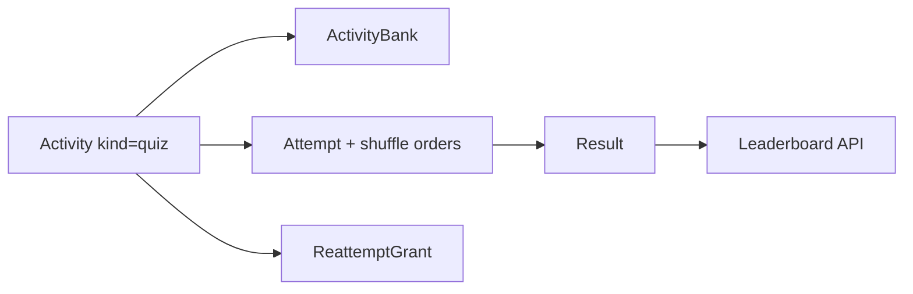

# Quiz module ops (PGDM behavior, BrainPulses UI)

## Locked decisions

- **Approach A**: keep flat quiz model ([`ActivityBank`](api/prisma/schema.prisma) + single attempt). Do not port quiz-owned questions or assessment rounds.
- **UI**: BrainPulses design system only ([`docs/design/DESIGN.md`](docs/design/DESIGN.md)).
- **In scope**: shuffle Q/options; score/answers visibility; reattempt grants (`continue` | `restart`); disqualify / re-qualify; leaderboards (activity + overall individual & group); soft client proctoring (tab blur warn, block copy/paste/context menu).
- **Out of scope**: attendance, geofence, same-day-only IST window (keep existing flexible `startsAt`/`endsAt`), assessment changes, realtime sockets.
- **Group boards**: add optional `Student.cohort` (string) for grouping; admin can set on student form; empty cohort excluded from group boards.

## Domain mapping (PGDM → BrainPulses)

| PGDM | BrainPulses target |
|------|-------------------|
| `Quiz` flags | Quiz-only fields on `Activity.settings.quiz` JSON |
| `QuizAttempt.questionOrder` / `optionOrders` | New columns on `Attempt` |
| `disqualified` / `isAuthoritative` | New columns on `Attempt` |
| `ReattemptGrant` | New `ReattemptGrant` model (activity + student) |
| Daily/overall boards | Computed from authoritative, non-disqualified quiz `Result`s |
| Group boards | Group by `Student.cohort` |



## Schema / settings

Extend [`Activity.settings`](api/src/modules/activities/schema.ts) for **quizzes only**:

```ts
quiz?: {
  shuffleQuestions: boolean;      // default true
  shuffleOptions: boolean;        // default true
  scoreVisibleToStudent: boolean; // default false (align with withheld results)
  answersVisibleToStudent: boolean;
  dailyLeaderboardVisible: boolean;
  overallLeaderboardVisible: boolean;
  dailyGroupLeaderboardVisible: boolean;
  overallGroupLeaderboardVisible: boolean;
  countsForGroupLeaderboard: boolean;
  leaderboardReleasedAt: string | null; // ISO
}
```

Prisma additions ([`api/prisma/schema.prisma`](api/prisma/schema.prisma)):

- `Student.cohort String?`
- `Attempt`: `questionOrder String[]` (questionVersionIds), `optionOrders Json?`, `isAuthoritative Boolean @default(true)`, `disqualified Boolean @default(false)`, `disqualifiedAt`, `disqualifiedByUserId`, `disqualifiedNote`
- `ReattemptGrant`: `id`, `organizationId`, `activityId`, `studentId`, `mode` (`continue` | `restart`), `note?`, `grantedByUserId`, `consumedAt?`, timestamps

Keep existing `startsAt`/`endsAt`/`durationMinutes` (no same-day constraint).

## API

| Area | Change |
|------|--------|
| Activities create/update | Accept/persist `settings.quiz` when `kind === 'quiz'` |
| [`attempts/service.ts`](api/src/modules/attempts/service.ts) `startAttempt` (quiz) | If prior completed attempt and no unused grant → conflict; apply grant (`restart` clears / new attempt; `continue` extends in-progress deadline); build shuffled `questionOrder` / `optionOrders` from bank pool; store on attempt |
| Resume / save / present | Serve questions in frozen order; shuffle options per stored map |
| Student result mapping | Honor `scoreVisibleToStudent` / `answersVisibleToStudent` (in addition to `Result.releaseStatus`) |
| Admin attempts ops | `POST …/attempts/:id/disqualify`, `POST …/requalify`; `POST …/activities/:id/reattempts` grant; list grants |
| Leaderboards | `GET /api/activities/:id/leaderboard?scope=daily\|overall&kind=individual\|group` and org overall for quizzes; filter `isAuthoritative && !disqualified`; respect visibility + `leaderboardReleasedAt`; group by `cohort` |
| Students | CRUD includes `cohort` |

Quizzes only for reattempt/disqualify/leaderboard surfaces; assessments unchanged.

## Admin UI

- Wizard **Behaviour Settings** (quiz): toggles for shuffle, visibility, leaderboard flags + release datetime ([`activity-wizard.tsx`](admin/src/pages/activity-wizard.tsx)).
- Reports / result detail: Disqualify / Re-qualify; Grant reattempt (continue/restart + note) — BrainPulses buttons/dialogs, not PGDM chrome.
- Students form: optional **Cohort** field.
- New lightweight **Leaderboard** view under quiz module nav (or reports filter): activity picker + individual/group tables.

## Client UI

- [`attempt.tsx`](client/src/pages/attempt.tsx): soft proctoring — warn on `visibilitychange` hidden; prevent copy/cut/paste/contextmenu on exam shell (quiz attempts; assessments unchanged unless shared shell — **apply only when activity kind is quiz** via attempt payload flag).
- Pre-start / results: show score/answers only when flags + release allow.
- Library/detail: optional “Leaderboard” link when visible/released.
- New [`leaderboard.tsx`](client/src/pages/) page for individual/group boards.

## Delivery slices (stacked)

1. **Quiz settings + shuffle on start** — schema `settings.quiz` + Attempt order columns; start/resume use frozen shuffle; admin wizard toggles; student sees shuffled order.
2. **Visibility + soft proctoring** — score/answers gates on student result/review; quiz attempt shell proctoring.
3. **Reattempts + disqualify** — `ReattemptGrant` + admin actions; startAttempt grant logic; reports UI.
4. **Leaderboards + cohort** — `Student.cohort`, leaderboard API, admin + student board pages.

## Verification

- API: typecheck; tests for shuffle freeze, grant restart, disqualify exclusion from boards, visibility gating.
- Admin/client: typecheck, lint, format:check on touched packages.
- Manual: create quiz with shuffle + boards → assign students with cohorts → take → submit → grant restart → disqualify one → boards update; no attendance/geofence UI.
