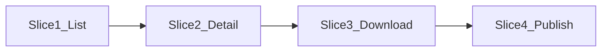

# Quiz Reports & Results

Quizzes already have a reports list at `/quizzes/reports` ([admin/src/pages/reports.tsx](admin/src/pages/reports.tsx)): one row per attempt, unwired filters, and a separate result page. This work replaces **only the quiz page**. [admin/src/routes/app-routes.tsx](admin/src/routes/app-routes.tsx) will point `/quizzes/reports` at a new quiz page. `/assessments/reports` keeps the current `ReportsPage`.

The HTML mock is a behaviour spec, not a visual spec. No Sora/Manrope, hex palette, gradient KPI, native `<select>`, filter chips, or custom pager. Use the list chrome already on quizzes and participants: `PageHeaderActions`, flat `Card` metrics, `Toolbar` + `Select`, `ResponsiveRecords`, `SortHeader`, `StatusBadge` / `StatusPill`, `Alert`, `Sheet`, `Dialog`, `RadioGroup`, `DropdownMenu`, and `sonner`. Page size stays **10 / 20 / 50**. Control height stays `--control-h`.

## Rules that override the current result list

- One row per assigned registration (student × quiz). Unassigned registrations stay off the page.
- **Best attempt** is the submitted or auto-submitted attempt with the highest `Result.score`. A tie uses the earlier `submittedAt`. This does not change `Attempt.isAuthoritative` (that flag stays “latest counting attempt” for the rest of the product).
- Disqualified attempts are ignored when picking the best score. If every submitted attempt is disqualified, the row is still Completed and the score cells stay empty.
- Attempt status: **Completed** if any non-voided attempt is submitted or auto-submitted (a later in-progress retry stays Completed). **In progress** only when the quiz display status is Active and an attempt is still open. **Not started** when the student never started.
- Quiz status filter uses the mock’s three values, mapped onto statuses that exist today in [api/src/lib/activity-status.ts](api/src/lib/activity-status.ts): **Active**, **Expired**, and **Inactive = Archived** (the archive action in [api/src/modules/activities/service.ts](api/src/modules/activities/service.ts)). Draft, Scheduled, and Completed still appear under **Any**. They are not extra filter options. In progress is removed from the attempt-status filter unless the quiz is Active, and a hidden selection resets to Any.
- Auto-submitted is `Attempt.status === auto_submitted`. The reason is stored on the attempt for the detail panel: timer ran out, quiz ended, or quiz deactivated.
- Marks, percent, and pass/fail come from the best attempt’s `Result` (score is already after negative marking and clamped at 0). Percent on screen is a whole number. Pass uses the quiz `passingPercent`. Empty when nothing was submitted or the quiz has no pass mark.
- Correct, skipped, and negative-mark totals are computed on read with `scoreObjective`, `hasSubmittedAnswer`, and `applyNegativeMarking` in [api/src/modules/attempts/scoring.ts](api/src/modules/attempts/scoring.ts). They are not new columns on `Result`.
- Attempts used is started attempts (including one in progress, excluding voided) out of the quiz cap plus reattempt grants. Unlimited when `maxAttempts` is null.

## Slice 1 — List, filters, and summary

**Actor:** admin. **Trigger:** open Quizzes → Reports & Results, or open `/quizzes/reports?activityId=`. **Outcome:** one row per registration, filters and cards match the full set, not just the current page.

API, new quiz-only module beside results (do not reshape `GET /api/results`):

- Before building rows, settle open quiz attempts that the product would already auto-submit: deadline passed → reason timer; `endsAt` passed → quiz ended. Archive already closes the quiz; on archive, submit open attempts with reason quiz deactivated. Record the reason on `Attempt` (`auto_submit_reason`). Existing auto-submitted rows with no reason stay “Yes” with no subtitle. Do not invent Inactive as a new `FlowStatus`.
- `GET` returns summary (registered, completed, not started, average score, pass rate over completed rows only) plus one page of rows. Search is registration code or participant name. Filters AND together: contest, quiz (options narrowed by contest and quiz status), quiz status, attempt status, auto-submitted. Sort is server-side. Default sort is submitted time, newest first. Empty score and date values sort last; name A–Z breaks ties. Reset to page 1 on every filter change.

Admin page:

- Subtitle via the existing page meta description: “One row per student per quiz. Scores show each student's best attempt.”
- **Download report** sits in `PageHeaderActions` and stays disabled until slice 3.
- Five flat metric cards (label, value, muted hint). No tint and no gradient. Grid `grid-cols-1 sm:grid-cols-2 xl:grid-cols-5`.
- `Toolbar` search placeholder “Search name or Registration ID”, five `Select` filters, **Clear Filters**. No chip row.
- Table columns in the spec order. Default hidden: Contest, No. of skipped questions, Negative marks. A `DropdownMenu` checklist (at least one column) remembers the choice in `localStorage` for that admin. Same choice is what slice 3 exports.
- Percent uses `text-success` at or above the pass mark, `text-warning` within 10 points under it, `text-destructive` further under. Pass `ok`, Fail `er`, Completed `ok`, In progress `wn`, Not started `gy`, auto-submitted Yes `wn`. Empty cells are a muted em dash on screen.
- Loading uses `ListPageSkeleton`. Empty copy matches the spec (no registrations, no matches with clear, load error with try again).
- Narrow layout stays `ResponsiveRecords` cards, not a second table CSS.
- Quiz list gets one extra row action, **View report**, only for `kind="quiz"`, linking to `?activityId=`. Assessment rows are unchanged. Clicking a report row does nothing new until slice 2 (no navigation to the old per-attempt page).

## Slice 2 — Attempt detail

**Trigger:** click a row, or Enter / Space. **Outcome:** a right `Sheet` (full width on a narrow viewport) with that registration’s history. Esc, the close button, and the overlay close it and return focus to the row.

`GET` by registration id returns every non-voided attempt in order, the counted attempt id, and answers for one submitted attempt. Admin always sees scores and the key. Reuse the participant review mapping in [api/src/modules/participant-portal/service.ts](api/src/modules/participant-portal/service.ts) without its publish gate. Group comprehension passages with the existing question-order blocks.

Sheet content follows the spec: quiz and contest, student details, attempts table (Counted badge on the best row, auto-submit reason under Yes, in-progress row not selectable), then the answer cards or the not-started / still-in-progress note. Marks on a question use `text-success`, `text-destructive`, and `text-muted-foreground`.

Keep [admin/src/pages/result-detail.tsx](admin/src/pages/result-detail.tsx) and its route for regrade, disqualify, and delete. The sheet header links to that page for the counted attempt when one exists. Do not move those actions into the sheet.

## Slice 3 — Download

**Trigger:** Download report. **Outcome:** an Excel or CSV file of the current search, filters, and sort.

Dialog (`Dialog` + `RadioGroup`): Excel default, CSV, and “Include participants who haven't appeared” (off by default). Copy matches the spec, including the live counts. The file is built in the API with ExcelJS, same pattern as the bank and participant workbooks. Shown columns only, in table order. Score cells blank in the file, not an em dash. Name is `BrainPulses-results.xlsx`, or `BrainPulses-results-<quiz-name>.xlsx` when one quiz is filtered. CSV is UTF-8 with a BOM. Success and failure toasts use the spec wording. No per-attempt export.

## Slice 4 — Publish results

**Trigger:** one quiz is selected and its `scoreRelease` is `after_publish`. **Outcome:** students can see scores, and later submits stay visible.

Store `resultsPublishedAt` on the activity (quiz only). The bar is an `Alert`: warning plus **Publish results** when unset; success with the published date when set; hidden for “after submit” and when no single quiz is selected. Confirm with `useConfirm` using the spec title and body. Publish sets the timestamp and marks existing withheld results for that quiz published. It cannot be undone from this page. On later submit, if that timestamp is set, the new quiz result is created as published. Publishing one result from the result detail page does not flip the quiz-level bar. Failure toast leaves the bar unpublished.

## Out of scope

- Assessment reports, regrade, disqualify, and registration CSV.
- Email or phone search.
- A best-or-latest setting. Best is always highest marks.
- New fonts, colors, filter chips, or a 10/25/50 page size.
