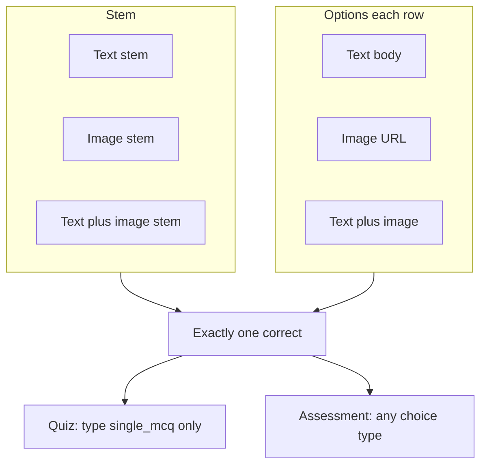
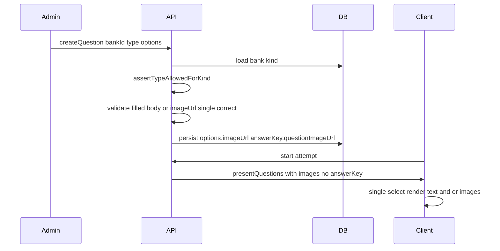

# Quiz single-choice + image/text media

## Product rules (locked defaults)

| Surface | Answer formats | Media |
|---|---|---|
| **Quiz banks** | **Only** `single_mcq` (exactly one correct option). No multi-select, T/F, numeric, text, comprehension, or `image_selection`. | Optional stem image + optional per-option images; options may be text, image, or both |
| **Assessment banks** | All current authorable types unchanged | Same optional stem/option images on **choice** types (`single_mcq`, `multiple_mcq`, `true_false`, `comprehension_mcq`, `image_mcq`, `image_selection`) |

**Defaults chosen (change on confirm if needed):** quizzes do **not** include True/False as a separate type; media is **orthogonal** to type (not locked behind `image_mcq` / `image_selection`). Legacy `image_mcq` rows stay readable/scorable; quiz **authoring** stores new questions as `single_mcq`. Assessment may still create `image_mcq` / `image_selection` for compatibility with existing labels/import samples.

**Out of scope:** binary image upload (URLs only, same as today); activity-wizard local-question type catalog expansion beyond media fields if rounds stay `single_mcq`.

## Scenario matrix (must work)

Examples covered: text Q + text options; image Q + text options; text Q + image options (Taj Mahal); image Q + image options; mixed options in one question (some text, some image).

## Current gaps

- No `bank.kind` allowlist — quiz banks can author every type ([`bank-question-form.tsx`](admin/src/pages/bank-question-form.tsx), [`banks/service.ts`](api/src/modules/banks/service.ts)).
- Stem image UI only for `image_mcq` / `image_selection`; option image UI only for `image_selection` ([`bank-question-form.tsx`](admin/src/pages/bank-question-form.tsx) ~L217–315).
- Option `body` is required (`min(1)`) in [`optionSchema`](api/src/modules/banks/schema.ts) — blocks image-only options.
- “Filled option” checks use `body.trim()` only in draft/API validation — image-only rows are dropped.
- Student **attempt** already renders `questionImageUrl` + `op.imageUrl` ([`client/src/pages/attempt.tsx`](client/src/pages/attempt.tsx)); **results review** does not pass/render option images.

## Approach

### 1. Shared “choice media” rules (API)

In [`api/src/modules/banks/schema.ts`](api/src/modules/banks/schema.ts):

- Change options so each option is valid if **`body.trim()` OR `imageUrl`** is present (not body-only).
- Treat “filled” as that same rule everywhere (validation, import row map, draft).
- For choice types, allow optional `answerKey.questionImageUrl` / `stemImageUrl` (normalize on write to one alias — prefer `questionImageUrl` to match admin/client; keep reading both).
- `image_selection`: keep “every filled option needs `imageUrl`” for assessment; still multi-correct.
- Add **`assertTypeAllowedForKind(kind, type)`**:
  - `quiz` → only `single_mcq` (reject others with a clear message).
  - `assessment` → all authorable types (current set).

Enforce in [`createQuestion` / `updateQuestion`](api/src/modules/banks/service.ts) using the bank’s `kind`, and in round local-question create if the parent activity is a quiz (quizzes should not get non-single types via rounds either — quizzes already disallow rounds).

When attaching reusable banks to a quiz activity ([`assertReusableBanksForKind`](api/src/modules/activities/service.ts)): also reject banks that contain any question whose type is not `single_mcq` (and optionally warn if legacy `image_mcq` exists — **decision in plan:** allow existing `image_mcq` in quiz banks for attempt scoring, but block **new** creates; bank attach allows `single_mcq` + legacy `image_mcq` only so old image MCQs still run).

### 2. Admin authoring

[`bank-question-types.ts`](admin/src/pages/bank-question-types.ts):

- Export `typesForKind(kind)` → quiz: `[{ single_mcq, 'Single choice' }]`; assessment: full `BANK_QUESTION_TYPES`.
- Helper `supportsChoiceMedia(type)` for choice types that show stem/option image fields.

[`bank-question-form.tsx`](admin/src/pages/bank-question-form.tsx) + [`bank-question-draft.ts`](admin/src/pages/bank-question-draft.ts):

- Pass bank `kind` into the dialog; filter type select.
- For quiz, lock type to `single_mcq` (hide picker or single option).
- Show **Question image URL** for all choice types that support media (quiz `single_mcq` + assessment choice types).
- Show **option image URL** for those same types (not only `image_selection`).
- `validateDraft` / `draftToPayload`: filled = body or imageUrl; image-only options keep a short placeholder body if the API still needs a non-empty body string after relaxation, or empty body once schema allows it (prefer empty body + imageUrl once Zod is fixed).
- Copy/help under options: “Each option needs text, an image URL, or both. Mark exactly one correct.”

[`bank-form.tsx`](admin/src/pages/bank-form.tsx): pass `kind`; if a quiz bank already has disallowed types (legacy data), show a one-line Alert that those rows remain but cannot be added/edited as non-single types (edit forces coerce or blocks save — **coerce on edit to `single_mcq` only when already single-correct**; otherwise read-only + message).

### 3. Import / export

[`api/src/modules/banks/import-export.ts`](api/src/modules/banks/import-export.ts):

- Kind-aware allowlist (quiz sample/instructions only document `single_mcq` + media columns).
- Reject non-single types on quiz import rows.
- Filled option = text or `option*_imageUrl`; do not require body for image-only.
- Assessment sample keeps all types; document that stem/option image columns work on choice types generally.
- Align write alias: prefer `questionImageUrl` in answerKey (still accept `stemImageUrl` on import).

### 4. Client attempt + results

- Attempt path: no scoring/render change required for new media on `single_mcq` (already works).
- Results / review: include `imageUrl` on review options and `questionImageUrl` in [`student-portal`](api/src/modules/student-portal) (or results DTO) and render in [`client/src/pages/results.tsx`](client/src/pages/results.tsx) so post-submit review matches the attempt UI.

### 5. Activity wizard (light touch)

[`activity-wizard.tsx`](admin/src/pages/activity-wizard.tsx) local round questions already use `single_mcq`. Add optional stem + option image URL fields on that mini-editor so assessment round-local questions can be image/mixed too (parity with bank editor for the one type they create).

## Enforcement flow

## Verification

- API: create `single_mcq` on quiz with (a) text-only, (b) stem image only, (c) option images only, (d) mixed options — all score via existing single-label path.
- API: reject `multiple_mcq` / `numeric` create on quiz bank; allow on assessment.
- Admin: quiz bank type picker shows only Single choice; stem + option image fields visible; assessment picker unchanged + media fields on choice types.
- Import: quiz sample imports only `single_mcq` media rows; assessment sample still covers full set.
- Client: attempt + results show stem/option images for quiz single_mcq.
- `npm run typecheck` / `lint` / `format:check` in `api/`, `admin/`, `client/` for touched packages; `graphify update .` after code edits.

## Key files

- [`api/src/modules/banks/schema.ts`](api/src/modules/banks/schema.ts) — option fill rule + kind allowlist helper
- [`api/src/modules/banks/service.ts`](api/src/modules/banks/service.ts) — enforce on create/update
- [`api/src/modules/banks/import-export.ts`](api/src/modules/banks/import-export.ts) — kind-aware samples/import
- [`api/src/modules/activities/service.ts`](api/src/modules/activities/service.ts) — quiz bank attach type check
- [`admin/src/pages/bank-question-types.ts`](admin/src/pages/bank-question-types.ts), [`bank-question-form.tsx`](admin/src/pages/bank-question-form.tsx), [`bank-question-draft.ts`](admin/src/pages/bank-question-draft.ts), [`bank-form.tsx`](admin/src/pages/bank-form.tsx)
- [`client/src/pages/results.tsx`](client/src/pages/results.tsx) + student results DTO
- Light: [`activity-wizard.tsx`](admin/src/pages/activity-wizard.tsx) local-question media fields
