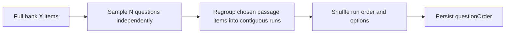

# Random attempt questions with contiguous passages

## Problem
[`buildAttemptOrders`](api/src/modules/attempts/service.ts) calls `applyQuestionLimit` **before** shuffle, and [`blocksFromItems`](api/src/lib/question-order.ts) treats every comprehension as an atomic all-or-nothing block. With limit 5 of 41, every participant gets the same first five bank questions.

## Target behavior (confirmed)
1. **Select** any N questions independently from the full pool (a passage may contribute 0..all of its items).
2. **Present** so that once a chosen comprehension question appears, **all chosen items from that passage run contiguously** (inner order may shuffle, then answer linearly). The passage does not reappear later mixed with other items.

## Core change — [`api/src/lib/question-order.ts`](api/src/lib/question-order.ts)

Replace prefix-of-blocks limiting with two steps:

1. **`selectAttemptItems(items, limit, shuffleQuestions)`**
   - Sort stably by `sortOrder` / id.
   - If shuffle: `shuffleInPlace` the full pool, then take `limit` (or all if null).
   - If not shuffle: take the first `limit` items in bank order (fixed paper).
   - Selection is **per question**, not per full passage.

2. **`buildDisplayOrder(selected, shuffleQuestions)`** (or keep `orderBlocks` after regroup)
   - Run `blocksFromItems(selected)` so only the **chosen** siblings form a passage block (partial passages are fine).
   - `orderBlocks`: shuffle block order when enabled; within a multi-item passage block, shuffle then present linearly (existing behavior).

Rewrite or retire **`applyQuestionLimit`** so nothing still does “skip whole passages that do not fit / force oversized passage whole.” That rule contradicts independent sampling.

**`servedQuestionCount`**: return `min(limit, activeCount)` (or full count when limit is null). UI question counts stay honest under independent sampling.

## Wire-up — [`api/src/modules/attempts/service.ts`](api/src/modules/attempts/service.ts)

- **`buildAttemptOrders`**: `selectAttemptItems` → `blocksFromItems` → `orderBlocks` → option shuffle.
- **`startAttempt`**: stop the duplicate `applyQuestionLimit(...).flatMap` for `candidateIds`. Select once, load options for those version IDs, then build orders from the same selection (avoid double-shuffle drift).

Applies to **assessment rounds and quizzes** that use the same helper (same bug today).

## Tests — [`api/test/question-order.test.ts`](api/test/question-order.test.ts)

Replace obsolete “skip passage that does not fit” / “oversized passage served whole” cases with:

- Limit can pick a **subset** of a passage (e.g. 2 of 5).
- After regroup, chosen passage IDs are **contiguous** and appear once.
- Without shuffle, selection is a stable prefix of individuals, still regrouped for display.
- With shuffle, selection is from the full pool (assert set size and that pool size &gt; limit so a prefix-only algorithm would be wrong if we inject a deterministic shuffle in the test or assert properties of `selectAttemptItems` with a controllable shuffle hook).

Prefer a small injectable shuffle (or testing `select`/`order` separately) over flaky random assertions.

## Out of scope
- Participant attempt UI changes (order is driven by persisted `questionOrder`).
- Admin bank editing or import.
- Re-sampling already-started attempts (only new starts).
