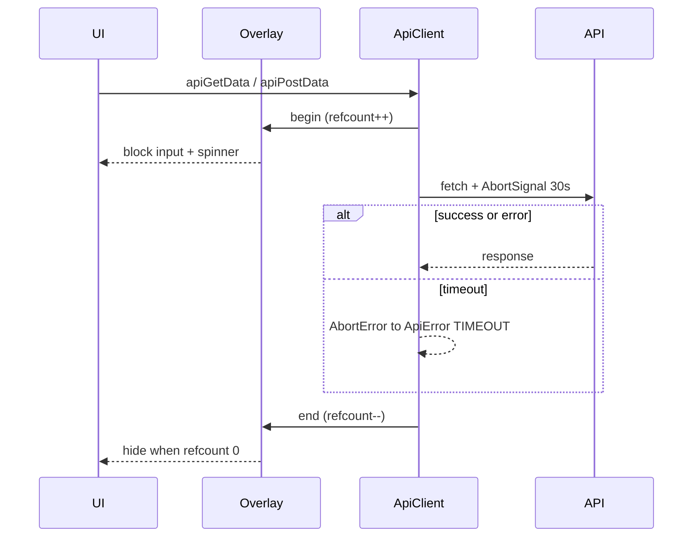

# Request timeout + blocking API overlay

## Decisions (locked)

- **Rate limits:** unchanged (`RATE_LIMIT_MAX` / `AUTH_RATE_LIMIT_MAX` stay as today).
- **Timeout:** **30 seconds** on server and both frontends.
- **Overlay:** full-screen, blocks all pointer input while any `api*` / shared `request` call is in flight (lists, detail, save, auth).
- **Skeletons:** keep [`RouteLoadingSkeleton`](admin/src/components/loading-skeletons.tsx) / client skeletons for route/shell mount; overlay sits on top once network starts.
- **Duplicate actions:** overlay captures clicks (no serial request queue). Concurrent requests use an **in-flight refcount**—overlay stays until the last call finishes.

## 1. API — server request timeout only

**Files:** [`api/src/config/env.ts`](api/src/config/env.ts), new [`api/src/middleware/request-timeout.ts`](api/src/middleware/request-timeout.ts), [`api/src/app.ts`](api/src/app.ts), [`api/src/index.ts`](api/src/index.ts), [`.env.example`](api/.env.example) if present (placeholders only).

- Add `REQUEST_TIMEOUT_MS` (default `30000`) to the Zod env schema.
- Middleware: start a timer per request; if it fires and headers are not sent, respond `504` with `{ error: { code: 'REQUEST_TIMEOUT', message: '...', requestId } }` and destroy the socket if still open. Clear timer on `res` finish/close. Apply under `/api` (not `/health` or `/health/ready`).
- On `app.listen` server: set `server.requestTimeout = env.REQUEST_TIMEOUT_MS` (and `headersTimeout` slightly above, e.g. +5s) so Node also bounds hung sockets.
- Do **not** change rate-limit wiring or max values.

## 2. Admin — timeout + global overlay

**API client** — [`admin/src/lib/api-client.ts`](admin/src/lib/api-client.ts):

- Constant `REQUEST_TIMEOUT_MS = 30_000`.
- In `request` (and auth refresh `fetch`): merge `AbortSignal.timeout(REQUEST_TIMEOUT_MS)` with any caller `signal` (`AbortSignal.any` when available).
- On abort from timeout → throw `ApiError(408, 'TIMEOUT', 'Request timed out. Please try again.')`.
- Register begin/end hooks (module-level listener) around every network attempt so the provider can refcount. Nested 401-refresh must not double-count incorrectly (increment once per top-level `request` / refresh call).

**UI** (design tokens only; match Sonner’s `Loader2Icon` + `animate-spin`):

- New [`admin/src/components/loading-overlay.tsx`](admin/src/components/loading-overlay.tsx): fixed `inset-0`, high z-index, `bg-background/80`, centered spinner, `aria-busy` / polite status text (“Loading…”), `pointer-events-auto` so underlying UI cannot receive clicks/focus.
- New provider (same file or [`admin/src/contexts/api-loading.tsx`](admin/src/contexts/api-loading.tsx)): refcount; mount overlay when `> 0`; wire listener into `api-client` on mount.
- Wrap app in [`admin/src/App.tsx`](admin/src/App.tsx) (inside router/theme so overlay uses theme tokens).

**Docs:** update [`docs/design/DESIGN.md`](docs/design/DESIGN.md) §4 Loading row: route/shell → `Skeleton`; in-flight API → blocking spinner overlay. Note §6 still applies (disable submit where pages already do).

## 3. Client — parity

Mirror admin behavior in:

- [`client/src/lib/api-client.ts`](client/src/lib/api-client.ts) — same 30s abort + TIMEOUT error + begin/end hooks on all helpers.
- New overlay + provider under `client/src/`, mount in [`client/src/App.tsx`](client/src/App.tsx).
- Tokens/classes aligned with admin (`bg-background/80`, `Loader2`, focus/ARIA). Client page skeletons stay for first paint.

## 4. Behavior notes (no page-by-page rewrites)

- Existing page skeletons / `useAsyncService` loading flags stay; overlay is the global blocker.
- No per-page “queue” of clicks—overlay is the guard.
- Toast/error handling for TIMEOUT: reuse existing page/`ApiError` paths; do not invent a new toast system. If a call site already toasts errors, it will surface; otherwise the request fails cleanly after 30s and the overlay clears.

## 5. Verify

- `api`: typecheck/lint for touched files; quick middleware test if the API test helpers already cover middleware patterns.
- `admin` and `client`: `typecheck`, `lint`, `format:check` for changed packages.
- Manual smoke: open a list page → overlay during fetch → UI not clickable; force a hung path or mock delay → abort at ~30s and overlay clears.
- After code edits: `graphify update .`

## Out of scope

- Changing rate-limit numbers or Redis store behavior.
- Replacing skeletons with spinners for Suspense/route fallbacks.
- Per-route custom timeouts or a serial request queue.
