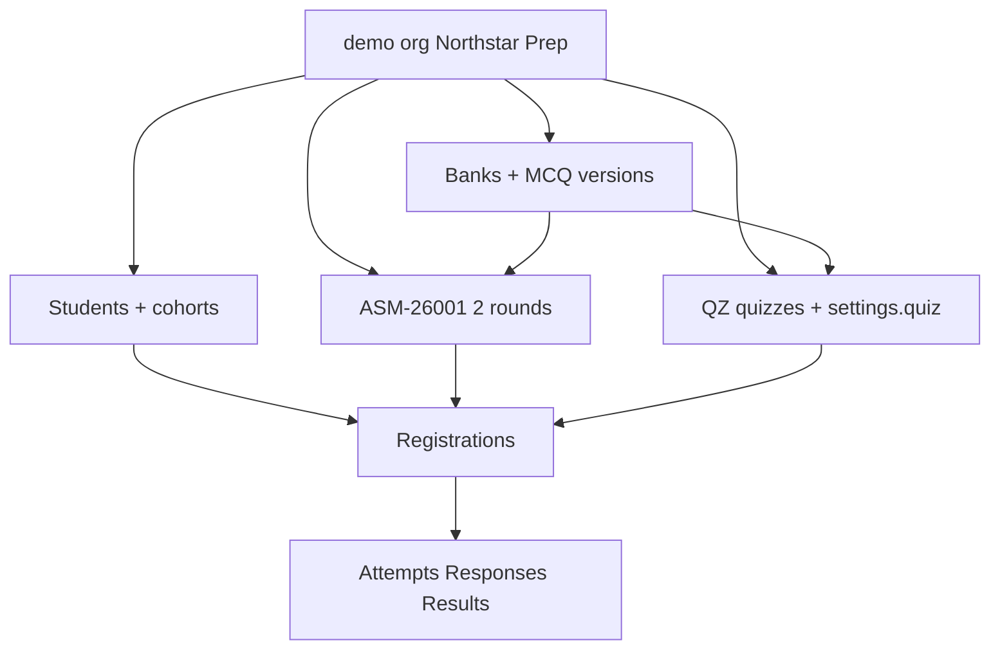

# Realistic demo seed (wired, not UI-only)

## Defaults (locked)

- **Narrative**: Indian coaching academy under org slug `demo` (rename display name to something like **Northstar Prep**, keep slug `demo` for handoff). Secondary org `other` stays for tenancy tests only.
- **Stable credentials/codes** (do not break tests/docs): `admin@brainpulses.com` / `viewer@brainpulses.com` / `Password123!`, student `BP-24101`, activities `ASM-26001` / `QZ-26001`, banks `QB-26001` / `QB-26002`, cross-tenant `BP-99001`. New students/activities may use additional codes.
- **Completeness**: seed **attempts + responses + results** (published and withheld), not only banks/registrations.

## What’s wrong today

[`api/prisma/seed.ts`](api/prisma/seed.ts) only creates org/users/3 students/2×5 MCQs/1 assessment (single round)/2 quizzes/registrations. No attempts, results, quiz `settings.quiz`, multi-round assessments, status variety, or usable leaderboard history. `ensureMcq` **skips** existing codes, so reseed does not refresh question text.

## Approach

Rewrite [`api/prisma/seed.ts`](api/prisma/seed.ts) as a structured seeder:

1. **Auth / tenancy** (same as now): orgs, admin + viewer memberships, orgB student.
2. **Wipe demo domain data** before recreate (so “new” content sticks without requiring only `migrate reset`): delete in FK-safe order for org `demo` — results/revisions, attempt responses, attempts, reattempt grants, registrations, activity round banks/rounds/activity banks, activities, questions/versions/options, banks. Keep users/memberships/orgs.
3. **Students (~10–12)**: realistic Indian names, cities, courses (JEE / NEET / Foundation), **cohorts** (e.g. Alpha / Beta / Gamma), phones Unique-ID style; include `BP-24101`… as the primary login student plus siblings.
4. **Banks + questions** (real MCQ stems, still short demos):
   - Assessment banks: Physics Mechanics, Chemistry Basics (8–12 Q each) → `QB-26001` maps to primary physics bank used by tests.
   - Quiz banks: Weekly GK, Quant Aptitude → `QB-26002` primary quiz bank.
   - Fix `ensureMcq` to **upsert/update** stem/options/answerKey when code exists (or delete+recreate versions).
5. **Activities (wired)**:
   - **Assessment** `ASM-26001`: 2 rounds (e.g. Physics + Chemistry), linked banks + one small **round-local** bank on round 2; `active`; window open; all demo students registered.
   - **Quiz** `QZ-26001`: Weekly GK, `settings.quiz` with shuffle + score/answers visibility + leaderboard flags on; registered.
   - **Quiz** `QZ-26002`: Quant sprint (keep code); maybe `completed` or second window.
   - Add 1 **draft** quiz and 1 **archived**/completed activity so list filters look real.
6. **History (the “complete” part)**:
   - For several students on `QZ-26001`: submitted attempts with `questionOrder`/`optionOrders`, responses, **published** results with varied percents (leaderboards + reports populate). One **disqualified** attempt on a non-primary student. One **withheld** result.
   - For `ASM-26001`: at least one student with round-1 submitted + published result; primary student `BP-24101` left able to start/resume (clear or no in-progress for flaky tests — tests wipe their own attempts, but seed should not leave them blocked).
   - Optional: one unused `ReattemptGrant` (restart) for a completed quiz student.
7. **Org polish**: a few `Setting` rows (general org display name), 2–3 `Notification` + `AuditEvent` rows so settings/activity feel lived-in (only if admin UI surfaces them; skip if unused).

## Test / docs impact

- Prefer **keeping** codes/emails above; only adjust assertions if seed email/name for `BP-24101` changes (e.g. keep `student1@mail.com` or update [`api/test/*.test.ts`](api/test) + [`README.md`](README.md) / [`docs/handoff/*`](docs/handoff) in the same change).
- After implementation: `npm run db:reset` (or wipe+seed), then `npm test` in `api/`.

## Out of scope

- Admin client fixtures (`admin/src/services/fixtures*`) unless they still gate UI when `VITE_USE_FIXTURES=true` — no change required for live API demos.
- Fake file uploads / Twilio OTP secrets.
