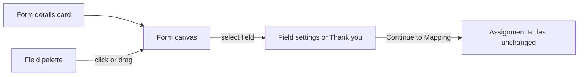

# Drag-and-drop registration form and thank-you message

The public registration form already lives in the contest form wizard ([admin/src/pages/contest-form-wizard.tsx](admin/src/pages/contest-form-wizard.tsx)), stored as JSON on `ContestRegistrationForm`. Step 2 (Assignment Rules), quiz mapping, draft/`step1`/`save` modes, locked name/email/mobile keys, and the registrations list stay untouched.

Visual language stays the admin system: tokens in [admin/src/index.css](admin/src/index.css), controls from `@/components/ui`, 44px controls. No new palette, gradients, or a second component kit. The attached design skills set the quality bar (focus, labels, keyboard alternative to drag, reduced motion). They do not trigger a repo-wide Button/EmptyState rewrite or extra commits.

## What the builder becomes

Step 1 keeps the existing form details (sponsor, contest, open/close, seats, welcome message, display chips) in the card above the builder. Those fields are required to save and are not in the mock.

Under that, a three-pane builder, stacked on small screens and side by side from `lg`:

- **Add fields** — palette of the eight types that already exist, grouped as Contact (email, phone), Basic (text, textarea, number), Choice (dropdown, multi-select, consent). Click adds a field. Drag from the palette also adds one. Date, time, heading, image, divider, and a single “full name” field are out of scope.
- **Form canvas** — contest name as the heading, fields in order. Selecting a field opens its settings. Locked fields (first name, last name, email, mobile) stay first and cannot be reordered out of that group. Email still cannot be removed. Custom fields can be reordered, duplicated (new id, still capped at 20 extra), or deleted. Up/down buttons stay so reorder works without a pointer (WCAG 2.5.7).
- **Right panel** — tabs **Field settings** and **Thank you message**. Settings move out of the inline row in [admin/src/components/contest-form-fields.tsx](admin/src/components/contest-form-fields.tsx): label, type (locked types stay fixed), required, placeholder, help, and the options/consent controls that row already has.

Header actions on step 1 stay **Save draft**, **Preview**, and the current continue action (same `mode: 'step1'` persist). The continue label becomes **Continue to Mapping**; it still opens Assignment Rules and does not change that step.

Drag uses `@dnd-kit/core`, `@dnd-kit/sortable`, and `@dnd-kit/utilities` in `admin/` only. Reorder rules move into [admin/src/lib/contest-form.ts](admin/src/lib/contest-form.ts) so tests do not depend on the page.

## Thank-you message

New optional columns on `ContestRegistrationForm`, all defaulting so existing rows do not change the public page:

- `thankYouEnabled` boolean, default `false`
- `thankYouKind` `template | custom | image`, default `template`
- `thankYouTitle` (short text), `thankYouHtml` (sanitized HTML)
- `thankYouImageFileId` (nullable file id)
- `thankYouShowNextSteps`, `thankYouShowQuizzes` booleans, default `false`
- `thankYouButtonLabel`, `thankYouButtonUrl` nullable

**Off (default, including every form that exists today):** [participant/src/pages/register.tsx](participant/src/pages/register.tsx) `Success` stays the current screen: “You’re registered!”, Registration ID, Copy, Log in.

**On:**

- **Success template** — current layout, plus the optional blocks below.
- **Custom message** — title plus body from the existing [admin/src/components/rich-text-editor.tsx](admin/src/components/rich-text-editor.tsx) (bold, italic, lists). Stored only after the current sanitizer in [admin/src/lib/sanitize-html.ts](admin/src/lib/sanitize-html.ts). Underline and inline links stay out; the separate button is the link.
- **Image only** — uploaded image, then the Registration ID. Image upload reuses the catalog file upload. On save, `placeOwnedImage` gets one new destination kind for this form so the file leaves `pending`. Public delivery extends the existing image route (`contest | sponsor | thank-you`) and still checks org and link state.

Optional blocks, only when enabled:

- Next steps: the three instructions already written on the register page.
- Quiz details: activity name and kind for quizzes already mapped to this form. Omitted when the list is empty. Not included in the public payload when the toggle is off.
- Button: label plus `http`/`https` URL, shown in addition to **Log in**. The Registration ID and login link always remain.

Draft saves stay loose. `step1` and `save` validate: custom message needs visible text, image mode needs a file, button URL must be `http` or `https` when a label is set. Same checks in admin `validateBuilder` and API `validateForm`. Zod `.strict()` on [api/src/modules/contest-forms/schema.ts](api/src/modules/contest-forms/schema.ts) gains these fields so unknown keys are still rejected.

## Left alone

- Field type union, answer shape, `defaultFields()`, email/mobile extraction, returning-ID match, manual registration, Give quiz, and Assignment Rules.
- Activity `endMessage` and the registrations list pages.
- Welcome message (that is the text above the form, not the thank-you).

## Tests and report

- Admin unit tests for add, duplicate, reorder (locked fields stay first), and thank-you validation.
- Admin component test: add a field from the palette, select it, edit the label, switch to Thank you and toggle it on.
- API tests: save schema accepts the new fields, rejects a `javascript:` button URL, and `publicForm` omits quiz names and keeps thank-you disabled when the columns are at their defaults.
- Participant test: disabled flag renders the current heading; enabled custom message renders the title and still shows the Registration ID.
- After the change: `npm run typecheck`, `npm run lint`, `npm run format:check`, and `npm test` in `admin/`; contest-form tests in `api/`; participant tests. Then exercise the wizard in the browser on the already-running admin server (reuse port 5173; do not restart it): add and reorder a field, open Thank you, and confirm step 2 still loads. Report results in the chat, not a new doc.
