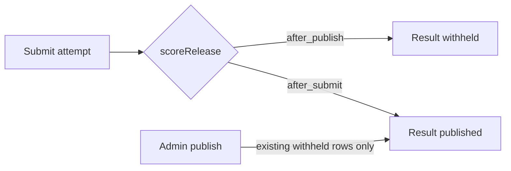

# Review, portal, registration, and reports

## 1–3. Assessment review is per round

The Review & Publish step in [admin/src/pages/activity-wizard.tsx](admin/src/pages/activity-wizard.tsx) still reads quiz-shaped activity fields. `Passing score` always prints `passingPercent` (default `"50"`) and never reads `rounds[].settings.passRequired`, `passMode`, or `passingPercent` / `passingScore`. Round editors update the round draft only, so the card stays visible and stale. `Rounds` joins every name and question count into one `truncate` line, so a third round clips.

A single passing score is the right fact for a quiz (`Activity.passingPercent`). It is the wrong fact for an assessment: each `ActivityRound` has its own pass rule.

**Quiz review** stays a single summary: sponsor, contest, questions, attempts, score release, duration, passing percent, presentation, window.

**Assessment review** drops the activity-level Passing score, Duration, and Presentation cards. Those three are edited per round and the activity copies do not follow the round form. Keep only facts that belong to the assessment: sponsor, contest, round count as a number (`1`, `2`, `3`, …), and the window when dates are set.

Replace the cramped round list with one card per round. Each card shows that round’s own name, question count, question limit, duration, attempts, score release, question shuffle, option shuffle, and pass rule. When `passRequired` is off, the card says “Attempt to continue” and does not show a percent. This is the same data already computed at lines 2470–2527; it becomes the summary instead of a second clipped KPI.

## 4. Attempt bar stays on the right

In [participant/src/pages/attempt.tsx](participant/src/pages/attempt.tsx) the timer, theme toggle, and exit sit after `.segs`. In [participant/src/styles/portal.css](participant/src/styles/portal.css), `.segs` is the only item with `margin: 0 auto`, so hiding the question overview (or forward-only mode) lets that cluster sit next to the brand.

Give `.tmr` `margin-left: auto` only when the overview segment is not rendered. Leave `.segs { margin: 0 auto }` in place so the overview stays centered when it is on. Theme and exit follow the timer.

## 5. Question order and option order stay independent

`startAttempt` already passes `shuffleQuestions` and `shuffleOptions` separately in [api/src/modules/attempts/service.ts](api/src/modules/attempts/service.ts). Option shuffle only rewrites `optionOrders`.

Questions still leave bank order when question shuffle is off. Banks load `createdAt` ascending, but almost every question is stored with `sortOrder: 0`. `stableSort` in [api/src/lib/question-order.ts](api/src/lib/question-order.ts) then breaks ties with question id, which is not bank order.

Keep `Array.sort`’s stable tie (`sortOrder` only, return `0` when equal) so equal sort values keep the `createdAt` order already loaded. Do the same inside passage groups. Do not touch the `shuffleOptions` branch.

## 6. Form assignment updates existing registrants

The portal lists `Registration` rows with `status: 'assigned'` ([api/src/modules/participant-portal/service.ts](api/src/modules/participant-portal/service.ts)). Saving a form only updates `contest_form_quizzes`, then `assignSavedForm` in [api/src/modules/contest-forms/service.ts](api/src/modules/contest-forms/service.ts) upserts assignments for activities still on the form. Removed activities are never set to `unassigned`, so older registrants keep them.

On a saved-form save, for participants in that form’s `ContestFormSubmission` set:

- Activities still on the form stay assigned (adds already work this way).
- Activities removed from the form get `Registration.status = 'unassigned'` and `assignedAt = null`. Keep the rows so attempts and results remain.
- Do not switch the portal to a live join. `startAttempt` and per-person unassign already key off `Registration`.

A later save still re-assigns someone who was unassigned from the registrations page while that activity remains on the form. That is the current add path; this change only revokes activities that left the form.

## 7 and 11. Participants page

[admin/src/pages/participants.tsx](admin/src/pages/participants.tsx) renders registration forms as cards labeled **Quizzes**, counting every linked activity, then a second table of every registrant.

Turn the form list into the same `ResponsiveRecords` table already used for people. Toolbar: search (contest, sponsor, link), sponsor filter, contest filter, Clear Filters. Columns: contest, sponsor, status, quizzes, assessments, registered count, link. Quizzes and assessments are separate counts from `form.quizzes` by `kind`. Row actions stay Copy link, Open, Edit, and super-admin Delete.

Move the registered-participants table onto [admin/src/pages/contest-form-view.tsx](admin/src/pages/contest-form-view.tsx), filtered to that form. The detail page already splits quizzes and assessments. Add `formId` on overview people if it is not there, and give the detail table search by name, email, and registration ID. Sponsor and contest filters stay on the forms list, because one form is one contest.

The “Forms with no quiz yet” KPI should count forms with no quiz and no assessment, and the label should say activity.

## 8. Super admin deletes an assessment or a round

Quiz delete already uses [confirmSensitiveDelete](admin/src/components/use-confirm.ts) (warning, then password). Assessment delete is rejected in `deleteActivity`, and `replaceRounds` refuses to drop a round that has attempts.

Add super-admin-only permanent delete:

- **Assessment:** same password route shape as quiz delete, allowed when `kind === 'assessment'` and the actor is `super_admin`. Delete attempts first (`Attempt.round` is `onDelete: Restrict`), then results, reattempt grants, registrations, form links, and the activity (rounds, banks, and questions cascade with it).
- **Round:** new delete that a super admin can run even when attempts exist. Same two-step warning plus password. Delete that round’s attempts and results, then the round and its local bank. Leave the assessment and other rounds.

The warning lists what goes away: attempts, results, registrations, and questions. Editors can still remove a round that has no attempts while drafting. Buttons sit on the assessment review step and on each round, and they call the existing confirm helper.

## 9. Clear Filters resets columns

[admin/src/pages/quiz-reports.tsx](admin/src/pages/quiz-reports.tsx) and [admin/src/pages/assessment-reports.tsx](admin/src/pages/assessment-reports.tsx) keep column picks in `sessionStorage`. `clearFilters` resets search and filters and leaves `columns` alone.

In both `clearFilters` handlers, set columns back to the page default and write that default to storage.

## 10. Publish covers the results that exist then

`submitAttemptInternal` copies `Activity.resultsPublishedAt` or `ActivityRound.resultsPublishedAt` onto every new `Result`, so a later attempt is born `published`. Deleting an attempt cascades its result; the next attempt hits the same timestamp.

On submit, set `releaseStatus` from the quiz or round `scoreRelease` only. `after_submit` publishes that result. `after_publish` stores `withheld` even when the activity or round was published before. Do not read `resultsPublishedAt` in that branch.

Bulk publish keeps updating withheld `Result` rows that exist in that call. Remove the quiz early return in `publishQuizResults` that ignores a second publish, and set `resultsPublishedAt` to the time of this publish. Already published results stay published. `after_submit` activities still reject the publish action.

## 12. Report filters list every active activity

Quiz and assessment filter options are built by scanning report rows, so an active quiz, assessment, or round with no assigned attempts never appears. Load options from `Activity` where `status = 'active'` (quizzes on the quiz report, assessments on the assessment report) and from those assessments’ rounds. Contest options come from those activities.

The table query stays as it is. Choosing an active activity or round with no rows shows the existing empty state.

## Checks

After the edits, run `npm run typecheck`, `npm run lint`, and `npm run format:check` in `admin/` and the matching API checks. Update or add API tests around question order, form unassign, and publish-on-submit if those suites already cover the functions.