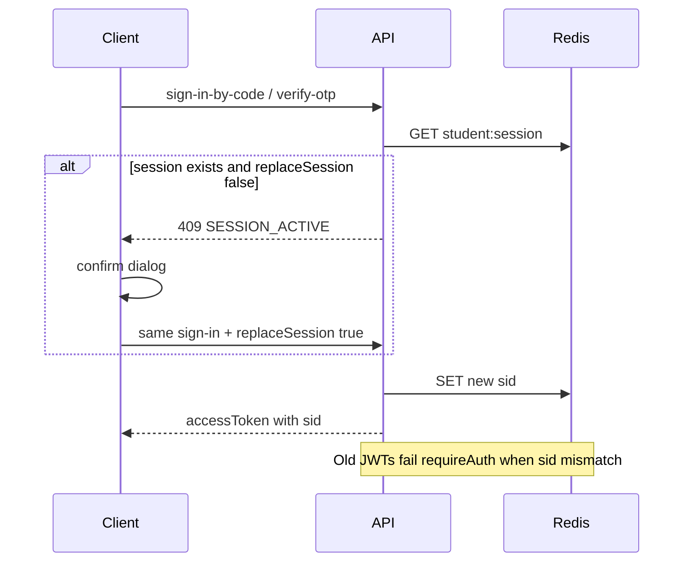

# Review replay + Unique ID session hardening

## Decisions

- **Unique ID 2FA:** Skip. Keep code-only sign-in ([`studentSignInByCode`](api/src/modules/auth/service.ts)).
- **Already fixed:** Skip Content-Disposition change in [`api/src/modules/files/routes.ts`](api/src/modules/files/routes.ts) (manual header already correct).
- **Attempt labels:** Skip remapping statuses (already correct); still map assignment `Unassigned` → `Pending` for Registrations filters.
- **Single session (new, replaces 2FA for Unique ID risk):** One active student session per student; new login detects an existing session and requires explicit client confirmation before revoking it.

## A. Student single-session takeover

Today students get a JWT only ([`issueStudentSession`](api/src/modules/auth/service.ts) ~271–296) with no Redis session registry and no refresh family. Concurrent devices stay valid until JWT expiry.

**API**

- Add [`api/src/lib/student-sessions.ts`](api/src/lib/student-sessions.ts): Redis key `student:session:{organizationId}:{studentId}` → `{ sessionId }`, TTL ≥ access-token lifetime.
- Extend `StudentAccessTokenPayload` with `sid` in [`api/src/lib/jwt.ts`](api/src/lib/jwt.ts).
- `issueStudentSession`: if Redis has a session and `replaceSession` is false → `conflict('SESSION_ACTIVE', …)`; if true or none → write new `sessionId`, sign JWT with `sid`, audit `student.session.replace` when replacing.
- Apply to **all** student issuers (code, OTP verify, email/password) so takeover is consistent.
- In [`requireAuth`](api/src/middleware/auth.ts): for `typ === 'student'`, verify Redis current `sid` matches payload (async); mismatch → 401.
- Student sign-out: clear Redis session when current token’s `sid` matches.
- Schema: accept optional `replaceSession: boolean` on student sign-in / verify-otp bodies.

**Client**

- On Unique ID (and OTP) login: if API returns `SESSION_ACTIVE`, show confirm modal (reuse attempt confirm pattern in [`client/src/pages/attempt.tsx`](client/src/pages/attempt.tsx) / login styles): warn that the other session will be revoked and unsaved answers on that device will be lost; Continue retries with `replaceSession: true`, Cancel aborts.
- Wire through [`client/src/services/api.ts`](client/src/services/api.ts) + [`client/src/contexts/auth.tsx`](client/src/contexts/auth.tsx) + [`client/src/pages/login.tsx`](client/src/pages/login.tsx).
- “Delete unsaved work” = invalidate the other device’s JWT so further autosaves fail; do **not** wipe server-persisted `attemptResponse` rows (last successful save remains).

**Extra Unique ID hardening (with this wave)**

- Auth rate-limit Redis prefix isolation + trust-proxy config (findings below).
- OTP cooldown/daily limits, atomic verify, Twilio prod gates (findings below).
- Production: empty Unique ID field + hide demo notes ([`client/src/pages/login.tsx`](client/src/pages/login.tsx)).
- Audit `student.sign_in_by_code` / `student.sign_in_otp` on success.
- Keep generic “Invalid Unique ID” errors (no enumeration).

## B. API security / integrity (still valid)

| Area | Change |
|---|---|
| OTP send | Per-phone cooldown + daily Redis counters in request/resend; preserve attempts on reissue (separate attempts key or merge); Twilio off critical path / catch → generic ok ([`auth/service.ts`](api/src/modules/auth/service.ts), [`student-otp.ts`](api/src/lib/student-otp.ts)) |
| OTP verify | Atomic INCR attempts before compare; GETDEL/Lua consume on success; reset attempts key on store |
| Refresh | Atomic `GETDEL` (or MULTI GET+DEL) in [`refresh-tokens.ts`](api/src/lib/refresh-tokens.ts) |
| Trust proxy | Env hop count default `0`/false; enable XFF validation on both limiters ([`app.ts`](api/src/app.ts), [`env.ts`](api/src/config/env.ts)) |
| Rate-limit stores | Distinct Redis prefixes for api vs auth limiters |
| Twilio | Production require `TWILIO_ENABLED` + creds; no OTP console logs in prod; `DEV_FIXED_*` only non-prod |
| Registrations/results | Pass full actor; `assertActivityAccess` edit/view/full; filter lists by viewable kinds |
| Users | Block non-super editing super-admin or self; clamp access ≤ actor; AND status+q in list |
| Attempts save | Revision `updateMany` guard first (org, id, in_progress, revision, deadline); reject unknown `questionVersionId` creates |
| Attempts submit | `updateMany` only `in_progress` + count check; idempotency scoped to attempt+student+key; migration `@@unique([attemptId, submitIdempotencyKey])` |
| resumeAttempt | Return `maybe.attempt` after auto-submit |
| Results regrade | Cap score; recompute `passed` from `passingPercent` |
| Student portal | Merge kind+q activity filter; keys/`correct` only when `releaseStatus === 'published'` |
| Banks | Partial update keeps latest options/answerKey; import trim only (no `stripFormulaInjection`) |
| Students update | P2002 → conflict like create |
| prisma tenant | Flatten compound unique `where` before findFirst |
| codes | Parse sequence after current-year base; filter by year base |
| prisma.config | `process.env.DATABASE_URL ?? ''`; drop unused `env` import |
| error-handler | `entity.parse.failed` → 400, `entity.too.large` → 413 |
| tests | Wait for `listening` in helpers; tenancy try/finally restore status |

## C. Admin / client / docs (still valid)

- [`settings-access.tsx`](admin/src/pages/settings-access.tsx): API call outside `setPeople`; rollback on failure.
- [`toolbar.tsx`](admin/src/components/toolbar.tsx): skip emit when `debouncedInput !== inputValue`; deps include `inputValue`.
- [`api-mappers.ts`](admin/src/services/api-mappers.ts): assignment `Unassigned` → `Pending`.
- [`settings-system.tsx`](admin/src/pages/settings-system.tsx) + settings defaults: `requireTwoFactor` key (storage only; no full 2FA stack).
- [`create-activity.tsx`](admin/src/pages/create-activity.tsx): retain created id across publish retry.
- [`registrations.tsx`](admin/src/pages/registrations.tsx): keys/selection/`pageIds` use `registrationId`.
- [`student-form.tsx`](admin/src/pages/student-form.tsx) + schema: blank phone/course/city → `null`.
- Client attempt timer clear on submit/unmount; `answerLabel` shapes; login DEV-only demo.
- Docs: THREAT_MODEL pipe escape; LOCAL_PRODUCTION ports table blank line; note student single-session in threat model briefly.

## D. Validation

- `api/`: typecheck + targeted tests (auth OTP/session, attempts concurrency/idempotency, tenancy) + lint.
- `admin/` + `client/`: typecheck, lint, format:check as touched.
- `graphify update .` after code edits.

## Out of scope

- Implementing real admin TOTP for `requireTwoFactor` (persist flag only).
- Wiping persisted attempt answers on session replace.
- Changing Unique ID to require password/OTP.