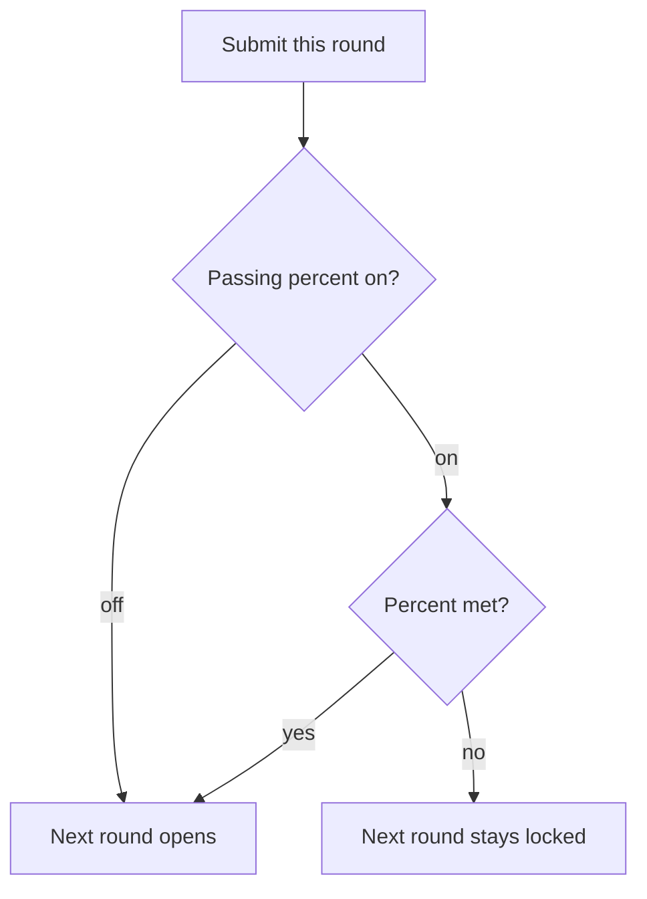

# Per-round passing toggle

Today every previous round must be **passed** before the next one starts. That check is `roundIsCleared` in [`api/src/lib/round-unlock.ts`](api/src/lib/round-unlock.ts), used by [`api/src/modules/attempts/service.ts`](api/src/modules/attempts/service.ts) and [`api/src/modules/participant-portal/service.ts`](api/src/modules/participant-portal/service.ts). Passing percent is always required on the round form in [`admin/src/pages/activity-wizard.tsx`](admin/src/pages/activity-wizard.tsx).

Add a per-round switch, stored in the existing round `settings` JSON (no migration). Missing value stays **on**, so current rounds keep the pass gate.

Each round gates only the round after it. Round 1 can require 40% to open Round 2. Round 2 can require only a submitted attempt to open Round 3. A later round still waits on every earlier gate, so Round 3 stays locked until Round 1 is passed and Round 2 is submitted.

## Admin

In each round’s behaviour section, add a switch beside Passing percent, same pattern as the All / Unlimited switches.

- On: keep the existing percent input (and the current percent / marks choice). The number is required.
- Off: hide the percent and marks fields. The next round does not use a pass mark.
- Round summary shows `Pass 40%` when the switch is on, and `Attempt to continue` when it is off.
- Default for a new round is on, at the current 40%.

Wire the flag through the round draft, save payload, and [`admin/src/services/types.ts`](admin/src/services/types.ts).

## API

- Add `passRequired` to `roundBehaviourSettingsSchema` in [`api/src/modules/activities/schema.ts`](api/src/modules/activities/schema.ts), default `true`.
- When it is false, do not require `passingPercent` or `passingScore`.
- Parse it in [`api/src/lib/round-settings.ts`](api/src/lib/round-settings.ts). Absent means `true`.
- Add `roundGateSatisfied` in [`api/src/lib/round-unlock.ts`](api/src/lib/round-unlock.ts):
  - Switch on: a published passing result, same as `roundIsCleared` today.
  - Switch off: at least one submitted or auto-submitted attempt. Starting a round is not enough; leaving it in progress does not open the next.
- Use that helper for every previous round in `startAttempt`, and for `previousCleared` on the participant activity payload. A failed attempt still uses the existing attempt cap on that round, and the next round can already be open.
- An in-progress attempt still resumes. The attempt cap is unchanged.
- Extend [`api/test/round-unlock.test.ts`](api/test/round-unlock.test.ts): pass required blocks the next round on a fail; pass not required opens it after submit; an in-progress attempt does not.

## Participant

- Locked copy follows the previous round: “Locked until you pass the previous round” when that round requires a percent, and “Locked until you finish the previous round” when it only requires an attempt.
- Quizzes are unchanged. They have no rounds.