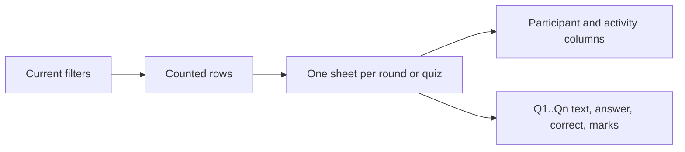

# Question-level assessment and quiz reports

The download stays filtered the same way (search, assessment/round or contest/quiz, status, include-absent). Each row is still the counted attempt (`bestAttemptId`). The file layout changes from one `Results` sheet of summary columns into the G6 / LevelUP shape in [references/LevelUP/api/src/modules/reports/service.ts](references/LevelUP/api/src/modules/reports/service.ts).

Per-question time is not stored on `AttemptResponse` (only `answer` JSON). The sheet keeps **overall** time from `startedAt` to `submittedAt`. Each question uses **marks** instead of a seconds column.

The on-screen Columns checkboxes keep controlling the table only. The workbook uses a fixed layout, so a hidden table column is still in the file. `columns` stays accepted on the export query so current requests do not fail; the builder stops using it.

## Workbook shape

**Assessment:** one sheet per round, ordered by assessment name then round `sortOrder`. Sheet name is the round name (31-character Excel limit; if two rounds collapse to the same name, prefix the assessment name). A single-round filter produces one sheet.

**Quiz:** one sheet per quiz (quizzes have no rounds). Sheet name is the quiz name, with the same collision rule using the contest name.

Empty exports still produce one sheet with the header row only.

## Fixed columns

Shared, in this order, blanks when the field is empty:

- Registration ID, Participant Name, Email, Phone, Course, Cohort, City
- Assessment name, then Round (assessment only) or Contest and Quiz (quiz only)
- Started at and Submitted as `YYYY-MM-DD HH:mm:ss` in Asia/Kolkata
- Time taken as `HH:MM:SS`
- Allowed time from the round or quiz (`N min`, or `N s each` when duration is per question)
- Auto-submitted, including the existing reason label
- Marks scored, Total marks, %, Pass mark (`40%` or a score, matching pass mode), Result
- Correct, Total questions, Skipped, Negative marks
- Attempts used, Attempt status, Disqualified

No Browser, Device, or IP columns.

## Question columns

For each sheet, take the union of question versions on the counted attempts. Number them `Q1`…`Qn` by the parent question’s bank `sortOrder`, then question code, so a shuffled paper still lines up across students. Someone who was not given that question gets blank answer and marks cells; the question text and correct answer stay filled, matching the sample.

Each question is four columns:

- `Qn Question Text` — stem from the version the attempt used
- `Qn Student Answer` — option label plus body (`A. …`), joined for multi-select; free text or number as entered; `Not answered` when the item was on the paper and skipped
- `Qn Correct Answer` — from options / answer key, including when the student was right; blank for unscored text with no reference
- `Qn Marks` — points earned, `0` when wrong, the negative penalty when that round or quiz deducts it, blank when unanswered, not on the paper, or unscored

Reuse the scoring rules in [api/src/modules/attempts/scoring.ts](api/src/modules/attempts/scoring.ts) and the answer text already built in [api/src/modules/quiz-reports/review.ts](api/src/modules/quiz-reports/review.ts). Load responses only inside the export job, not on the list page: counted attempt ids, `questionOrder`, responses, versions, options, and parent `sortOrder`.

Header row frozen. Question-text columns wider than the summary columns. Values are recorded results, not formulas.

## Files

- New shared builder next to the exports, used by both workbooks: sheet names, IST timestamps, question-column assembly, answer text.
- [api/src/modules/assessment-reports/export.ts](api/src/modules/assessment-reports/export.ts) and [api/src/modules/quiz-reports/export.ts](api/src/modules/quiz-reports/export.ts): replace the single `Results` sheet.
- [api/src/modules/assessment-reports/service.ts](api/src/modules/assessment-reports/service.ts) and [api/src/modules/quiz-reports/service.ts](api/src/modules/quiz-reports/service.ts): add course, cohort, and city on the export path; load the counted attempt’s responses for the workbook. List JSON stays the same aside from those three participant fields if they are cheapest to carry on the existing row (they are not shown in the table).
- [api/src/lib/queue/processors.ts](api/src/lib/queue/processors.ts): pass the loaded answers into the workbook builders.
- [admin/src/pages/quiz-report-download.tsx](admin/src/pages/quiz-report-download.tsx): describe one sheet per round or quiz, question columns, and that the file is the counted attempt. Assessment keeps its include-absent hint.

## Check

Add an API test that builds both workbooks from a small in-memory fixture (two rounds or two quizzes, one shuffled order, one skipped question, one absent row) and asserts sheet names, header groups, aligned question text, marks, and blank cells. No browser, device, or IP headers.