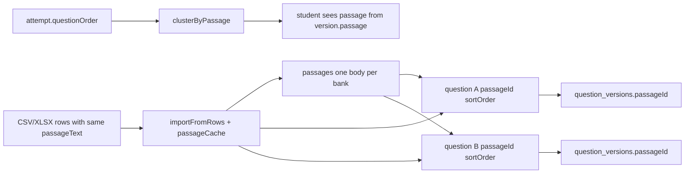

# Shared passages — production finish plan

## What already exists (do not rebuild)

The schema and core path are already in place:

- [`api/prisma/schema.prisma`](api/prisma/schema.prisma) — `Passage`; `Question.passageId` + `sortOrder`; `QuestionVersion.passageId`
- [`api/prisma/migrations/20261029143000_shared_passages/migration.sql`](api/prisma/migrations/20261029143000_shared_passages/migration.sql) — creates tables/columns, backfills by identical trimmed `answer_key.passageText`, strips that key after linking
- [`api/src/modules/banks/passages.ts`](api/src/modules/banks/passages.ts) — `saveSharedPassage` (cache + body match + in-place edit + fork when an attempt already references a version on that passage), `clusterByPassage`, `stripPassageText`
- [`api/src/modules/banks/service.ts`](api/src/modules/banks/service.ts) — create/update/import call `linkQuestionPassage`; import uses a per-file `passageCache`
- [`api/src/modules/attempts/service.ts`](api/src/modules/attempts/service.ts) — attempt order via `clusterByPassage`; student payload reads `version.passage.body` (fallback to legacy `answerKey.passageText`)
- Admin form copy in [`bank-question-form.tsx`](admin/src/pages/bank-question-form.tsx) when `passageSharedCount > 1`
- Unit coverage in [`api/test/passages.test.ts`](api/test/passages.test.ts)

## Locked product rules (LevelUP-aligned)

- Assessment banks only; quiz banks never author `comprehension_mcq`.
- Spreadsheet: put `passageText` on **every** comprehension row (no blank follow-up rows). Identical trimmed body in one import file → one `passages` row.
- Options stay on each question; only the passage body is shared.
- Editing a passage with no attempt on its versions updates that row in place (all linked current questions see the new text).
- Editing after an attempt has pinned a version on that passage: create a new passage, move current sibling questions + new versions to it; old versions keep the old `passageId` so in-flight attempts stay stable.
- No separate admin “passage library” picker in this pass — matching is by body (create) or by the question’s existing `passageId` (edit), same as LevelUP import semantics.

## Gaps to close before calling it production

1. **Sample Excel must demonstrate sharing**  
   In [`import-export.ts`](api/src/modules/banks/import-export.ts) `sampleDataRows('assessment')`, add a second `comprehension_mcq` row with the **same** `passageText` and a different stem/options (LevelUP sample pattern). Keep instructions line 9 as-is (already documents sharing).

2. **Import/export proof tests** (new cases in [`bank-import-export.test.ts`](api/test/bank-import-export.test.ts) and/or a focused API/integration test):
   - Parse sample assessment workbook → two comprehension rows with identical `passageText`.
   - DB-level: import two comprehension rows into a bank via `createQuestion` + shared cache → `passage.count === 1`, both questions share `passageId`, `sortOrder` 0 then 1, `answer_key` has no `passageText`.
   - Export → re-import (or export columns) still emits `passageText` from the joined passage for every related row.
   - After an attempt pins a version, editing the passage body via `saveSharedPassage` forks (extend/assert beside existing [`passages.test.ts`](api/test/passages.test.ts) if needed).
   - `clusterByPassage` already covered; add one assertion that `versionIdsFromBank`-style ordering keeps siblings adjacent when shuffled bank order would otherwise split them (can stay unit-level on `clusterByPassage`).

3. **Admin UX copy when forked vs shared**  
   Keep the existing shared-count description. Add one short note that if students have already started using these questions, saving a passage edit keeps their attempt on the previous text (fork). No new dialogs.

4. **Deploy / local verify**  
   Ensure migration `20261029143000_shared_passages` is applied on the environment under test (`prisma migrate deploy` / status). Do not invent a second migration unless a real schema mismatch appears.

5. **Out of scope (explicit)**  
   Student client redesign to show the passage only once for a sibling block; blank `passageText` on later rows; user/student spreadsheet import; changing quiz types.

## Implementation order

1. Sample second comprehension row + any instruction tweak if the second row needs a one-line tip.
2. Tests listed above (parser + DB import sharing + export column).
3. Admin fork-awareness sentence on the passage field.
4. Run: `api` `passages` + `bank-import-export` + related attempt/bank tests; `npm run typecheck` / `lint` / `format:check` in `api` and `admin` as touched; `graphify update .` after code edits.
5. Smoke checklist (manual or scripted against running API if ports already up — reuse 3002/5173, never kill):
   - Download assessment Sample Excel → confirm two comprehension rows, same passage.
   - Import into an empty assessment bank → one passage in DB, two questions, form shows “Shared with 1 other…”.
   - Export → `passageText` present on both rows.
   - Edit passage before any attempt → one body updated.
   - Start attempt (or insert attempt row) → edit passage → old version still has old `passageId` / body.

## Done means

- Identical `passageText` in one import creates **one** `passages` row and N linked questions.
- Attempts keep sibling comprehension questions together and read passage from `question_versions.passage_id`.
- Post-attempt passage edits fork; pre-attempt edits update in place.
- Sample + automated tests prove the above; typecheck/lint/format clean on touched packages.
