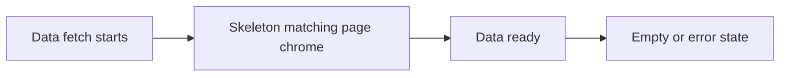

# Skeleton loading UX (admin + client)

## Problem

**Admin:** Almost every data page defaults async data to `[]` while fetching (`const { data: x = [] } = useAsyncService(...)`), so KPIs/tables flash empty. [`Skeleton`](admin/src/components/ui/skeleton.tsx) exists but is only used by sidebar chrome. Auth / lazy-route fallbacks are plain “Loading…” text ([`require-auth.tsx`](admin/src/contexts/require-auth.tsx), [`routes/index.tsx`](admin/src/routes/index.tsx)).

**Client:** Library / dashboard lists / results list already have solid skeletons (no empty flash). Confirmed gaps from audit: auth gate + login while `!ready` (form can flash), attempt + result detail (plain “Loading…” text), dashboard **weekly goal** flashing `0/5` during load, metrics/summary using bare `—`, result-detail not-found missing `.empty-icon`.

## Approach

Ship **layout-matching skeletons** (same chrome as the loaded page: KPI row + table, exam shell, result hero) with `aria-busy` / `sr-only` labels and `prefers-reduced-motion` respect. Do not invent a second visual language.

## Admin

### 1. Shared skeleton compositions

Add [`admin/src/components/loading-skeletons.tsx`](admin/src/components/loading-skeletons.tsx) built on `@/components/ui/skeleton`:

- `AuthLoadingSkeleton` — centered card/shell for session bootstrap (replaces full-screen “Loading…”)
- `RouteLoadingSkeleton` — page-width block for Suspense ([`RouteFallback`](admin/src/routes/index.tsx))
- `DashboardSkeleton` — KPI tiles + 3 chart cards + activity list placeholders
- `ListPageSkeleton` — KPI row (4) + toolbar strip + table header + N ghost rows (props: `columns`, `rows`)
- `FormPageSkeleton` — title + field blocks for edit forms

### 2. Wire loading flags (stop empty flash)

Use `{ data, loading }` from [`useAsyncService`](admin/src/hooks/use-async-service.ts). While `loading`, render the matching skeleton **instead of** defaulting to `[]`.

| Page | File | Skeleton |
|------|------|----------|
| Dashboard | [`dashboard.tsx`](admin/src/pages/dashboard.tsx) | `DashboardSkeleton` |
| Students | [`students.tsx`](admin/src/pages/students.tsx) | `ListPageSkeleton` |
| Users | [`users.tsx`](admin/src/pages/users.tsx) | `ListPageSkeleton` |
| Assessments/Quizzes | [`activity-list.tsx`](admin/src/pages/activity-list.tsx) | `ListPageSkeleton` |
| Question banks | [`question-banks.tsx`](admin/src/pages/question-banks.tsx) | `ListPageSkeleton` |
| Registrations | [`registrations.tsx`](admin/src/pages/registrations.tsx) | `ListPageSkeleton` |
| Reports | [`reports.tsx`](admin/src/pages/reports.tsx) | KPI + table skeleton |
| Assign registration | [`assign-registration.tsx`](admin/src/pages/assign-registration.tsx) | form/list skeleton while activities/students load |
| Student edit | [`student-form.tsx`](admin/src/pages/student-form.tsx) | `FormPageSkeleton` (replace “Loading student…”) |

Keep page chrome that is already known (meta title, ModuleNav, header actions) visible where it does not depend on fetched rows; only the data regions skeletonize.

### 3. Auth + route fallbacks

Replace text fallbacks in [`require-auth.tsx`](admin/src/contexts/require-auth.tsx) and [`RouteFallback`](admin/src/routes/index.tsx) with `AuthLoadingSkeleton` / `RouteLoadingSkeleton`.

Settings that fetch on mount also flash empty/default UI ([`settings-notifications.tsx`](admin/src/pages/settings-notifications.tsx), [`settings-access.tsx`](admin/src/pages/settings-access.tsx), audit list on system). Add a light `FormPageSkeleton` / list stub while those loads settle; [`settings-general.tsx`](admin/src/pages/settings-general.tsx) can keep defaults if the jump is mild, or gate fields until first fetch completes.

## Client

### 1. Shared skeleton helpers

Extract small helpers (e.g. [`client/src/components/skeletons.tsx`](client/src/components/skeletons.tsx)) using existing classes in [`styles.css`](client/src/styles.css) (`skeleton-line`, `skeleton-card`, `skeleton-row`). Add any missing shapes:

- Metric/summary card skeletons (replace bare `—` in dashboard metrics + results summary)
- Exam shell skeleton (topbar + question card + sidebar grid)
- Result detail skeleton (hero ring + copy + review rows)
- Auth session skeleton (login-card shaped)

### 2. Wire remaining pages

| Surface | File | Change |
|---------|------|--------|
| Auth gate | [`require-auth.tsx`](client/src/contexts/require-auth.tsx) | Auth session skeleton instead of “Loading session…” |
| Login | [`login.tsx`](client/src/pages/login.tsx) | While `!ready`, show the same session skeleton (do not paint the sign-in form) so returning users never flash login |
| Attempt | [`attempt.tsx`](client/src/pages/attempt.tsx) | Exam shell skeleton when `busy` and no attempt yet |
| Result detail | [`results.tsx`](client/src/pages/results.tsx) `ResultDetailPage` | Result detail skeleton instead of “Loading result…”; align not-found empty with `.empty-icon` |
| Dashboard | [`dashboard.tsx`](client/src/pages/dashboard.tsx) | Metric card skeletons; **goal panel** skeleton/`—` instead of `0/5` while loading |
| Results list | [`results.tsx`](client/src/pages/results.tsx) | Summary tile skeletons while loading (table skeleton already present) |
| Library | [`library.tsx`](client/src/pages/library.tsx) | Keep grid skeleton; skeletonize summary stats strip for consistency |

Profile / help need no fetch skeleton (data from auth or static). Leave `App.handoff.tsx` alone.

## Verification

- `admin/`: `npm run typecheck && npm run lint && npm run format:check`
- `client/`: `npm run check`
- Manual smoke: open Students, Dashboard, Quizzes library, Attempt start, Result detail with network throttling — skeletons appear, then content/empty; no empty-table flash; reduced-motion disables pulse.

## Out of scope

- No new animation libraries
- No virtualization changes
- Do not restyle loaded content or empty states beyond skeleton parity
