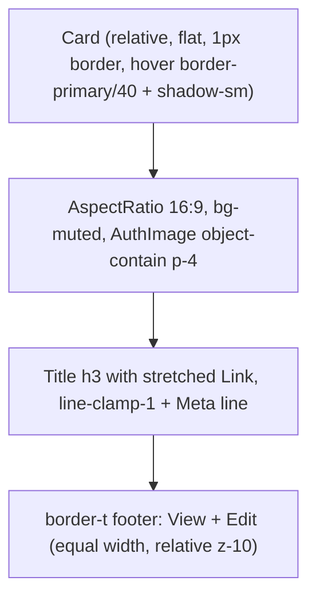

# Sponsors and Contests: card grid revamp

## Research takeaways (what drives the design)
- Card/gallery views fit small collections where an **image identifies the record**, such as sponsor logos and contest banners. Tables fit dense comparison (Cloudscape "View resources", Teable/Wiserows gallery docs). Sponsors and contests each have only 1 to 2 text fields, so cards are a good fit.
- Gallery cards work best with a cover image, a title, 1 to 3 key fields, and one primary destination. Don't overload them.
- Accessible clickable card: use a **stretched link** (title `<Link>` with `after:absolute after:inset-0`). Don't wrap the card in an anchor. Nested buttons sit above it (`relative z-10`) with some dead space around them to avoid mis-taps (Inclusive Components, Kitty Giraudel, Adrian Roselli).
- Repo rules apply: flat 12px cards, 1px borders, 44px controls, tokens only, `AspectRatio` + `object-contain` on a muted fill for image previews (`docs/design/DESIGN.md` §4), no gradients or glass, and motion limited to transform/opacity/border/shadow at 150–200ms with reduced-motion respected.

## Card anatomy

- **Sponsor card:** logo, name, meta `N contests` (from the existing `Sponsor.contests` field), View / Edit.
- **Contest card:** banner, name, meta `Sponsor: {sponsorName}`, optional description (`line-clamp-2`, muted), View / Edit.
- Edit appears only when `canMutate`. Without it, View fills the footer.
- Focus: `has-[a:focus-visible]:ring-2 ring-ring` on the card, so keyboard focus on the stretched link outlines the whole card. Hover: `transition-[border-color,box-shadow]` only, plus `motion-reduce:transition-none`.
- Grid: `grid gap-4 grid-cols-[repeat(auto-fill,minmax(15rem,1fr))]`. The grid follows the container width, not a fixed column count, which gives about 1 column at 375px, 2–3 at 768px, and 3–4 at 1280px with the sidebar.

## Files

**New: [admin/src/components/media-card-grid.tsx](admin/src/components/media-card-grid.tsx)** (exports components only, to satisfy the Fast Refresh lint rule)
- `MediaCardGrid` is an `<ul role="list">` grid wrapper. It shows the empty state (one muted sentence inside a `Card`, matching current copy) when it has no items.
- `MediaCard` takes props `{ to, title, imageFileId, meta?, description?, editTo? }`. It builds on `Card`, `AspectRatio`, `AuthImage` (passing `className="size-full object-contain"`), and `Button asChild` + `Link` with `EyeIcon` / `PencilIcon`, the same labels `RowActions` uses.
- `ListPager` lifts the "Showing X to Y of Z", per-page select, and prev/current/next markup that is copy-pasted in both pages today. Only these two pages use it; other pages stay untouched.

**Edit: [admin/src/components/loading-skeletons.tsx](admin/src/components/loading-skeletons.tsx)**
- Add a `layout?: 'table' | 'cards'` prop to `ListPageSkeleton` (default `'table'`, so other pages don't change). `cards` renders the same grid with ghost cards: a 16:9 block, two text lines, and a footer with two control-height blocks.

**Edit: [admin/src/pages/sponsors.tsx](admin/src/pages/sponsors.tsx) and [admin/src/pages/contests.tsx](admin/src/pages/contests.tsx)**
- Keep `PageHeaderActions` (Add Sponsor / Add Contest), the KPI card, the `Toolbar` search, and Clear Filters.
- Replace `ResponsiveRecords` with `MediaCardGrid` / `MediaCard`. Drop `useContainerNarrow`, `useRecordSelection`, `RowActions`, `onRowOpen`, and the column definitions.
- `RecordSortSelect` now **always** shows in the toolbar, since cards have no sortable headers. Sponsors sorts by Name; Contests by Contest Name or Sponsor. The existing cycle stays: asc, then desc, then default.
- Per-page options change to **12 / 24 / 48** (default 12, labelled "Cards per page") so rows of 2, 3, or 4 fill evenly. This is the one intentional behavior change besides removing selection.
- Loading state: `<ListPageSkeleton layout="cards" kpiCount={1} />`.

**Edit: [docs/design/DESIGN.md](docs/design/DESIGN.md)**
- Add a "Media card grid" row to §4 component mapping and a short recipe under the list section. It covers image-led catalog lists (Sponsors, Contests) only: no selection, stretched link, View/Edit footer, sort in the toolbar, 12/24/48 paging. Tables remain the default for every other list.

## Out of scope
- Detail and form pages (`sponsor-form.tsx`, `contest-form.tsx`), routes, `meta.ts` copy, services, and API.
- `client/` has no Sponsors or Contests pages, so there is nothing to mirror for parity.
- A grid/table view toggle (not requested).

## Verification
- In `admin/`: `npm run typecheck`, `npm run lint`, `npm run format:check`. Then run `graphify update .` at the root.
- If port 5173 is already listening, reuse it to check `/sponsors` and `/contests` at 375, 768, and 1280px in light and dark mode: keyboard tab order (card link, then View, then Edit), the focus ring, empty search results, and a viewer role with no Edit. If 5173 is not running, ask before starting it.
