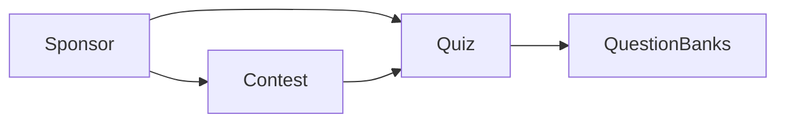

# Sponsors, contests, and quiz create

## Scope

Admin and API only. The student app is left as it is, including the activity code it already shows.

Assessments keep the Code field, the current duration field, and their wizard steps. Registration, Assignment Rules, and Review stay in the quiz wizard; Review text is updated so it no longer shows Code and so it shows sponsor, contest, and the chosen timing.

## Sponsors and contests

New org-scoped records, same permission gate as students (`requireOrgAccess` view/edit, admin `canMutateOrg`).

- **Sponsor:** required name, required image.
- **Contest:** required sponsor (exactly one), required name, required image, optional description.
- **Pages:** top-level sidebar items after Users in [`admin/src/layouts/admin-layout.tsx`](admin/src/layouts/admin-layout.tsx). Routes and titles in [`admin/src/routes/app-routes.tsx`](admin/src/routes/app-routes.tsx) and [`admin/src/routes/meta.ts`](admin/src/routes/meta.ts): `/sponsors`, `/sponsors/new`, `/sponsors/:id`, `/sponsors/:id/edit`, and the same shape for `/contests`.
- **List chrome:** match Students (search, sortable table, pagination, row selection, kebab View/Edit, header Create). No status, no bulk upload, no delete. One total-count KPI only. Sponsor columns: image, name. Contest columns: image, name, sponsor.
- **Forms:** one page for create, view, and edit, same pattern as [`admin/src/pages/student-form.tsx`](admin/src/pages/student-form.tsx). Contest sponsor is a select of existing sponsors.

Images use the existing upload flow in [`api/src/modules/files/service.ts`](api/src/modules/files/service.ts) (`POST /api/files/initiate`, then `PUT /api/files/:id/content`). Sponsor and contest records store `imageFileId`. Accept only png, jpeg, and webp, max 2MB, and only a finalized image file in the same org. The admin shows the image by fetching it with the authenticated API client (the current download route forces an attachment and a short-lived token, which is a poor fit for a table thumbnail).

API modules follow students: `api/src/modules/sponsors/` and `api/src/modules/contests/`, mounted from [`api/src/app.ts`](api/src/app.ts). Contest list can be filtered by `sponsorId` for the quiz dropdown.

## Data model

In [`api/prisma/schema.prisma`](api/prisma/schema.prisma), plus a new migration:

- `Sponsor` and `Contest` as above, both cascade with the organization.
- `Activity.sponsorId` and `Activity.contestId` nullable. Required only when `kind` is `quiz`. Contest must belong to the chosen sponsor and the same org.
- `Activity.durationMode` enum `overall` | `per_question`, default `overall`.
- `Activity.perQuestionSeconds` optional int. Assessments ignore it.

`Activity.code` stays in the database because assessments share the table and the unique `(organizationId, code)` constraint. Quiz create ignores any client-supplied code and keeps the server-generated value from [`nextHumanCode`](api/src/lib/codes.ts). Quiz update rejects a code change. The admin quiz detail mapping omits `code`. Assessment responses still include it.

Existing quizzes have no sponsor or contest. The next quiz save requires both. Existing rows stay `durationMode = overall` and keep `durationMinutes`.

## Quiz wizard

All of this is quiz-only inside [`admin/src/pages/activity-wizard.tsx`](admin/src/pages/activity-wizard.tsx). Create, edit, and view use the same fields.

**Basic details**

- Keep title, optional description, and the current start/end date-time pickers. For a quiz, start and end are required (they are optional in the API today).
- Remove the Code field and the Review line `Code:`.
- Add required Sponsor, then required Contest. Contest options are only contests for the selected sponsor. Changing sponsor clears a contest that no longer matches.

**Select question banks**

Replace the plain checkbox stack with searchable selectable cards: bank name, question count, checked state, and a selected count. Multi-select stays. Empty and no-match states stay readable. Keyboard and label behavior stay on the checkbox.

**Behaviour settings**

Replace the single duration input for quizzes with a dropdown:

- **Overall quiz:** one minutes input. Saved as `durationMinutes`; `perQuestionSeconds` cleared.
- **Per question:** one seconds input (same number for every question). Saved as `perQuestionSeconds`; `durationMinutes` cleared.

Assessments keep the current minutes field. Passing percent, presentation, and the quiz switches stay.

**Attempt timing** in [`api/src/modules/attempts/service.ts`](api/src/modules/attempts/service.ts): overall mode keeps today’s `durationMinutes` deadline, still capped by `endsAt`. Per-question mode sets the attempt deadline to `question count × seconds`, also capped by `endsAt`. That uses the deadline the student player already reads. This slice does not add a countdown that resets on each question.

## Out of scope

- Student screens, sponsor/contest branding on the student quiz, and a per-question countdown UI.
- Delete for sponsors or contests.
- Quiz list columns (sponsor and contest appear on the wizard and review, not as new list columns).
- Assessment wizard, assessment code, and assessment duration.
