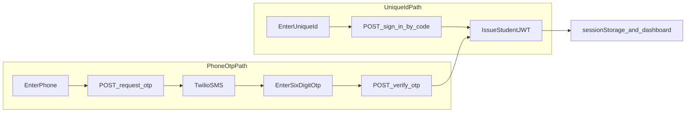

# Student login: Unique ID + Phone OTP

## Decisions (locked)

- **RegistrationID** = `Student.code` in [api/prisma/schema.prisma](api/prisma/schema.prisma) (admin Unique ID such as `BP-24101`), not `Registration.id` UUID.
- **Email/password UI** = archived (not shown). API `POST /api/auth/student/sign-in` stays for later.
- **App surface** = [client/](client/) (port 5174). Screens use existing design tokens in [client/src/styles.css](client/src/styles.css) (already aligned with [docs/design/DESIGN.md](docs/design/DESIGN.md)): flat card, 44px controls, primary violet.
- **Org resolution** = optional `organizationSlug` (default `demo` for local/seed). If Unique ID or phone matches multiple orgs without a slug, return a clear error.

## Reference flows (adapt, do not copy stack)

- QuizTel (`references/brainpulses/quiztel`): one-field Unique ID then session. We look up Postgres `Student` (must exist, `isActive`), not Google Sheets.
- ccdschool (`references/brainpulses/ccdschool`): phone then OTP then verify. Twilio lives in the API (pattern from `references/brainpulses/backend`). Only issue a token if the phone matches an existing student (no auto-create).

## API (`api/`)

### New routes on [api/src/modules/auth/routes.ts](api/src/modules/auth/routes.ts)

- `POST /api/auth/student/sign-in-by-code` — body `{ code, organizationSlug? }`. Trim code; find active student by org+code. Issue same student JWT shape as existing `studentSignIn`.
- `POST /api/auth/student/request-otp` — body `{ countryCode, mobileNumber, organizationSlug? }` (normalize to E.164). Resolve student by phone; store hashed OTP in Redis (~10 min); send SMS. Generic success (no user enumeration).
- `POST /api/auth/student/resend-otp` — same lookup, rate-limited resend.
- `POST /api/auth/student/verify-otp` — phone + `otp` + optional slug. Verify Redis OTP; issue JWT; update `lastLoginAt`.

Keep existing `POST /api/auth/student/sign-in` (email/password) unchanged for the archived frontend and tests.

### Phone identity

- Normalize to E.164 (e.g. `+919876510001`).
- Add Prisma `@@unique([organizationId, phone])` (migration + seed phones already unique per org).
- Seed phones in [api/prisma/seed.ts](api/prisma/seed.ts) remain usable for OTP testing.

### Twilio + OTP storage

- Document in `.env.example` only: `TWILIO_ACCOUNT_SID`, `TWILIO_AUTH_TOKEN`, `TWILIO_FROM_NUMBER`, `TWILIO_ENABLED` (default `false` outside production).
- When `TWILIO_ENABLED=false`: generate OTP, store in Redis, log OTP to API console; optional fixed OTP for one seeded test number (mirror legacy `000000` pattern).
- When enabled: send SMS via `twilio` package installed in `api/`.
- OTP: 6 digits, hashed in Redis key `student-otp:{orgId}:{phone}`; attempt counter; reuse auth rate limiter.
- Update [api/openapi.yaml](api/openapi.yaml) and auth tests under `api/test/`.

### Shared helper

Extract issue-student-session from `studentSignIn` in [api/src/modules/auth/service.ts](api/src/modules/auth/service.ts) so code-login and OTP-verify return the same `{ accessToken, student, organization }` payload.

## Client (`client/`)

### Archive email/password UI

- Move current form from [client/src/pages/login.tsx](client/src/pages/login.tsx) to `client/src/pages/_archived/login-email-password.tsx` with a short comment that it is not routed.
- Keep `studentSignIn` in [client/src/services/api.ts](client/src/services/api.ts); stop calling it from live auth UI.
- Do not register a route for the archived page.

### New login UX

Rebuild [client/src/pages/login.tsx](client/src/pages/login.tsx) as a centered auth card (closer to [admin/src/pages/login.tsx](admin/src/pages/login.tsx) than the marketing split), using existing CSS tokens / `.btn` / 44px inputs:

1. Segmented control: Unique ID | Phone
2. Unique ID tab: required field, submit, JWT, dashboard
3. Phone tab: country + number, Continue, OTP step (6 digits, auto-submit at 6, Resend), JWT, dashboard
4. Loading / error / disabled states; mobile-first

Wire [client/src/contexts/auth.tsx](client/src/contexts/auth.tsx) with `signInWithCode` and phone request/verify helpers; default `organizationSlug: 'demo'`.

### CSS

- Extend the login section in [client/src/styles.css](client/src/styles.css) for tabs, OTP boxes, phone field — reuse tokens; no new palette; no full shadcn/Tailwind port of client.

## Docs / handoff

- Update [docs/handoff/CUSTOMER_TEST.md](docs/handoff/CUSTOMER_TEST.md): Unique ID `BP-24101` and phone OTP (dev: read OTP from API log).
- Brief note in README student auth section if present.

## Out of scope

- Admin login unchanged.
- Auto-creating students on OTP.
- Student refresh-token flow.
- Porting full shadcn/Tailwind into `client/`.
