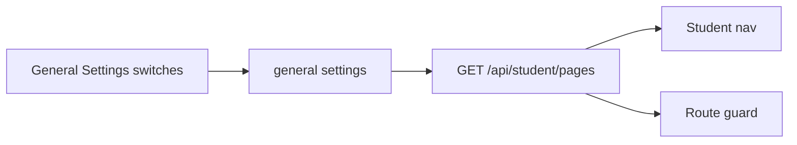

# Student portal page toggles

DISHA stores portal switches in settings and the student app both filters navigation and redirects a disabled route ([`references/PGDM Induction Program/student/src/components/guards.tsx`](references/PGDM Induction Program/student/src/components/guards.tsx), [`student-shell.tsx`](references/PGDM Induction Program/student/src/components/student-shell.tsx)). BrainPulses will do the same for every item in [`client/src/layouts/student-shell.tsx`](client/src/layouts/student-shell.tsx), with admin chrome matching the existing switch rows on System Settings.

## Pages

All six navigation items, default **on** so current behavior stays the same:

- Overview (`/dashboard`)
- My quizzes (`/quizzes`, `/quizzes/:activityId`, quiz attempts)
- Assessments (`/assessments`, `/assessments/:activityId`, assessment attempts)
- My results (`/results`, `/results/:id`)
- My profile (`/profile`)
- Help centre (`/help`)

Login stays available. Turning a page off hides its nav item and sends a direct visit to the first page that is still on. If every page is off, the shell shows a short “no pages are available” message and does not redirect in a loop. The index route (`/`) follows the same first-enabled page.

Dashboard links into quizzes, assessments, or results are hidden when that page is off, so Overview does not offer a path into a disabled page.

## Admin

On [General Settings](admin/src/pages/settings-general.tsx), add a card **Student portal pages** using the same row layout as the switches in [`admin/src/pages/settings-system.tsx`](admin/src/pages/settings-system.tsx): label, one-line hint, `Switch` with an accessible name. Users who cannot manage settings see the switches disabled.

Load and save the flags with the existing general settings form (`getSettingsGroup` / `patchSettingsGroup('general')`), so one Save writes organization name and page visibility together.

## API

Store booleans on the existing `general` settings group in [`api/src/modules/settings/service.ts`](api/src/modules/settings/service.ts). Missing keys mean **on**.

Students cannot call `/api/settings` (that route requires an admin user). Add `GET /api/student/pages` on the student portal router and return only:

`overview`, `quizzes`, `assessments`, `results`, `profile`, `help`

Reject student reads and attempt start/resume for a section whose page is off, so a bookmarked URL cannot load that page’s data. Profile update stays allowed only while My profile is on.

## Client

- Query `/api/student/pages` from the shell (refetch on focus, same stale policy as other student lists).
- Filter main nav and the profile / help links.
- Guard shell routes and attempt routes. Wait for the pages response before choosing a redirect, so a disabled page does not flash.
- While the request is in flight, keep the current shell and a quiet loading state.

