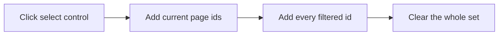

# Remembered selection and student dialogs

Selection is forgotten today because each list keeps it in `useState` on the page. Opening View goes to `/students/:id` and unmounts that state. The lists already hold the full filtered set in memory and only slice it for the pager, so “select every match” does not need a new list query.

## Selection cycle

Applies to the seven index lists that already pass `selection` into [`ResponsiveRecords`](admin/src/components/responsive-records.tsx): Students, Users, Registrations, Activities, Question Banks, Contests, and Sponsors. The assign-registration picker stays as it is.

A module map (not `sessionStorage`) stores each list’s `Set` of ids, keyed by organization and list name. A reload drops it. Signing out clears the map. Changing search, filters, or page does not.

The header control ignores the checkbox’s true/false and cycles from what is already selected:

- If this page is not fully selected, add this page’s ids and keep anything already selected on other pages.
- If this page is fully selected and the filter still has more, add every filtered id.
- If every filtered row is already selected, clear the whole set.
- When the page is the entire filter, the middle step is skipped: the next click clears.

The label follows that step, for example “Select all students on this page”, then “Select all 25 students”, then “Unselect all students”. Checked means every filtered row is selected. Indeterminate means some ids are selected but not the whole filter. Unchecked means the set is empty.

**Clear selection** sits beside that label and renders only when the set has at least one id. The same bar is shown above the cards and above the desktop table, and the table header checkbox runs the same cycle.

## Bulk disable (students only)

The bar on Students also shows **Disable** when the set is not empty and the membership can manage the org (`full`, the same gate as `POST /api/students/:id/deactivate`). Confirm with the existing confirm dialog. Cancel leaves the selection. Confirm sets those students Inactive.

Login is already refused for inactive students in [`findActiveStudents`](api/src/modules/auth/service.ts) (`isActive: true`). The badge stays **Inactive**. No auth or label change.

Add `POST /api/students/deactivate` with `{ ids }` (uuid array, capped), `requireOrgAccess('full')`, one `updateMany` for that organization, and one audit entry. The admin client calls it once, refreshes the student list, and then clears the selection. Already-inactive ids are a no-op.

## Student create and edit dialog

Add and Edit stop being pages. The dialog uses the fields the form already has: full name, email, unique ID, phone, course, city, cohort. Unique ID stays editable only while creating (blank still means auto-generated) and locked while editing. Status and assigned-activity count stay out of the dialog.

- **Add Student** and each row **Edit** open the dialog on the list.
- The student view page stays. Its Edit button opens the same dialog.
- `/students/new` redirects to `/students?create=1`, and `/students/:studentId/edit` redirects to `/students/:studentId?edit=1`, so old links open the dialog. Drop those two titles from [`admin/src/routes/meta.ts`](admin/src/routes/meta.ts).
- Save still uses `createStudent` / `updateStudent`. A dirty close asks before discarding.
